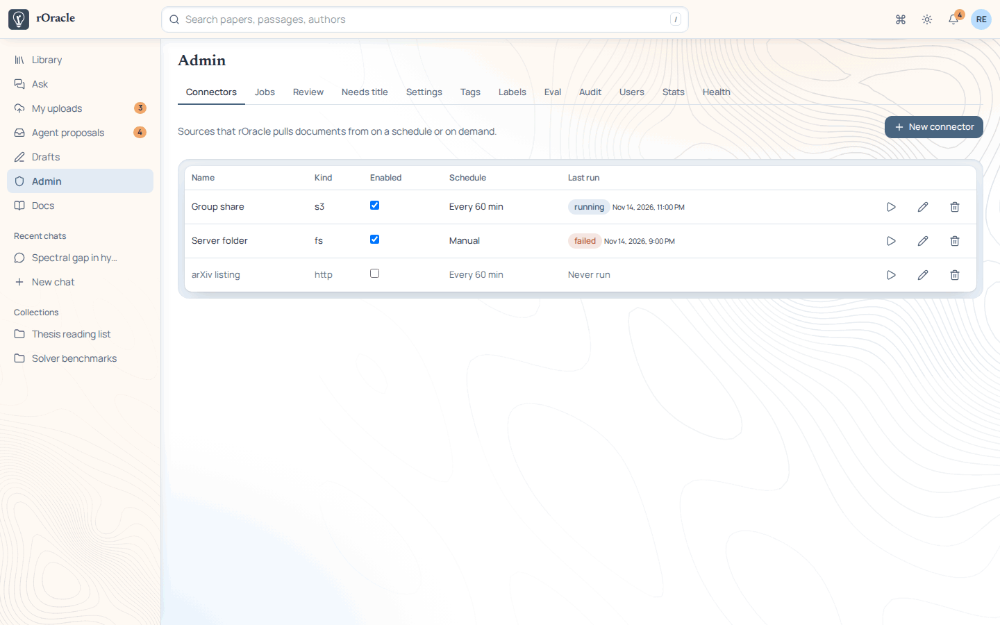

# Admin guide

For rOracle administrators: the people, labels, sources and limits that shape what researchers can do, and the audit trail of what admins did. These pages describe the admin screens and name the admin API calls where they are the tool for the job. Cluster operations (Helm, Terraform, backups, upgrades) stay in the [enterprise section](../enterprise/README.md). Terms are defined in the [glossary](../glossary.md).

## Pages

- [Users and groups](users-groups.md): Keycloak as the source of users, the admin role, org units, the directory, revoking tokens
- [Sensitivity labels](labels.md): create and order labels, gates, defaults, lowering with a reason, drift repair
- [Connectors](connectors.md): S3, folder and website sources, schedules, secrets, run history
- [Quotas and limits](quotas-limits.md): upload size, per-user quota, rate limit, connector caps
- [Audit log](audit.md): the viewer, what is recorded, getting data out, retention

- [Evaluation](eval.md): gold sets, runs, the trend, compare gates and the CI job
- [Index maintenance](index-maintenance.md): re-embed, rebuild, shadow indexes, reference re-extraction, jobs and cleanup
- [Runtime settings](runtime-settings.md): the fourteen settings an admin can change, precedence over the environment, audit
- [Writing profiles](writing-profiles.md): the YAML schema, validation and how a draft gets its profile

## The admin area

Admins see an **Admin** entry in the web app. It opens `/admin` with one tab per section. Anyone else gets "Admins only" and no admin request is sent. A signed-in admin lands on **Connectors**.

| Tab | What it is for | Where it is covered |
|---|---|---|
| Connectors | Sources rOracle pulls papers from | [Connectors](connectors.md) |
| Jobs | The processing queue; retry failed jobs | Jobs and queue: see [architecture](../architecture/README.md) |
| Review | Uploads and connector items that look like papers already in the library, oldest first; filter by All, Uploads or Connectors | [Uploads](../user/uploads.md#near-duplicates) (the researcher's side) |
| Needs title | Versions waiting for a title | [Uploads](../user/uploads.md) |
| Settings | Runtime overrides of selected settings | [Runtime settings](runtime-settings.md); the limit settings are also in [Quotas and limits](quotas-limits.md) |
| Tags | Merge tags | [Labels](labels.md#tags-and-index-drift) |
| Labels | Sensitivity labels | [Labels](labels.md) |
| Eval | Retrieval-quality evaluation | [Evaluation](eval.md) |
| Audit | The audit log | [Audit log](audit.md) |
| Users | Users, groups, revoking tokens | [Users and groups](users-groups.md) |
| Stats | Document, version, blob and user counts and the top uploaders | [Quotas and limits](quotas-limits.md#watching-usage) |
| Health | Database, Elasticsearch and storage checks, queue depth | [Operations runbook](../enterprise/operations-runbook.md) |

## Rules that apply to every admin call

- Admin routes need an interactive sign-in (a JWT). A personal access token is refused with `403 admin only`, even one minted by an admin.
- Each successful admin request is written to the audit log as `admin.<handler>`; a refused one is written as `admin.denied` on a best-effort basis. See [audit](audit.md#what-is-recorded).
- All admin routes live under `/api/admin/`. The full list is in the [OpenAPI schema](../reference/openapi.json); settings are in the [settings reference](../reference/settings.md).
