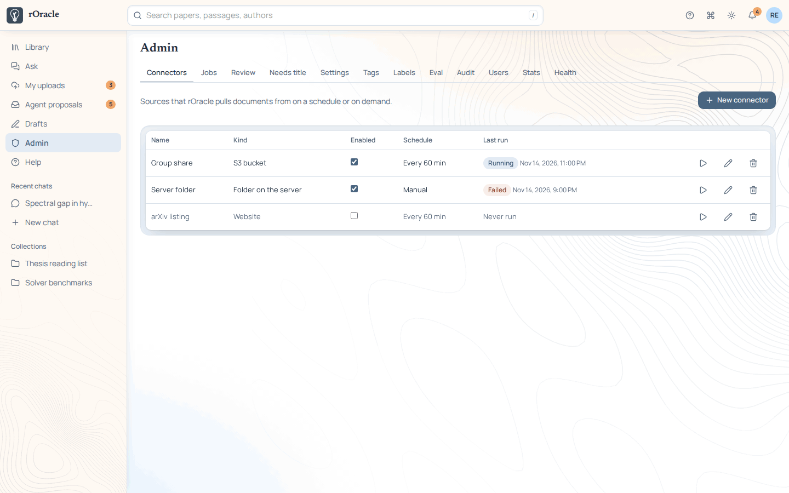
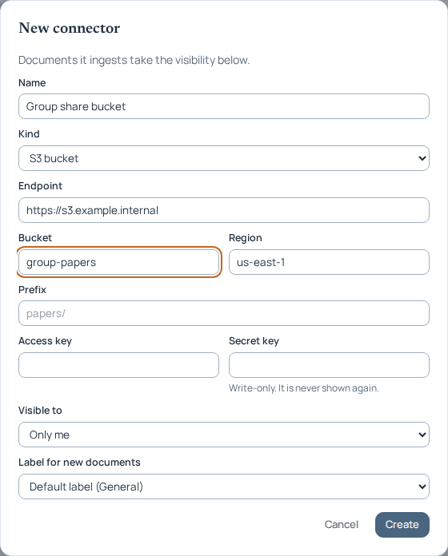
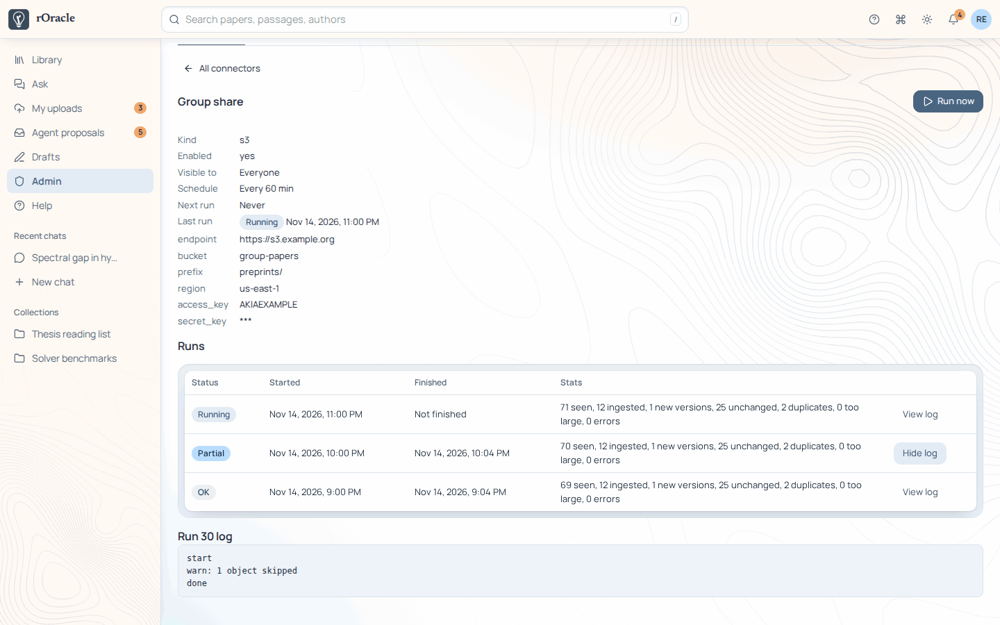

# Connectors

A connector is a source that rOracle pulls papers from, on a schedule or on demand: an S3 bucket, a folder on the server or a website. Everything a connector brings in goes through the same processing as an upload. Manage them in **Admin, Connectors** (the first tab of the admin area).

The list shows each connector's name, kind, an **Enabled** tick, its schedule and the status of its last run. A connector's name opens its detail page. The row has **Run now**, **Edit** and **Delete**. Names must be unique (`409` otherwise).

## Creating a connector

**New connector** opens a form. The kind cannot be changed afterwards.

| Field | Meaning |
|---|---|
| Name | Up to 200 characters, unique |
| Kind | **S3 bucket**, **Folder on the server** or **Website** (`s3`, `fs` and `http` in the API). The list shows the same names |
| Visible to | **Only me** (`private`, only the admin who created it), **An org unit** (`org_unit`) or **Everyone** (`everyone`). Choosing an org unit needs a path starting with `/`, for example `/Physics/Optics` |
| Label for new documents | See [labels and visibility](#labels-and-visibility) |
| Run every (minutes) | 5 to 10080. Empty means manual runs only |
| Enabled | A disabled connector is skipped by the scheduler. **Run now** still works |

API: `POST /api/admin/connectors` (`201`), `GET /api/admin/connectors`, `GET /api/admin/connectors/{cid}`, `PATCH /api/admin/connectors/{cid}`, `DELETE /api/admin/connectors/{cid}` (`204`). Creating, changing and deleting are recorded as `admin.connector_create`, `admin.connector_update` and `admin.connector_delete` with the connector's settings (secrets masked).

### S3 bucket

| Field | Meaning |
|---|---|
| Endpoint | `http(s)` URL of the S3 service, without credentials, for example `https://s3.example.internal` |
| Bucket, Prefix | Every object under the prefix is listed; keys ending in `/` are skipped |
| Region | Default `us-east-1` |
| Access key, Secret key | Optional. Without both, requests are sent unsigned (anonymous access) |

Addressing is path-style. The endpoint is whatever the admin enters: unlike the website connector, it is not filtered against private address ranges, so reach internal object stores freely and limit who is an admin accordingly. Requests time out after `ROR_CONNECTOR_HTTP_TIMEOUT_S` (default 60 seconds).

### Folder on the server

| Field | Meaning |
|---|---|
| Path | Absolute path of a directory |
| Include patterns | 1 to 20 glob patterns (default `*`), matched against each file's path relative to the folder, for example `*.pdf` |

The path must be equal to or inside one of the roots the operator allows with `ROR_CONNECTOR_FS_ROOTS`. With no roots configured, folder connectors are disabled and creating one fails with "filesystem connectors are disabled". The check runs again on every run, so a connector whose root was removed stops working. Files and folders whose names start with a dot, symbolic links and anything that is not a regular file are skipped, and the walk cannot leave the root. Hard links to files outside the root cannot be told apart from ordinary files, so mount the roots read-only. The variable is in the [settings reference](../reference/settings.md); mounting the folder is the operator's job.

### Website

| Field | Meaning |
|---|---|
| Start URLs | 1 to 20 `http(s)` URLs without credentials |
| Max depth | 0 to 3 (default 1): how many links deep to follow from each start URL |
| Max pages | 1 to 1000 (default 100): pages fetched in one run |
| Respect robots.txt | On by default. A missing or unreachable `robots.txt` does not stop the crawl; a server error on it blocks the origin |
| Ingest HTML pages too | Off by default: pages are only followed for links. On: HTML pages are ingested as documents |

The crawler stays on the origin of each start URL, follows links in HTML pages and ingests PDF, Word, RTF, plain text, Markdown, OpenOffice and Office files. Redirects are followed up to 5 times and a redirect to another origin is skipped.

**Network guard.** The crawler only connects to publicly routable addresses. A private, loopback or otherwise non-public address is blocked unless the operator listed its range in `ROR_CONNECTOR_HTTP_ALLOW_CIDRS` (a setting of the deployment, not of the Settings screen). Link-local and multicast addresses and the known cloud metadata addresses are never allowed, even when listed. Every address a name resolves to is checked at connect time, on every request and redirect. If an internal site is blocked, the run log says the address "is not publicly routable and not in ROR_CONNECTOR_HTTP_ALLOW_CIDRS": ask the operator to add the smallest range that covers it.

## Credentials handling

Only the S3 secret key is a secret.

- It is write-only. Every read, including the connector list, the detail page and the audit log, shows `***` in its place.
- When you edit a connector the field shows `***`. Leave it to keep the stored secret, type a new one to replace it, or clear it to remove it. The API follows the same rule: `PATCH` merges the `config` you send, a `null` value deletes a key and `***` keeps the secret.
- The access key is not masked.
- rOracle keeps the secret in the connector's configuration in Postgres and adds no encryption of its own, so protect the database and its backups as you would any credential store. Prefer an account that can only read the one bucket.

## Labels and visibility

- Documents a connector ingests are owned by the admin who created it and take the connector's visibility. Changing **Visible to** later changes the documents it already ingested too, and queues an index sync for each.
- **Label for new documents** applies to what the connector ingests from then on. It is never applied to existing documents. Without one, documents take the [default label](labels.md#default-label). Changing a connector's label later does not relabel anything already ingested; relabel those papers individually.
- Connector documents are exempt from the [per-user upload quota](quotas-limits.md#per-user-upload-quota).
- Items that look like papers already in the library wait in **Admin, Review** (filter **Connectors**).

## Schedules and runs

The worker checks for due connectors every `ROR_CONNECTOR_TICK_S` seconds (default 60) and queues one run for each enabled connector whose time has come. A new or changed schedule is due at the next check. Only one run per connector is queued or running at a time: **Run now** on a busy connector answers `409`. **Run now** is `POST /api/admin/connectors/{cid}/run` (`202`, returns a `job_id`).

A run compares every item with what it saw before:

| Outcome | Meaning |
|---|---|
| ingested | A new paper |
| new versions | The item changed at the source: its content is added as a new version of the same paper |
| unchanged | Same etag or same content as last time |
| duplicates | The same content was already ingested by this connector |
| too large | Over `ROR_MAX_UPLOAD_BYTES` (see [limits](quotas-limits.md#upload-size)) |
| errors | The item failed; the run log names it |

Nothing is ever removed because an item disappeared from the source. To remove papers, delete them in the library.

A run ends **ok**, **partial** or **failed**. It is partial when any item failed or a warning was logged, and when it hit a cap: at most `ROR_CONNECTOR_MAX_ITEMS` (default 1000) items that are not simply unchanged, or `ROR_CONNECTOR_MAX_RUN_S` seconds (default 3600). The rest is picked up on the next run. A run that was interrupted by a worker restart is marked failed with "worker interrupted" when the next run starts. When a run is partial or failed, every admin gets a notification.

On the detail page, **Runs** lists the history, newest first, with status, times and counts. **View log** shows the run's log as plain text: the last 500 lines are kept, and the page shows the last 200 KB. Log lines come from remote systems and are never interpreted. API: `GET /api/admin/connectors/{cid}/runs` and `GET /api/admin/connectors/{cid}/runs/{run_id}`.

## Deleting

**Delete** removes the connector, its run history and its memory of seen items after confirmation. The papers it ingested stay in the library. If a run is in flight when you delete, it stops.

## Related

- [Sensitivity labels](labels.md)
- [Quotas and limits](quotas-limits.md)
- [Ingest data flow](../architecture/ingest.md)
- [Settings reference](../reference/settings.md)
