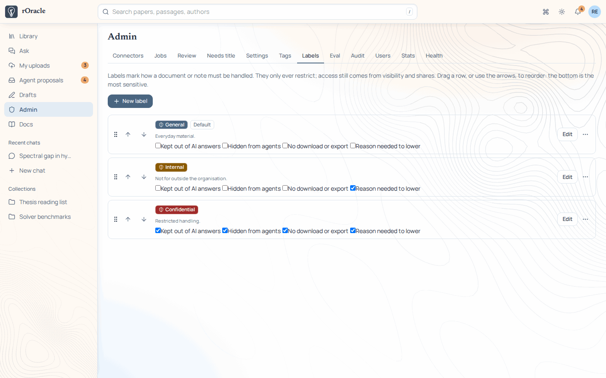
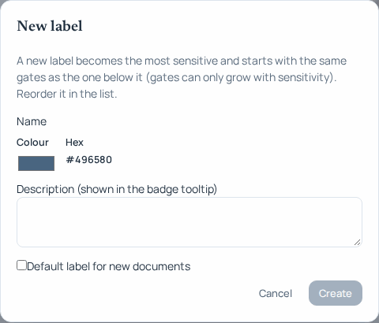
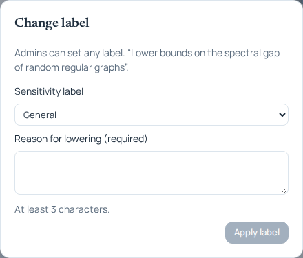

# Sensitivity labels

Labels mark how a paper or note must be handled. They only ever restrict: access still comes from visibility and shares ([glossary](../glossary.md#labels)). You define the label set in **Admin, Labels**. What each gate means for a researcher is on the [user page](../user/labels.md); this page is about running the set.

## The label set

- At most 20 labels. A fresh install has one, `General` (colour `#496580`, rank 0), which is the default and holds every existing paper. Rename it rather than deleting it.
- Each label has a **name** (1 to 40 characters, unique ignoring case), a **colour** (`#rrggbb`), an optional **description** (up to 500 characters, shown in the badge tooltip), a **rank** and four **gates**.
- The list is ordered by rank: the top is the least sensitive, the bottom the most sensitive. Labels are compared by rank everywhere, so the order is the policy.

### Creating and editing

**New label** opens a dialog for name, colour and description, and a **Default label for new documents** tick. The new label becomes the most sensitive one and starts with the same gates as the label below it. Each row has a three-dot menu with **Edit**, **Move up**, **Move down** and **Delete…** (which opens a confirmation explaining the in-use rule below). **Edit** changes name, colour, description and default. Gates are not in the dialog: switch them in the list.

API: `POST /api/admin/labels` (`201`), `PATCH /api/admin/labels/{label_id}`, `DELETE /api/admin/labels/{label_id}` (`204`).

### Ordering

Drag a row, or use the up and down arrows, to move it. The new order is saved at once: the app sends every label id, least sensitive first, to `PUT /api/admin/labels/order`, and ranks are renumbered 0, 1, 2 and so on. The call must list every label exactly once (`422` otherwise).

### Gates

Each label has four switches, shown as checkboxes under it.

| Switch in the list | Gate | In short |
|---|---|---|
| Kept out of AI answers | `exclude_llm` | The paper's text is not sent to a language model and is withheld from agents |
| Hidden from agents | `block_agents` | The paper is invisible to access-token callers, admins included, and dropped from handoffs for everyone |
| No download or export | `block_export` | Non-owners who are not admins cannot download or export it |
| Reason needed to lower | `reason_on_lower` | Lowering a paper from this label needs a written reason |

The full behaviour is in the [glossary](../glossary.md#labels) and the [user page](../user/labels.md#what-each-gate-means-to-you). One detail matters when you decide what to switch on: with `exclude_llm` the reranker may still score the paper's passages, so the paper can influence result order even though its text never reaches a model.

Gates must never decrease as sensitivity rises. Once a gate is on at some rank it must be on for every label ranked above it, otherwise the change is refused with "gates must not decrease with rank". In practice you can switch a gate on only when every more sensitive label has it, and off only when no less sensitive label has it. The app shows the server's message next to the list.

Gate edits and reordering need no reindex and apply to the next request, because the label set is read from the database each time it is needed.

### Default label

Exactly one label is the default. To change it, edit another label and tick **Default label for new documents**: the old default is unticked for you. The checkbox is disabled on the current default, so you cannot leave the set without one.

The default is what a new document gets when nothing else is said:

- **Uploads.** The upload form preselects the default. Researchers may choose a more sensitive label. Choosing a less sensitive one needs an admin; for anyone else, including agents, it fails with "label is below the default".
- **Connectors.** A connector can name its own label. Without one, its documents take the default. See [connectors](connectors.md#labels-and-visibility).

### Deleting

Deleting is refused with `409 label in use` while any document, note or connector uses the label, and for the default. Move the documents to another label first.

## Lowering a label

Raising a label (to a more sensitive one) is open to the paper's owner and to admins. Lowering is admin-only, and never by an access token (agents propose, and a person approves; see [agent proposals](../user/handoffs-inbox.md#agent-proposals)).

- Admins change a paper's label in the reader, with the pencil next to the badge (**Change label**). The API is `PUT /api/documents/{doc_id}/label` with `{"label_id": "...", "reason": "..."}`.
- When the label the paper is leaving has **Reason needed to lower**, the reason is mandatory, 3 to 500 characters (`422` otherwise). Without that gate the reason is optional, up to 500 characters.
- Notes work the same way (`PUT /api/annotations/{note_id}/label`). A note can never be labelled below its paper.
- The change is recorded as `document.label` (or `annotation.label`) with the old and new label ids and the reason, and the owner gets a notification when somebody else made the change. See [audit](audit.md#what-is-recorded).
- Adding a new version of a paper never lowers its label.

After a label change the search index follows: the API updates the paper's access fields in Elasticsearch and queues an `acl_sync` job. Until the index has converged, Postgres stays the authority and re-checks the label ([access control](../architecture/access-control.md)).

## Tags and index drift

Tags feed the same index projection as labels and access, so their maintenance sits here.

**Admin, Tags** lists tags with their document count, most used first, with a **Filter tags** box. The page loads only the 50 most-used tags and the box filters just those, so a rarer tag shows "No tags match"; type a rarer tag into **Merge into** by hand, or look it up with `GET /api/admin/tags?q=` (`limit` up to 200, `offset`). To merge tags, tick the sources (up to 50), type or choose the **Merge into** tag and confirm. Every document carrying a source tag gets the target and loses the sources. It cannot be undone. Tags are normalised (case-folded, punctuation and spaces become hyphens, 1 to 40 characters), so `PDE` and `pde` are one tag. Each changed document is queued for an index sync, and the merge is recorded as `admin.tags_merge`. API: `POST /api/admin/tags/merge` with `sources` and `target`.

If you suspect the index and Postgres disagree, for example after a failed job, run a reconcile. `POST /api/admin/maintenance/reconcile` (`202`, returns a `job_id`) starts a `reconcile_tags` chain:

- It walks the live documents in batches of 500 and compares a digest of each document's access fields (including its label), tags and title in Postgres with the one stored in the index.
- Only documents that differ get an `acl_sync` job, so an index that is in sync costs no writes. Repairs always re-read Postgres.
- The periodic maintenance job runs the same step, every `ROR_MAINTENANCE_INTERVAL_S` seconds (default 86400).

Follow the jobs in **Admin, Jobs** (kind `maintenance`, `reconcile_tags`, `acl_sync`). A failed `acl_sync` can be retried there. The other maintenance steps are covered in [index maintenance](index-maintenance.md#purge-blob-gc-and-tag-reconcile).

## Related

- [Sensitivity labels for users](../user/labels.md)
- [Access control architecture](../architecture/access-control.md)
- [Audit log](audit.md)
