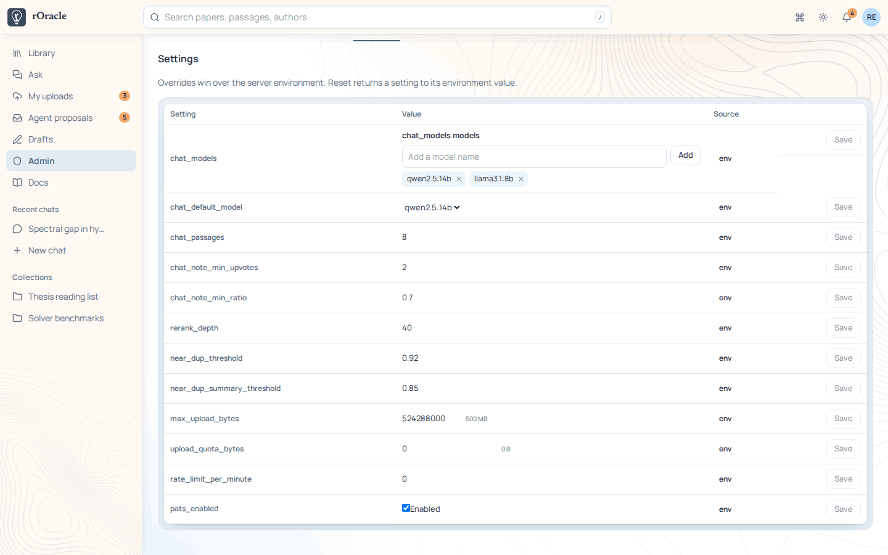

# Quotas and limits

Three limits are yours to set from the admin area: the size of one upload, how much a user may store and how fast one caller may call the API. Connector runs have their own caps. This page says what each limit measures, where it applies and what the user sees when they hit it.

## Runtime overrides

The three limits are runtime settings. **Admin, Settings** lists them with their current value and a **Source** of `env` (the deployment's value) or `override` (set here).

- Change the value and press **Save**. **Reset to env** deletes the override and the environment value applies again.
- Values are checked against bounds, and a bad value is refused with a message.
- Overrides apply to the next request. No restart is needed. Every API replica reads them from the database.
- Each change is recorded as `admin.settings_update` with the old and new value.
- API: `GET /api/admin/settings` and `PUT /api/admin/settings` with the keys to change. A key set to `null` deletes its override.

| Setting | Environment variable | Default | Bounds when overridden |
|---|---|---|---|
| `max_upload_bytes` | `ROR_MAX_UPLOAD_BYTES` | 524288000 (500 MiB) | 1 MiB to 5 GiB |
| `upload_quota_bytes` | `ROR_UPLOAD_QUOTA_BYTES` | 0 (unlimited) | 0 or more |
| `rate_limit_per_minute` | `ROR_RATE_LIMIT_PER_MINUTE` | 0 (off) | 0 or more |
| `pats_enabled` | `ROR_PATS_ENABLED` | on | on or off |

The other runtime settings (chat, retrieval and so on) are covered in [runtime settings](runtime-settings.md). All settings are in the [settings reference](../reference/settings.md).

## Upload size

`max_upload_bytes` caps one file.

- A file over the cap is refused with `413 file exceeds <n> MB limit`, whether it came from the web app or from an agent. An empty file gets `400 empty file`.
- Connectors use the same cap: an item over it is counted as "too large" in the run and skipped.
- The web app also checks the size before it sends anything, against a fixed 500 MiB that does not follow the override. Lowering the setting works for everybody, with the server's message. Raising it above 500 MiB does not let people upload larger files in the web app, only connectors and the API.
- Agents uploading through the MCP upload tool are held to a smaller cap, 25 MiB after decoding (`ROR_MCP_MAX_UPLOAD_BYTES`, not a runtime setting).
- Whatever sits in front of rOracle (ingress, proxy) may enforce a request-size limit of its own. That is the operator's to set.

## Per-user upload quota

`upload_quota_bytes` is the most one user may have stored. It is one global number applied to each user, with no per-user exceptions. `0` turns it off.

What counts:

- The sizes of the user's uploaded versions, older versions included, except versions that were rejected or cancelled.
- Documents ingested by connectors are exempt.
- Deleting a paper does not give the space back at once: a deleted paper keeps counting until it is purged for good, and purging only happens when `ROR_RETENTION_DELETED_DAYS` is set above 0 (default 0, never). See the operations runbook for retention.

When a new upload would go over, it is refused with `413 upload quota exceeded` and the user sees that message. Uploads by the same user are serialised while the check runs, so parallel uploads cannot overshoot.

To see who is close, use [Stats](#watching-usage). To free space for someone, they delete papers and you raise the quota or wait for purging.

## Rate limit

`rate_limit_per_minute` limits how many requests one caller can make. `0` is off.

- Every authenticated REST request and every MCP request takes one token from a bucket. The bucket holds the limit's worth of tokens and refills continuously at limit per 60 seconds, so short bursts up to the limit are fine.
- The bucket belongs to the caller: each access token has its own, and a signed-in user has one for the web app. Admin requests count like any other.
- An empty bucket gets `429 rate limited` with a `Retry-After` header (whole seconds, at least 1).
- Buckets live in each API process's memory. With several API replicas the effective ceiling is roughly the limit times the number of replicas, and a restart refills every bucket.

A web app session makes many small requests, so set the limit well above what a person triggers by hand. Agents are the usual reason to turn the limit on; give them [access tokens](../user/agents-and-tokens.md) of their own so one noisy agent cannot use up someone else's budget. Probe endpoints (`/healthz`, `/readyz`) need no sign-in and are not limited.

## Connector caps

Connector runs are bounded separately, with settings of the deployment (not on the Settings screen): `ROR_CONNECTOR_MAX_ITEMS` (default 1000 items per run), `ROR_CONNECTOR_MAX_RUN_S` (default 3600 seconds), `ROR_CONNECTOR_TICK_S` (default 60) and `ROR_CONNECTOR_HTTP_TIMEOUT_S` (default 60). A run that reaches a cap ends `partial` and carries on next time. See [connectors](connectors.md#schedules-and-runs).

## Watching usage

**Admin, Stats** shows live and deleted document counts, versions by stage, blob count and size, and the number of users, chats and connectors, plus the top 10 uploaders with their document count and size (`GET /api/admin/stats`, `top` up to 50). Its sizes skip rejected and cancelled versions and ignore deleted papers, and they include connector documents, so they are not the exact figure the quota checks. `GET /api/admin/users` returns the same counts for each user. For storage capacity planning see the [operations runbook](../enterprise/operations-runbook.md).

## Related

- [Uploads for users](../user/uploads.md)
- [Settings reference](../reference/settings.md)
- [Connectors](connectors.md)
