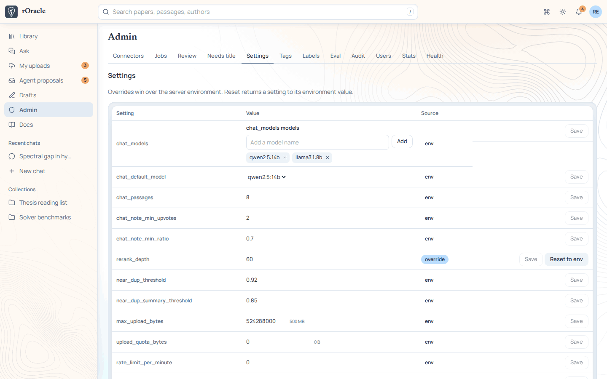

# Runtime settings

Fourteen settings can be changed while rOracle runs, without a restart and without touching the deployment. Everything else is fixed by the environment (`ROR_<NAME>` variables) and changes only through the operators' deployment. The full list of settings, with a **Runtime** column marking these fourteen, is in the [settings reference](../reference/settings.md). Terms are in the [glossary](../glossary.md).

## How to change one

In the web app open **Admin, Settings**. Each row shows the effective value, a **Source** (`env` or `override`) and its own **Save** button.

- Edit the value and press **Save** for that row. Only that setting is sent.
- **Reset to env** appears on rows whose source is `override`. It deletes the override, and the environment value applies again.
- A value outside its bounds is refused with a message, and nothing is stored.
- Model lists are edited as chips. The default model is a drop-down of the listed models.

API: `GET /api/admin/settings` returns every key as `{value, source}`. `PUT /api/admin/settings` takes an object with any of the keys below. Omit a key to leave it alone, and send `null` to delete its override. The body is checked strictly: an unknown key, a number sent as a string or a boolean sent as a number is a `422`. `GET /api/admin/settings/schema` returns the JSON schema with the bounds. Admin routes need an interactive sign-in; see the [admin overview](README.md#rules-that-apply-to-every-admin-call).

There is no CLI command for runtime settings.

## The fourteen settings

| Setting | Environment variable | Default | Allowed when overridden |
|---|---|---|---|
| `chat_models` | `ROR_CHAT_MODELS` (comma-separated) | `qwen2.5:14b` | 1 to 20 names of up to 200 characters, no commas |
| `chat_default_model` | none (the first of the list) | first of `chat_models` | one of the listed models |
| `chat_passages` | `ROR_CHAT_PASSAGES` | 8 | whole number 4 to 12 |
| `chat_note_min_upvotes` | `ROR_CHAT_NOTE_MIN_UPVOTES` | 3 | whole number, 0 or more |
| `chat_note_min_ratio` | `ROR_CHAT_NOTE_MIN_RATIO` | 0.6 | 0 to 1 |
| `rerank_depth` | `ROR_RERANK_DEPTH` | 200 | whole number 10 to 500 |
| `near_dup_threshold` | `ROR_NEAR_DUP_THRESHOLD` | 0.85 | 0.5 to 1 |
| `near_dup_summary_threshold` | `ROR_NEAR_DUP_SUMMARY_THRESHOLD` | 0.97 | 0.5 to 1 |
| `max_upload_bytes` | `ROR_MAX_UPLOAD_BYTES` | 524288000 (500 MiB) | 1 MiB to 5 GiB |
| `upload_quota_bytes` | `ROR_UPLOAD_QUOTA_BYTES` | 0 (unlimited) | 0 or more |
| `rate_limit_per_minute` | `ROR_RATE_LIMIT_PER_MINUTE` | 0 (off) | 0 or more |
| `pats_enabled` | `ROR_PATS_ENABLED` | on | on or off |
| `router` | `ROR_ROUTER` | off | on or off |
| `agentic_retrieval` | `ROR_AGENTIC_RETRIEVAL` | off | on or off |

What they do:

- **Chat models.** The first listed model is the default. `chat_models` replaces the whole list, and repeated names are collapsed. Setting `chat_default_model` moves that model to the front. It must be in the list, otherwise the save is refused with `422 chat_default_model must be one of chat_models`. See [chat](../user/chat.md) for what researchers see.
- **Chat passages.** How many passages go to the model in a chat answer.
- **Community notes.** `chat_note_min_upvotes` and `chat_note_min_ratio` set how well-rated a note must be before it reaches the model as context. A reader's own notes always do.
- **Rerank depth.** How many candidates the reranker scores for chat and other model-bound callers. The reranker itself is off until an operator configures it.
- **Near-duplicate thresholds.** How similar a new upload must be to a library paper to be flagged. See the [review queue](README.md#the-admin-area) and [uploads](../user/uploads.md#near-duplicates).
- **Upload size, quota, rate limit, tokens.** Covered in [quotas and limits](quotas-limits.md). `pats_enabled` switches personal access tokens on or off for everyone. While off, existing tokens get a plain 401 and creating a token returns `403 personal access tokens are disabled`.
- **Router and agentic retrieval.** Experimental chat paths that stay off until an evaluation passes. Do not turn them on without a PASS; see [evaluation](eval.md#the-router-and-raptor-preconditions).

Settings that are not here include the reranker URL, the context-notes and RAPTOR switches and `router_llm`. They are environment-only, and the evaluation tools may override some of them for one run only. The reranker URL is kept out on purpose: a URL an admin screen could set would let the server be pointed at any address. The embedding model is not a free setting either: it changes only through a [re-embed](index-maintenance.md#change-the-embedding-model).

## Which value wins

For these fourteen settings the order is: a stored override, else the environment value, else the built-in default. Details that matter in practice:

- Overrides live in the database, so every API replica and every worker sees the same value. They apply to the next request or job, with no restart.
- A stored value that no longer passes the checks is ignored, a warning is logged, and the environment value applies.
- The active embedding model, its dimensions and its index name are also stored in the database. Only the re-embed cutover writes them, and they win over `ROR_EMBED_MODEL` and its siblings. See [index maintenance](index-maintenance.md).
- Resetting an override never changes the environment. If an operator later changes the environment value, rows with source `env` follow it, and rows with source `override` do not.

## Audit

A save writes two [audit](audit.md#what-is-recorded) rows: `admin.put_settings` for the request itself and `admin.settings_update`, whose detail lists `changes` with the old and new value of every setting whose effective value actually changed. Reading the page writes `admin.get_settings`.

## Related

- [Quotas and limits](quotas-limits.md) for the three limit settings.
- [Settings reference](../reference/settings.md) for every environment variable.
- [Index maintenance](index-maintenance.md) for the embedding model.
