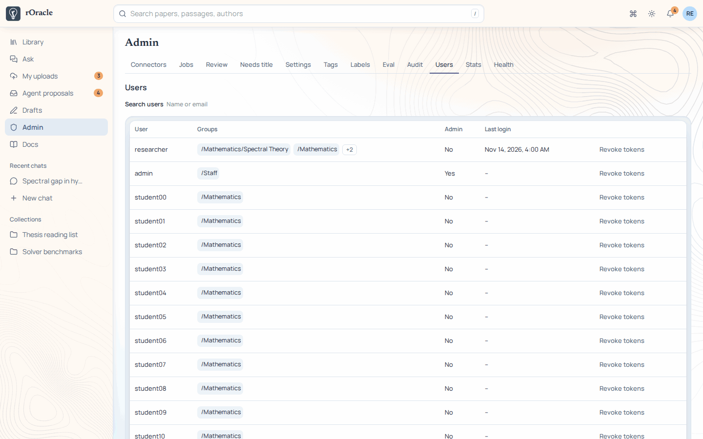

# Users and groups

rOracle has no user database of its own to administer. People, groups, org units and the admin role all come from Keycloak. rOracle records each person the first time their sign-in token reaches it and refreshes the record on every request. This page explains what rOracle reads from Keycloak, what the Users screen shows and the few user actions an admin has in rOracle itself. Setting up the realm and clients is covered in [Keycloak setup](../enterprise/keycloak-setup.md).

## What rOracle takes from the token

| Token content | What rOracle does with it |
|---|---|
| `sub` | Identifies the user. A new `sub` creates a user record |
| `preferred_username` | The user name shown in the app (falls back to `sub`) |
| `email` | Stored, and kept if a later token has none |
| `groups` | Stored as the user's groups and turned into org units (below) |
| Realm role `roracle-admin` in `realm_access.roles` | Makes the user an admin |

Tokens must be RS256, name the audience `ROR_OIDC_AUDIENCE` (default `roracle`) and come from one of the clients in `ROR_OIDC_ALLOWED_CLIENTS` (default `roracle-web`, `roracle-mcp`). Anything else gets `401 invalid token`. See the [settings reference](../reference/settings.md).

## Making someone an admin

Give the Keycloak user the realm role `roracle-admin`, directly or through a group or composite role that carries it. Nothing is configured in rOracle.

- The flag is refreshed from the token on every request. The change shows up with the user's next token, so it can take up to the access-token lifespan (5 minutes in the [recommended realm](../enterprise/keycloak-setup.md#1-realm)) to take effect. Removing the role works the same way.
- Admin routes need an interactive sign-in. A personal access token is never an admin, even when its owner is one, and gets `403 admin only` (recorded as `admin.denied`).
- An admin can read every live document, whatever its visibility. Treat the role accordingly and give it to as few people as the work needs.
- Admins also receive operational notifications, for example about failed jobs and connector runs that did not finish cleanly.

## Groups and org units

Groups in Keycloak model your organisation. rOracle turns each group path into an org unit:

- Paths are rooted and normalised, so `Physics/Optics` and `/Physics/Optics` are the same unit. Blank and root-only groups are ignored and never widen access to the whole organisation.
- A paper shared with an org unit is visible to people in that group and in groups below it. A paper owned by `/Physics` is visible to someone in `/Physics/Computational`, and not the other way round.
- The first org unit in the token is the owning unit of everything the user uploads. Put each person in their primary group first. A user with no usable group cannot upload with org-unit visibility.
- Group changes reach rOracle with the user's next token. A personal access token only ever keeps the groups its owner still has: it can lose groups but never gain them until it is recreated.

The terms are in the [glossary](../glossary.md#access).

## The Users screen

**Admin, Users** lists everyone who has signed in. A person who has never opened rOracle does not appear, and cannot be found by the pickers below either.

- **Search users** matches the user name or the email.
- The table shows the user, their groups (the first two, with the rest in a menu), whether they are an admin and their last sign-in, 20 users per page.
- **Groups** lists the group paths found across all users with the number of members, the first 50 alphabetically. The API pages through the rest.
- Names and groups are read-only here. Change them in Keycloak.

The matching API calls are `GET /api/admin/users` (`q`, `page`, `limit` up to 200) and `GET /api/admin/groups` (`q`, `limit`, `offset`). The API returns two extra fields per user, `documents` and `bytes`: the user's live documents (connector documents included) and their size. This is a usage view, not the figure the [upload quota](quotas-limits.md#per-user-upload-quota) checks.

## Revoking access tokens

Personal access tokens (the credentials agents use, see [agents and tokens](../user/agents-and-tokens.md)) are the one thing an admin changes on a user.

- **Revoke tokens** on the user's row asks for confirmation, then revokes every active token of that person at once. They can create new ones. The API is `DELETE /api/admin/users/{user_id}/pats` (`204`), recorded as `admin.revoke_pats`.
- Disabling or deleting a user in Keycloak stops their sign-in but not their tokens straight away. A token stops working once its owner's last sign-in is older than `ROR_PAT_MAX_IDENTITY_AGE_DAYS` (default 30), and then answers "token owner session stale". Revoke the tokens as well when access must end immediately.
- Tokens can be switched off for everyone with the runtime setting `pats_enabled` (`ROR_PATS_ENABLED`, default on). While it is off every token is refused as invalid. See [quotas and limits](quotas-limits.md#runtime-overrides).

## The directory

The sharing and co-author pickers in the app use two lookups that any signed-in caller can call, admins and researchers alike:

| Call | Returns |
|---|---|
| `GET /api/directory/users?q=` | Up to 10 users whose name contains `q`, as id and user name only |
| `GET /api/directory/groups?q=` | Up to 10 org units whose path contains `q`, case-insensitive |

`q` must be 2 to 100 characters. The directory exposes no emails and no group membership. Like the Users screen it only knows people who have signed in at least once, so ask a new colleague to open rOracle before you expect to find them for sharing. The groups come from the same stored group lists, normalised to org units.

## Related

- [Keycloak setup](../enterprise/keycloak-setup.md)
- [Audit log](audit.md)
- [Collections and sharing](../user/collections-sharing.md)
