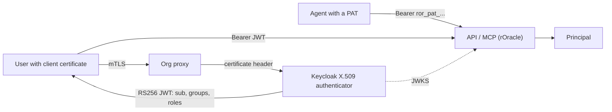
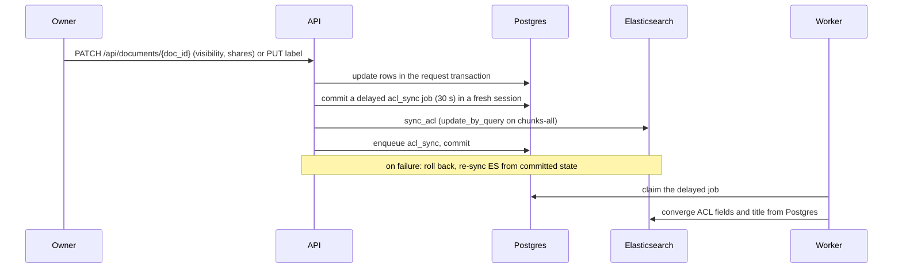

# Access control data flow

Who may see a document, and where that rule is enforced. Terms are in the [glossary](../glossary.md); the
design rationale is in [ADR-0002](../adr/0002-elastic-basic-app-acl.md),
[ADR-0004](../adr/0004-identity.md) and [ADR-0014](../adr/0014-sensitivity-labels.md). The retrieval side
(search, chat, `exclude_llm` handling, the reranker ruling) is in [Retrieval and chat](retrieval-chat.md).

The rule of thumb: **Postgres is the authority, Elasticsearch is a filter that saves work.** The application
builds the Elasticsearch ACL filter itself (Elasticsearch Basic has no document-level security), and every path
that returns ids, titles, counts or text re-checks the hits against Postgres before they leave the service. An
item the caller may not see looks exactly like one that does not exist (404 `not found`, no existence leaks
through error codes or counts; an unreadable citation is shown as `{"n", "available": false}` with no content).

## 1. Identity chain

mTLS termination and the X.509 login are not rOracle code. The org proxy terminates the user's client
certificate and Keycloak's X.509 authenticator turns it into a JWT (setup is in
[Keycloak setup](../enterprise/keycloak-setup.md)). rOracle only ever validates the resulting bearer token and
never accepts identity headers. REST, SSE and MCP share one resolver (`auth.resolve_principal`).

**JWT path** (`auth._verify`, `_jwt_principal`):

- RS256 only. The token must carry `exp`, `iss`, `aud` and `sub`, with issuer and audience matching
  `ROR_OIDC_ISSUER` and `ROR_OIDC_AUDIENCE`, a 30 s leeway, `typ` equal to `Bearer`, and `azp` in
  `ROR_OIDC_ALLOWED_CLIENTS`.
- Keys come from `ROR_OIDC_JWKS_URL` through a cache: an unknown `kid` or stale cache reloads at most once per
  60 s, keys older than 10 minutes are reloaded, and if reloading keeps failing the old keys serve until 1 hour
  and then fail closed.
- Every validation failure is the same 401 `invalid token`.
- The user row is upserted on each request from the claims: `groups` (org units) and `is_admin` (the realm role
  `roracle-admin`) are overwritten, `last_login_at` is set. Groups and the admin flag therefore follow the
  current token, not a stale copy.

**PAT path** (`pats.py`): a bearer token starting `ror_pat_` is an opaque secret. Only its SHA-256 is stored.
`principal_from_pat` fails with a plain 401 when PATs are disabled (`ROR_PATS_ENABLED`), the token is unknown,
revoked or expired, or its owner is gone. It answers 401 `token owner session stale` when the owner has not
signed in within `ROR_PAT_MAX_IDENTITY_AGE_DAYS`. The resulting principal:

- acts as the owner but is **never an admin** (admin needs an interactive JWT);
- carries the token's scopes, `read` and/or `write`. Without `write`, any method other than GET, HEAD or
  OPTIONS is 403 `insufficient scope` (`auth.current_principal`);
- carries the group snapshot taken at mint time **intersected with** the groups stored for the owner at their
  last JWT request, i.e. sign-in or app use (`pats.principal_from_pat`). A group removal reaches the token only then, and the
  token stops working entirely after `ROR_PAT_MAX_IDENTITY_AGE_DAYS` without one;
- is flagged `via="pat"`, which switches on the agent gates (section 5);
- writes a `pat.use` audit row per successful REST request (429, scope 403 and handler errors leave none; see
  [audit](../enterprise/security/audit.md#what-is-and-is-not-audited)). Token management (`/api/me/tokens`) needs a JWT (`require_jwt`, 403
  `personal access tokens cannot manage tokens`). Label changes and other human-only actions use `require_human`
  or the label service (403 `agents must propose`).

Workers have no request, so jobs that act for a user rebuild a principal from the groups and admin flag stored at
the user's last request (`auth.principal_for_user`).

An optional per-token rate limit (`ROR_RATE_LIMIT_PER_MINUTE`, default 0 = off) is a per-replica in-process
bucket keyed by `pat:<id>` or `user:<id>`, applied after the principal resolves.

## 2. Visibility, shares, org units, co-authors

A document has one `visibility` (`private`, `shared`, `org_unit`, `everyone`), an owner, and optional share rows
and co-author rows. `access.visible_documents(principal)` is the single SQL definition; non-deleted documents
are visible to a non-admin when any of these hold:

| Rule | Detail |
|---|---|
| `everyone` | Any authenticated user. |
| Owner | `owner_id` is the caller. |
| Co-author | The caller has a `document_coauthors` row, whatever the visibility. Rows are created when a draft is published as a paper (`writing/submit.py`) and can be removed by the owner through `PATCH /api/documents/{doc_id}`. |
| `shared` | The caller has a user share, or one of the caller's org units has a group share. Share rows count **only while** visibility is `shared`: stale rows under other visibilities are inert, and the PATCH handler drops them. |
| `org_unit` | The document's org unit is one of the caller's org units **or an ancestor** of one. |

Admins see every non-deleted document, except that a PAT principal is never an admin.

**Org-unit tree.** Org units are the token's `groups`, normalized to rooted paths (leading `/`, no `//`, no
trailing `/`). Blank and root-only groups are dropped, so a malformed group never widens access to `/`.
`org_ancestors` returns each unit, all its ancestors and `/`. A user in `/physics/optics` therefore sees
documents whose org unit is `/physics/optics`, `/physics` or `/`, but not `/physics/optics/lab` or
`/physics/astro`. Choosing `org_unit` visibility with no usable org unit is refused (422 `cannot determine org
unit; choose another visibility`): the rule fails closed.

**Non-owner non-admins only see documents with a `searchable` version** (`access.readable_documents`). Use it
wherever ids, titles or counts leave the service. Owners see their own documents in every stage.

Chats have their own, simpler rule (`chat/access.py`): the owner, or a recipient of a user or group share.
Recipients get 404 on anything else and 403 `read-only` on writes. Citations inside a shared chat are
re-checked per reader (section 4).

## 3. Elasticsearch filter and `acl_sync`

`search_acl.acl_filter(principal, policy)` mirrors the visibility rule as an Elasticsearch filter on fields
copied onto every chunk: `visibility`, `owner_id`, `coauthor_users`, `share_users`, `share_groups`, `org_unit`
and `label_id`. Admins get `match_all`. Callers put it in filter context and always add `is_latest: true`. For
agent principals (PAT, every `/mcp` caller, OAuth clients in `ROR_OIDC_AGENT_CLIENTS`) it adds `must_not label_id in <block_agents labels>`, admins included. The gate sets are read at
query time from the current label policy.

A visibility, share, co-author or label change updates Postgres and then pushes the new ACL fields to every
chunk through `chunks-all` (the mutation alias that spans all index generations, see
[Search index lifecycle](search-index-lifecycle.md)). The route first commits a **delayed** `acl_sync` job
(`ACL_JOB_DELAY_S`, 30 s) in its own session, so a crash between the Elasticsearch write and the commit still
converges. If Elasticsearch or the commit fails, the request rolls back and re-syncs Elasticsearch from the
committed state. `acl_sync` jobs are idempotent: the script compares before writing, an unchanged document is a
no-op, and the handler re-reads Postgres on every try so a concurrent revocation is never overwritten with older
data.

Other triggers enqueue the same job: tag changes (and a durable job on a failed tag sync), label raises by an
approved proposal, near-duplicate decisions, draft publication, admin and connector actions.

**Drift repair.** Every chunk carries an `acl_hash` over its ACL fields, tags and title. The `reconcile_tags`
job (see [Jobs and queue](jobs-queue.md)) compares Postgres hashes with Elasticsearch in batches of 500
documents, which writes nothing when there is no drift, and enqueues a normal-priority `acl_sync` per drifted
document (deduplicated against queued ones). It runs from the periodic maintenance job, after each re-embed
pass and at cutover. Until a sync lands, Elasticsearch can be stale; section 4 is why that is safe.

## 4. The R19 Postgres re-check

Elasticsearch hits are candidates. Every consumer of `retrieval.search_chunks` post-filters against Postgres
before returning anything:

- **Library search** loads the hit documents with the caller's visibility (`_load`) on every request, cached or
  not. The first-stage page cache holds only Elasticsearch results, per principal
  (`search_cache.cache_key` includes user, groups, `via`, admin flag and the label policy).
- **Chat, global answers, agentic retrieval and MCP `ask`** use `chat.retrieve._live`: the document must be in
  `visible_documents`, its **latest searchable** version must be the hit's version, and (for LLM-bound text) the
  current label must not carry `exclude_llm`.
- **Citations and handoffs** use `chat.access.visible_versions`, one query over `(doc_id, version_id)` pairs.
  Versions in `rejected` or `cancelled` are never shown. Non-owner non-admins need a `searchable` version, but
  **older versions of a visible document are allowed**: the same document, and its detail page lists them.
  Items that fail turn into `{"n", "available": false}` or are dropped; an item that cites a note also needs the
  note to be readable (fail closed).

Because Postgres re-checks the current document row, a revoked share, a visibility change, a relabel or a delete
takes effect on the next request even before `acl_sync` converges Elasticsearch. The reverse direction is the
filter's job: the rerank runs inside `retrieval.search_chunks`, before the Postgres re-check, so the reranker only
receives passages that passed the Elasticsearch ACL filter. During the `acl_sync` window that can include text
whose access was just revoked; the R19 re-check removes it before anything is returned.

## 5. Labels

A sensitivity label has a unique integer `rank`, a name and colour, one **default** label, and four flags
(`models_labels.GATES`): `exclude_llm`, `block_agents`, `block_export`, `reason_on_lower`. At most 20 labels
exist. `labels.policy.Policy` is an immutable per-request snapshot: labels sorted by rank, and the set of ids per
gate.

**Ordering and the effective label.** Higher rank means more sensitive. A note (a thread root) may carry its own
label, never below its document's. The **effective label** is the higher-ranked of the document label and the
note label (`Policy.effective`), and gates on note text use it. Replies have no label of their own.

**Who may set a label** (`labels/service.py`): agent principals (PATs, `/mcp` callers, OAuth agent tokens) cannot (403 `agents must propose`). The owner or an
admin may keep or raise a document label. **Lowering is admin only.** When the label being left has
`reason_on_lower`, a reason of 3 to 500 characters is required, otherwise 422. Uploads choose a label that ranks
at or above the default unless the caller is an admin acting by JWT. Every change writes a `document.label` (or
`annotation.label`) audit row and notifies the owner or author when someone else made the change.

### Gate matrix

"PAT" is an agent principal (`via == "pat"`). Humans means a JWT principal. All gates run after the normal
visibility check, so a document the caller cannot see is still 404 and naming the label leaks nothing.

| Gate | Surface | Effect |
|---|---|---|
| `exclude_llm` | Chat context (chat, global answers, agentic, MCP `ask`) | Chunks are filtered in Elasticsearch (`must_not label_id`), then dropped again if Postgres says the **current** label excludes LLM (the stored `label_id` can lag a raise). Applies to everyone. |
| | Replay of chat history to an LLM | Assistant turns, and the user turn before each, whose sources now carry the gate are dropped, for everyone. |
| | Ingest | No summary, no contextual notes, no RAPTOR units for the document. Embeddings are still computed. |
| | Library search, reader, notes | Humans are unaffected. PAT callers get metadata and the label but no passage text (`withheld` names the label). Raw bytes, layout and text-bearing evidence files return 403 `withheld by label`. |
| | Reranker | May score the passages. See the ruling in [Retrieval and chat](retrieval-chat.md#4-exclude_llm-handling-end-to-end). |
| `block_agents` | Every read surface for PAT callers | The document is invisible, admins included (`visible_documents` and `acl_filter` add the clause for `via == "pat"`). Drafts and notes follow the same rule. |
| | MCP and handoffs | Handoffs drop such documents for **every** loader, and transcripts withhold their text for every loader. |
| `block_export` | Download and export (original file, evidence file, draft PDF, chat export, BibTeX) | 403 `export blocked by label` with an audit row `label.export_blocked`, for non-owners and non-admins. The owner holds the original and admins can relabel anyway, so both are exempt: the owner by JWT or PAT, admins on an interactive JWT only (an admin PAT is not exempt, a PAT is never admin). Chat exports replace such references with a `[withheld: <label>]` marker and BibTeX silently omits the entries. |
| | Inline reading (reader, PDF viewer) | Allowed for humans. A non-owner non-admin read writes at most one `label.view` audit row per user, document and UTC day. Non-owner PAT callers are always treated as downloads, so they are blocked here too (the owner exemption still applies; an admin PAT is not exempt). |
| `reason_on_lower` | Lowering a label | Admin only, reason of 3 to 500 characters required. |

**`block_export` is a deterrent, not DRM.** It stops the download and export routes and leaves an audit trail
for inline reading. It cannot stop a reader from copying, photographing or screen-capturing text they are
allowed to read. `exclude_llm` and `block_agents` bind rOracle's own code paths: they do not constrain what a
human, or an agent holding the human's JWT, does with text they can read. Treat labels as policy enforcement
inside rOracle, not as a data-loss-prevention system.

Gates resolve from the label at the time of use, so relabeling a document takes effect on the next request.
Data created earlier is not rewritten by a relabel: a past chat answer stays stored, but PAT callers see it
stripped and it is dropped from LLM replay, and vectors already in the index stay there. The operator view of the
same controls is in [security](../enterprise/security.md).

### No cross-document summaries

rOracle never builds a corpus-wide graph or a summary that combines several documents (no corpus GraphRAG, no
cross-document RAPTOR). Such an artifact would mix text from documents with different audiences and could not be
post-filtered per reader without leaking what it was built from. Summary units are strictly per document
(`ingest/raptor.py`), an `exclude_llm` document gets none, and a unit hit expands into its real source chunks so a
summary is never cited. Global answers are computed at query time, per request, from passages that already
passed the caller's ACL, the gates and the R19 re-check ([Retrieval and chat](retrieval-chat.md#global-answers-map-reduce)).
The decision is recorded in [ADR-0015](../adr/0015-retrieval-quality.md).

## 6. Where each check lives

| Check | Code |
|---|---|
| Postgres visibility, readable, agent and LLM gates | `access.py` |
| Elasticsearch ACL filter | `search_acl.py` |
| ACL fields, hash and sync script | `search_index_acl.py`, `acl_sync.py` |
| Per-hit and per-citation re-check | `chat/access.py`, `chat/retrieve.py` |
| Label policy, export gate, audit | `labels/policy.py` |
| Label changes | `labels/service.py` |
| Text withholding for agents, replay | `labels/textgate.py` |
| JWT, PAT, scopes | `auth.py`, `pats.py`, `mcp/auth.py` |

The MCP mount at `/mcp` wraps the same resolver in a pure ASGI layer (`mcp/auth.py`): it resolves the bearer
token, applies the rate limit, and answers 401 with a `WWW-Authenticate` header that points at
`/.well-known/oauth-protected-resource`. Tools then run as that principal, so visibility, the ACL
filter and the R19 re-check apply. Every caller on this mount is an agent, and so is any OAuth token whose client is in `ROR_OIDC_AGENT_CLIENTS` (default `roracle-mcp`) on REST too: the agent gates (`block_agents` hiding, `exclude_llm` text withholding) apply, see [known limits](../enterprise/security/known-limits.md#agents-and-the-mcp-mount). Two things differ from REST: the mount skips
`current_principal`, so there is no `pat.use` audit row (each tool audits `mcp.<tool>` instead), and the `write`
scope is enforced per tool (`tools_write._need_write`) rather than by HTTP method.
