# Ingest data flow

How a file becomes searchable passages, stage by stage. Terms are in the [glossary](../glossary.md); knobs are
in the [settings reference](../reference/settings.md) (only the ones that shape a stage are named here). The
design rationale is in [ADR-0005](../adr/0005-ingestion-pipeline.md) and
[ADR-0008](../adr/0008-dedup-versioning.md). Retrieval is in [Retrieval and chat](retrieval-chat.md).

Ingest is one job kind, `ingest`, whose payload is a `version_id`. The handler is resumable and at-least-once:
it reads the version's persisted `stage` and runs only the stages after it. Every stage write goes through short
committed sessions (`ingest/state.py`), fenced to the running job's lease, so a stale worker cannot write.

## Job kinds used

All names are the keys of the handler map in `worker.py`.

| Job kind | Enqueued by | Role in ingest |
|---|---|---|
| `ingest` | upload, MCP `upload`, connector run, title decision, near-duplicate decision | Runs the stages below for one version. |
| `citations` | ingest, in the same transaction that sets `searchable` | Links the version's parsed references to library documents and backfills links into it. |
| `connector_tick` | itself (a self-rescheduling scheduler) | Enqueues a `connector_run` for each due connector. |
| `connector_run` | `connector_tick`, or a manual run | Lists a source and creates documents or versions, which enqueue `ingest`. |

Other kinds in the map (`acl_sync`, `evidence_scan`, `maintenance`, `reconcile_tags`, `lsh_backfill`, `eval_run`,
`eval_generate`, `rebuild_units`, `rebuild_watch`, `reembed`) are not part of a normal ingest. A failed `ingest`
job is retried with backoff `10 * 2**(attempts - released)` seconds and fails for good at 5 attempts (`MAX_ATTEMPTS`). The
handler also keeps its own start counter: more than 5 starts (`MAX_STARTS`) fails the version as "ingest crashed
repeatedly". An error raised as `NonRetryable` fails at once, and its message is shown to the uploader.

## Stage machine

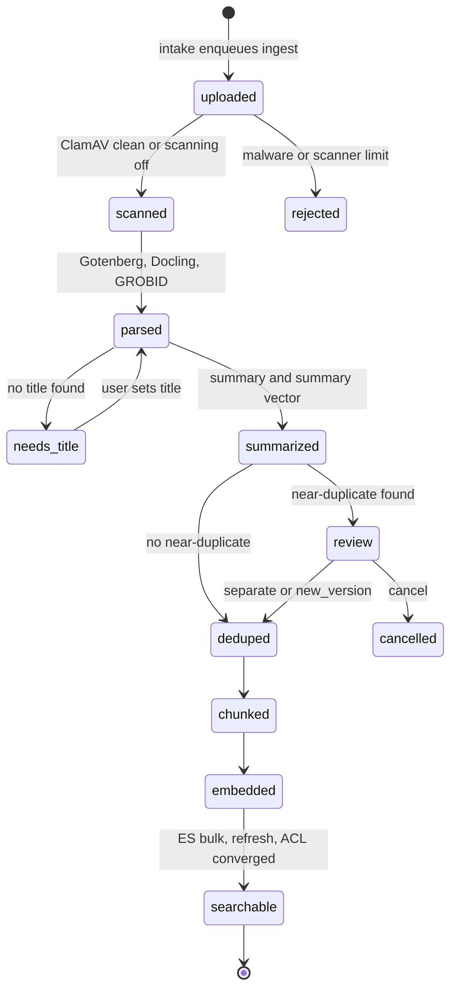

The handler stops (returns without work) when the stage is one of `searchable`, `review`, `needs_title`,
`rejected` or `cancelled`, or when the document is soft-deleted (`TERMINAL` in `ingest/pipeline.py`). A user
decision (`PUT /api/documents/{doc_id}/versions/{version_id}/title`, or
`POST /api/documents/{doc_id}/versions/{version_id}/near-dup` with `separate` or `new_version`) resets the
attempt counter and enqueues a new `ingest` job. `cancel` marks the version `cancelled` and releases its blob
reference.

## Entry points

An upload and a connector item both end in the same intake code (`ingest/intake.py`): reference the blob row,
write the object, create the `documents` and `document_versions` rows, and enqueue `ingest`, all in the caller's
transaction.

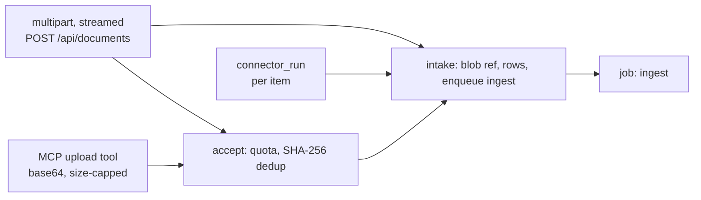

The MCP upload decodes at most `ROR_MCP_MAX_UPLOAD_BYTES` (default 25 MiB) and then takes the same
`accept` path as the web upload. The upload limit for the web route is `ROR_MAX_UPLOAD_BYTES` (default
524288000, 500 MiB) and can be overridden at runtime.

## 1. Upload stream

The request body is not spooled to local disk. A multipart parser feeds the single `file` part into a
temporary S3 object while hashing it. Parts of 8 MiB go out as S3 multipart parts.

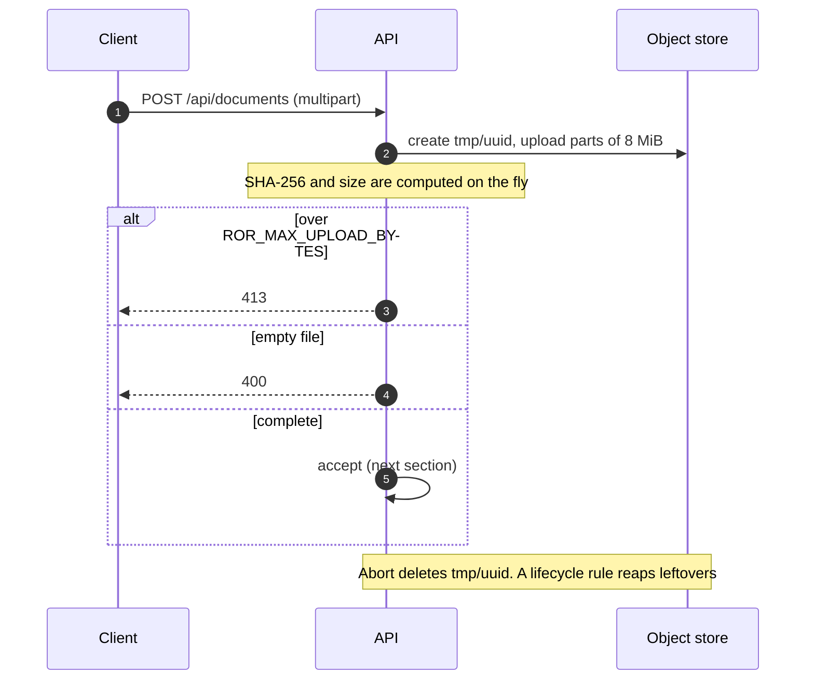

Fields (`title`, `visibility`, `force`, `label_id`) may come before or after the file part. The default
visibility is `everyone`.

## 2. SHA-256 dedup and quota

Before any row exists, `accept` checks the quota and then looks for the same content hash. The check never
discloses a document the caller could not already see.

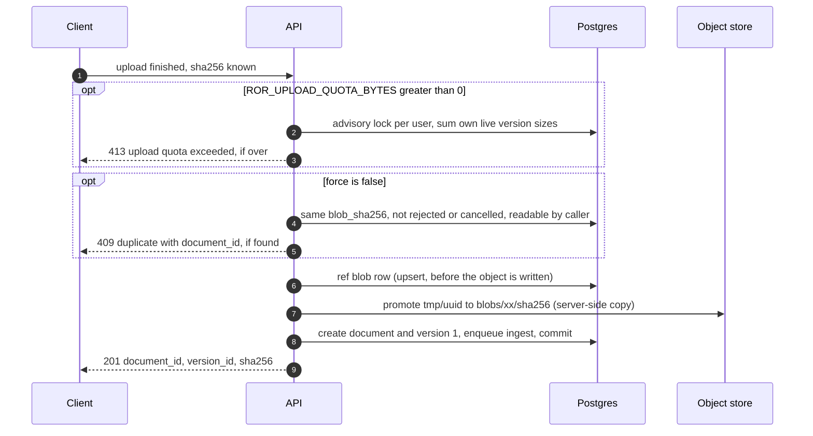

- The duplicate lookup only matches documents the caller may read (`readable_documents`). A non-owner,
  non-admin only matches a `searchable` version, so a private or still-processing upload by someone else never
  produces a 409. The 409 body carries `document_id` only for a match the caller can already see.
- `force: true` skips the lookup, so the same bytes can be stored as another document. Blobs are
  content-addressed and reference-counted (`blobs.refcount`), so the object is stored once.
- The quota counts the caller's own non-connector documents, excluding `rejected` and `cancelled` versions.
  Connector documents are exempt. `0` means unlimited.
- A new version of an existing document goes through `add_version`, which locks the document row so concurrent
  version numbers stay unique.

## 3. ClamAV scan

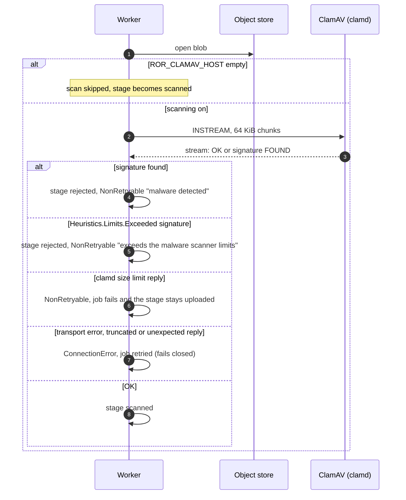

With `ROR_CLAMAV_HOST` empty the worker logs a warning at start and ingests without scanning. The clamd
`StreamMaxLength` must be at least the upload limit (comment in `ingest/scan.py`).

## 4. Gotenberg, Docling and GROBID

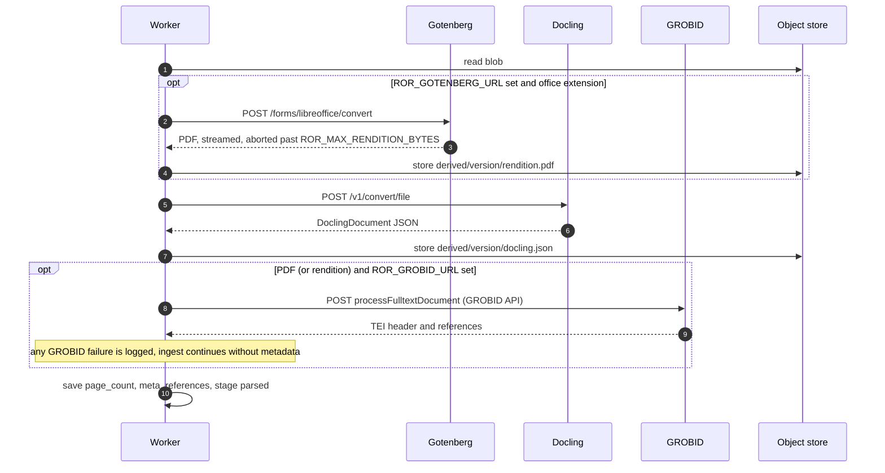

- Office types sent to Gotenberg: `doc`, `docx`, `odt`, `rtf`, `ppt`, `pptx`, `odp`, `xls`, `xlsx`, `ods`.
  With `ROR_GOTENBERG_URL` empty they go to Docling as they are. A 4xx from Gotenberg is permanent; other
  errors are retried. A non-PDF answer is an error.
- Docling answers 200 with a failure status for deterministic input problems (a fake PDF, a binary). Those fail
  permanently instead of retrying.
- GROBID is optional enrichment (`meta` and `references`). A retry after a later failure reuses
  `derived/<version>/docling.json` instead of converting again.

## 5. Title and needs_title

The title is the document's existing title (an uploader-supplied one wins), else the GROBID title (cleaned and
capped at 500 characters), else the first Docling `title` item, else the first `section_header`. If none is
found the version stops at `needs_title`; the owner (or an admin) supplies one with
`PUT /api/documents/{doc_id}/versions/{version_id}/title`, which moves it back to `parsed` and enqueues
`ingest` again.

## 6. LLM summary

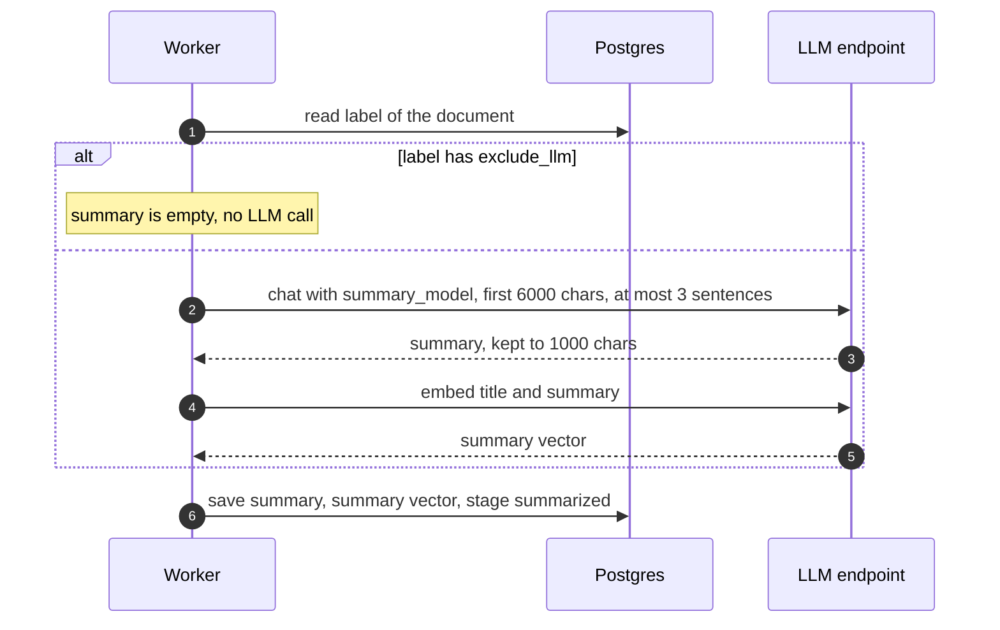

The model is `ROR_SUMMARY_MODEL` (default `qwen2.5:3b`). The `exclude_llm` check is gate (a), read from
Postgres at this point. The later LLM stages (notes, RAPTOR) re-read the label themselves.

## 7. Near-duplicate check

Runs after the summary so the summary vector can take part. It only considers documents the uploader may see.

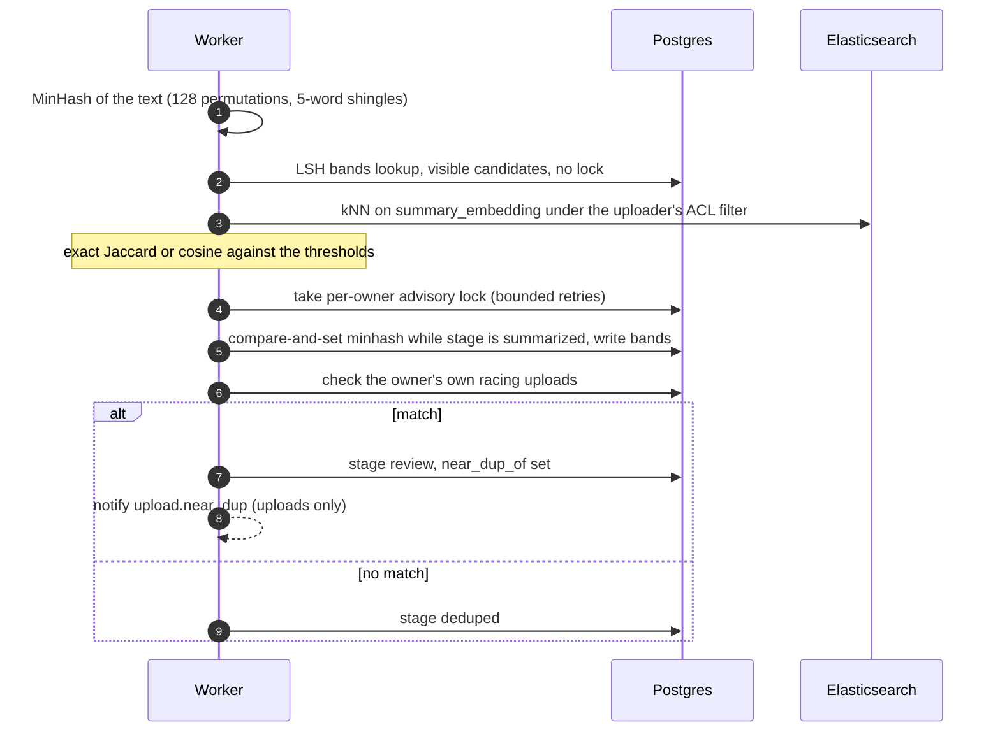

- Thresholds: `ROR_NEAR_DUP_THRESHOLD` (default 0.85, text similarity) and
  `ROR_NEAR_DUP_SUMMARY_THRESHOLD` (default 0.97, summary cosine). Both can be changed at runtime.
- Candidates must be visible to the uploader (R19), latest, not parked, and `searchable` unless they are the
  uploader's own. LSH uses 16 bands of 8 rows and caps candidates at 500. It is used only after the
  `lsh_backfill` marker exists and when the text threshold is at least 0.8. Otherwise an exhaustive scan runs.
- The per-owner lock is a transaction-scoped Postgres advisory lock tried up to 40 times. If it stays busy the
  job is requeued after 5 s and the ingest start is refunded. Of two simultaneous uploads of one paper, exactly
  one parks.
- A parked version waits in `review` until the owner chooses `separate` (keep as its own document),
  `new_version` (move under the match, which needs the owner of the match or an admin) or `cancel`.
- Connector items skip the notification; they still park.

## 8. Chunking, contextual notes and embeddings

Chunk, note, embed and index re-run as one unit. A crash leaves the version at `chunked` or `embedded` and the
retry redoes the unit.

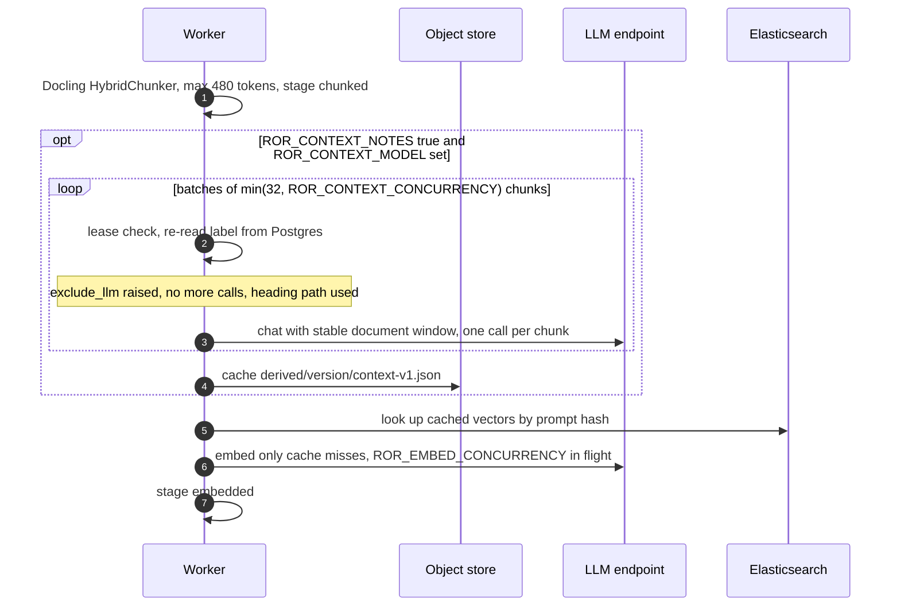

- Chunks come from the Docling document with page and bounding-box provenance. The cap is 480 tokens counted
  with `ROR_EMBED_TOKENIZER`.
- Contextual notes are off by default (`ROR_CONTEXT_NOTES` false) and need `ROR_CONTEXT_MODEL`. Each note is one
  call of at most `ROR_CONTEXT_MAX_TOKENS` tokens and 600 characters, using a window of
  `ROR_CONTEXT_DOC_CHARS` characters. Only the first `ROR_CONTEXT_MAX_CHUNKS` chunks of a document get an
  LLM note. Later chunks use their heading path. Notes are cached per version by chunk-text hash.
- An `exclude_llm` label is re-read from Postgres before every batch, so a raise stops further LLM calls after
  at most one batch. Notes from the batch in flight when a raise is seen are discarded, never cached. Notes feed
  BM25 and embeddings of the same document only.
- The embedding prompt combines title, chunk text and the context note (or the summary when there is no note).
  The prompt hash is the cache key, so re-ingesting or rebuilding only embeds chunks whose prompt changed.
  Vectors are `ROR_EMBED_DIMS` wide (default 768).

## 9. Per-document RAPTOR units, ES bulk and ACL convergence

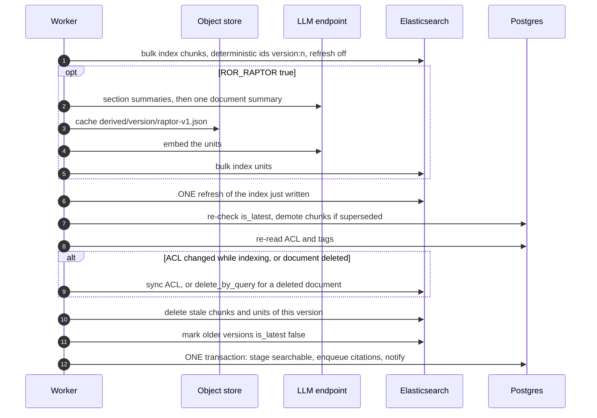

- The chunk bulk writes the document ACL fields (`owner_id`, `coauthor_users`, `visibility`, `org_unit`,
  `share_users`, `share_groups`, `label_id`), tags and `is_latest`, plus the summary vector on chunk 0.
  Bulk errors raise and fail the attempt; re-runs overwrite by id.
- RAPTOR is off by default (`ROR_RAPTOR` false). Units are built strictly per document: consecutive chunks that
  share the first heading form a section (headingless runs are cut into windows of 8 chunks). Sections are
  folded to at least a quarter of `ROR_RAPTOR_SECTION_CHARS` of text and at most `ROR_RAPTOR_MAX_SECTIONS`
  (default 64). Each unit is one summary call (model `ROR_RAPTOR_MODEL`, else the summary model), then one
  document unit from all section summaries. Units are retrieval aids: a hit expands to real source chunks at
  query time, so a summary is never cited. An `exclude_llm` document gets no units. A summary-LLM outage skips
  the units without blocking searchability. `roracle rebuild --what raptor` fills the gap later
  ([CLI reference](../reference/cli.md)).
- The single refresh comes right after the bulk and before the ACL re-read. A concurrent ACL change, relabel or
  delete then acts on a searcher that already contains the new chunks, and one that committed earlier is seen by
  the re-read. This is why ingest never leaves stale access in the index.
- The final transaction makes the version `searchable`, enqueues `citations`, demotes older versions'
  `is_latest` and, for non-connector documents, emits the `upload.searchable` notification. No searchable
  version exists without its `citations` job.
- A new latest version also clears the `outdated` reason on earlier downvotes (the votes stay).

## 10. Citations backfill

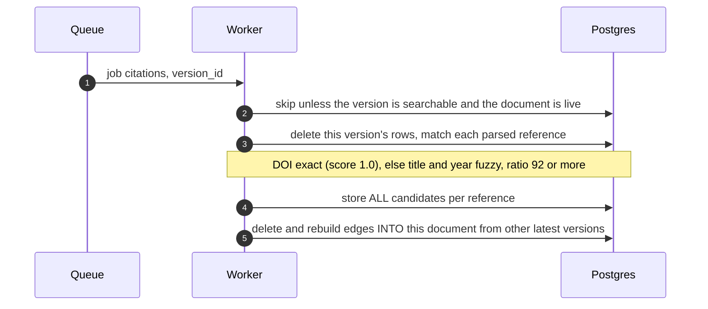

Matching is global and no access check is made at write time. The viewer's best visible candidate is picked at
read time (highest confidence, then oldest document), so a hidden document is never revealed through a link and
cited-by counts only count visible citing documents. Titles shorter than three words or 15 characters never
fuzzy-match.

## 11. Notify

Two notification kinds come from ingest, both only for non-connector documents: `upload.searchable` (when the
version becomes searchable) and `upload.near_dup` (when it parks in `review`). Connector runs notify admins
instead when a run ends `partial` or `failed` (`ops.connector_run`). Rejections and failures are shown on the
uploader's My uploads page through the job's user-safe error text.

## Connectors as an entry point

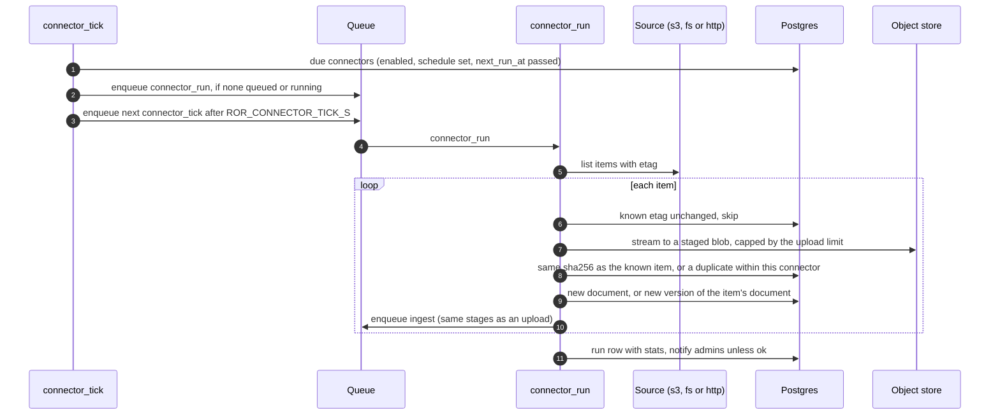

- Kinds: `s3`, `fs` and `http`. `fs` can only read under `ROR_CONNECTOR_FS_ROOTS` (empty disables it; paths are
  opened with no symlink following). `http` crawls from seed URLs, same origin only, through an SSRF guard. A
  private range is reachable only if it is listed in `ROR_CONNECTOR_HTTP_ALLOW_CIDRS`.
- Documents belong to the connector's owner, org unit and visibility, and get the connector's initial label.
- Duplicates are detected within one connector only (`Document.connector_id == connector`), so a connector can
  never reference or leak another principal's document. This differs from the upload check above.
- Caps per run: `ROR_CONNECTOR_MAX_ITEMS` (default 1000, unchanged items do not count) and
  `ROR_CONNECTOR_MAX_RUN_S` (default 3600). A cap ends the run `partial` and the rest follows next run.
  Run stats are `seen`, `ingested`, `versions`, `unchanged`, `duplicate`, `too_large` and `errors`.
- The malware scan, parsing and indexing are the same `ingest` stages as for uploads. Connector documents are
  exempt from the upload quota.
