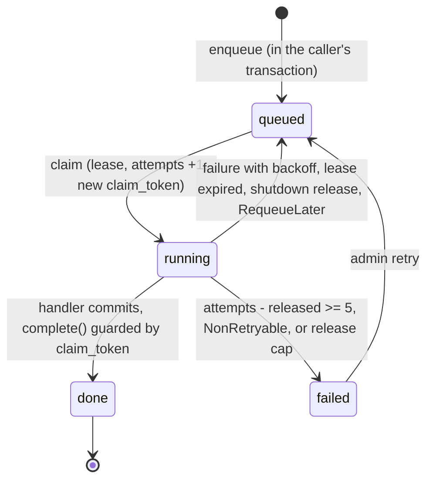

# Jobs and queue

Postgres is both the system of record and the job queue: no broker, no extra service. Terms are in the
[glossary](../glossary.md); the decision and its guarantees are in [ADR-0003](../adr/0003-postgres-job-queue.md).
Worker settings are in the [settings reference](../reference/settings.md), and the `roracle worker` entry point is
in the [CLI reference](../reference/cli.md).

## The `jobs` table

One row per job (`models.Job`):

| Column | Meaning |
|---|---|
| `kind`, `payload` | Handler name and its JSON arguments. |
| `status` | `queued`, `running`, `done` or `failed` (check constraint). |
| `attempts` | Counts **claims**; never decremented. |
| `released` | Free refunds: shutdown releases and `RequeueLater` deferrals. The attempt budget is `attempts - released`. |
| `run_after` | Not claimable before this time (backoff, delayed jobs). |
| `lease_until`, `claim_token` | Lease expiry of the running claim, and the fencing token of that claim. |
| `last_error` | Last failure text (capped at 2000 characters). |

`claim_token` comes from a database sequence (`jobs_claim_seq`), so it is **never reused**: every claim gets a
new one. It is the fence for everything a worker does to the row, which is why `attempts` can stay a plain
counter.

## Lifecycle



```mermaid
sequenceDiagram
  participant W as Worker
  participant H as Heartbeat thread
  participant PG as Postgres
  W->>PG: claim: SELECT ... FOR UPDATE SKIP LOCKED LIMIT 1
  W->>PG: set running, attempts+1, claim_token, lease_until; COMMIT
  W->>H: start (every lease/3)
  loop while the handler runs
    H->>PG: UPDATE lease_until WHERE status=running AND claim_token=mine
    H->>PG: requeue_expired() for other jobs
  end
  W->>PG: handler writes + complete() in ONE transaction
  alt claim still ours
    W->>PG: COMMIT
  else lease lost
    W->>PG: ROLLBACK (the new owner decides)
  end
```

1. **Enqueue** (`queue.enqueue`) inserts a row in the caller's transaction and does not commit, so a job exists
   exactly when the work that caused it commits. Many writers enqueue follow-ups from inside their own handler
   for the same reason.
2. **Claim** (`queue.claim`) selects one due row with `FOR UPDATE SKIP LOCKED`, marks it `running`, adds one
   attempt, takes a fresh `claim_token` and sets `lease_until`. `run_once` **commits at once**, so the row lock
   lasts milliseconds and no transaction stays open while the job runs. Concurrent workers never block each other
   and never take the same job.
3. **Run.** The handler gets its own session and runs inside a SAVEPOINT. It must not call `commit()`: that
   transaction also completes the job. Handlers that write through their own short sessions call `queue.fence`,
   which takes `FOR SHARE` on the job row of this claim and raises `LeaseLost` if the row is no longer running
   under it. Long loops call `check_lease()` as a cooperative abort point.
4. **Heartbeat.** A daemon thread extends the lease every `lease / 3` seconds with an `UPDATE ... WHERE
   claim_token = mine`, bounded by a statement and lock timeout of `lease / 6`. It runs on its own small engine
   so it never competes with handler sessions for the pool. If the update matches nothing the claim is lost
   (`lost` flag): the handler aborts at its next checkpoint.
5. **Complete.** On success, `complete()` runs inside the handler's own transaction, guarded by `status =
   'running' AND claim_token = mine`, then commits. The handler's writes and the completion are atomic. If the
   guard matches nothing the whole transaction is rolled back, so a reclaimed job never has its database effects
   applied twice.
6. **Fail.** The handler transaction is rolled back and `fail()` records the error in a fresh short transaction,
   guarded by the same token. A stale worker's error never touches the new owner's claim.

Delivery is **at least once**: a worker can die after doing external work and before completing, so handlers are
idempotent (ADR-0003 lists the guarantee per handler). `LeaseLost` handling is also the reason ingest and
re-embed split their work into resumable stages and pages.

### Leases, retries, backoff

- `ROR_JOB_LEASE_S` (default 90, minimum 5) is the lease length; the heartbeat period is a third of it. The chart
  sets the same 90.
- A failure requeues the job after `10 * 2^(attempts - released)` seconds: 20 s after the first claim, then 40,
  80 and 160. At `attempts - released >= 5` (`MAX_ATTEMPTS`) the job is `failed`. An error raised as
  `NonRetryable` fails at once and its message, prefixed `user:`, is safe to show to the uploader. Any other
  message that starts with `user:` is re-prefixed so it cannot spoof that.
- **Expired leases.** A worker that is killed stops heartbeating. `requeue_expired` puts its running job back
  with the same backoff, or fails it at the attempt limit. The lost claim already counted as an attempt, so a
  poison job that kills workers stops after five. Idle workers sweep every 30 s, and busy ones sweep on every
  heartbeat tick, so a worker stuck on a long job still recovers a crashed peer's job.
- **`RequeueLater`.** A handler that cannot proceed now through nobody's fault (for example a per-owner lock is
  busy) goes back to the queue after a delay without spending an attempt.
- **Refund cap.** A job can be released or deferred for free `MAX_REFUNDS` (200) times, then it fails, so there is
  no infinite free loop.
- A permanent failure notifies the uploader for `ingest` and every admin for other kinds (`notify.on_job_failed`).
  Admins can retry failed jobs one by one (`POST /api/admin/jobs/{job_id}/retry`) or in bulk
  (`POST /api/admin/jobs/retry-failed`); a retry resets `attempts` to 0 and, for `ingest`, the version's own start
  counter.

## Claim order and partial indexes

Every worker serves every kind: the claim runs over all handler names in the process. Two classes keep a backlog
from starving interactive work (`models.BULK_KINDS`):

- **User kinds** (everything except the bulk kinds) are claimed first, ordered by `(run_after, id)`.
- **Bulk kinds**, `reconcile_tags`, `rebuild_units` and `reparse_refs`, are claimed only when no user job is due.
  `reconcile_tags` goes before a `rebuild_units` backlog, FIFO within each.

Each step is an index-ordered `LIMIT 1`, so there is no sort and a bulk backlog is never scanned past. That
works because the claim SQL repeats the predicates of **partial indexes** literally (Postgres uses a partial
index only when the query's `WHERE` implies its predicate):

| Index | Predicate |
|---|---|
| `ix_jobs_due_user` | `status = 'queued'` and the kind is not a bulk kind |
| `ix_jobs_due_bulk` | `status = 'queued'` and the kind is a bulk kind |
| `ix_jobs_due_reconcile` | `status = 'queued' AND kind = 'reconcile_tags'` (migration 0017) |
| `ix_jobs_lease` | `lease_until` where `status = 'running'`, for `requeue_expired` |

Migration 0019 added `reparse_refs` to the bulk kinds by recreating the first two indexes (same swap, `CONCURRENTLY`; drain workers first).
Adding a bulk kind needs a migration that recreates the first two indexes (`tests/test_queue_claim.py` fails
until it does). Migration 0017 builds its index `CONCURRENTLY`, drops an invalid leftover first, and says to
drain workers first because the build waits for open transactions.

## Job kinds

These are the keys of the handler map built in `worker.py`. Details of the stages are in the linked pages.

| Kind | Enqueued by | What it does |
|---|---|---|
| `ingest` | Upload, connector, MCP upload, title and near-duplicate decisions | Resumable stage machine for one version. See [Ingest](ingest.md). |
| `citations` | Ingest, when the version becomes `searchable` | Links parsed references to library documents. |
| `connector_tick` | Itself; created at worker start | Enqueues a `connector_run` for each due connector, then reschedules after `ROR_CONNECTOR_TICK_S`. |
| `connector_run` | `connector_tick` or a manual run | Lists a source and creates documents or versions. |
| `evidence_scan` | Evidence upload | ClamAV scan of an evidence blob. Sets `unscanned` when scanning is off. |
| `acl_sync` | Visibility, share, label, tag changes, drift repair | Converges ACL fields, tags and title of one document in Elasticsearch. See [Access control](access-control.md). |
| `reconcile_tags` (bulk) | Maintenance, end of each re-embed pass and at cutover | Drift detection over the corpus, 500 documents per job, chained by an `after` cursor. |
| `rebuild_units` (bulk) | `roracle rebuild`, `POST /api/admin/retrieval/rebuild` | Re-runs the index step for 25 versions per job. See [Search index lifecycle](search-index-lifecycle.md). |
| `reparse_refs` (bulk) | `roracle reparse-refs [--limit N]` | Re-runs GROBID on one PDF version to refresh identifiers and references, then relinks citations. See [Ingest](ingest.md). |
| `rebuild_watch` | Rebuild start; re-enqueues itself every 60 s | Waits until the batch's `rebuild_units` jobs are done, then may start the reindex eval. |
| `reembed` | `POST /api/admin/reindex` and itself | One page or step of an embedding-model switch, per slice. |
| `maintenance` | Worker start (periodic), `POST /api/admin/maintenance/{op}` | `purge`, `prune_jobs`, `gc`, `reconcile`. |
| `lsh_backfill` | Migration 0014e (one-off) | Writes near-duplicate LSH bands, 500 versions per job. |
| `eval_run`, `eval_generate` | Eval admin routes, reindex | Retrieval evaluation and gold-set generation. |

**Maintenance.** The periodic job (`op = all`) reschedules itself before running, every
`ROR_MAINTENANCE_INTERVAL_S` (default 86400), and runs four steps, each in a savepoint so one failure does not
stop the others: retention purge (off when `ROR_RETENTION_DELETED_DAYS` is 0, the default), job pruning (`done`
rows older than 7 days, `failed` older than 30, never `queued` or `running`), blob garbage collection
([Storage](storage.md)) and a tag reconcile. A step that processed a full batch enqueues a follow-up. `ensure_*`
helpers at worker start create the periodic `maintenance` and `connector_tick` jobs under an advisory lock, so
several workers starting together create one.

## Drain and resume

On SIGTERM or SIGINT the worker stops claiming. What happens to the running job depends on
`ROR_JOB_DRAIN_S`:

- `0` (the code default): wait for the job to finish.
- `> 0`: the job gets that many seconds. At the deadline `release_active` tells the handler to abort
  (`LeaseLost` at its next checkpoint, its transaction rolls back) and returns the job to the queue
  **without spending the attempt**: `released + 1`, `run_after = now`. After 200 such releases it fails with a
  message that points at the drain window.

The Helm chart sets `ROR_JOB_DRAIN_S` to 120 and the worker `terminationGracePeriodSeconds` to 150 (drain plus
30 s), with a PodDisruptionBudget of `minAvailable: 1`. Keep the drain below the grace period. A released job
resumes where it left off because handlers are resumable: ingest continues from its persisted stage, re-embed is
one job per page of 1000 chunks (progress is in the payload cursor), the converge phase carries a checkpoint, and
rebuild is idempotent per version.

## Worker health, metrics and scaling

- The worker serves `/healthz` and `/metrics` on `ROR_WORKER_HEALTH_PORT` (default 8001, chart `worker.healthPort`;
  0 turns it off). `/healthz` returns 503 only when the loop heartbeat is more than 300 s old and no job is
  running, so a long handler never trips liveness.
- `roracle_job_runs_total{kind,outcome}` counts `done`, `retry` and `failed` runs; see the
  [metrics reference](../reference/README.md).
- **Scaling.** Workers scale out freely because claims use `SKIP LOCKED`. The chart enables a **CPU-based HPA** for
  workers by default (4 to 12 replicas, target 70 %, scale-down stabilization 3600 s, at most one pod removed per
  10 minutes). The chart comment says that is a poor signal for I/O-bound workers, because CPU-based scale-down
  removes exactly the pods waiting on a long job, and recommends KEDA or external metrics on queue depth
  (`SELECT count(*) FROM jobs WHERE status = 'queued'`) with the HPA disabled.
