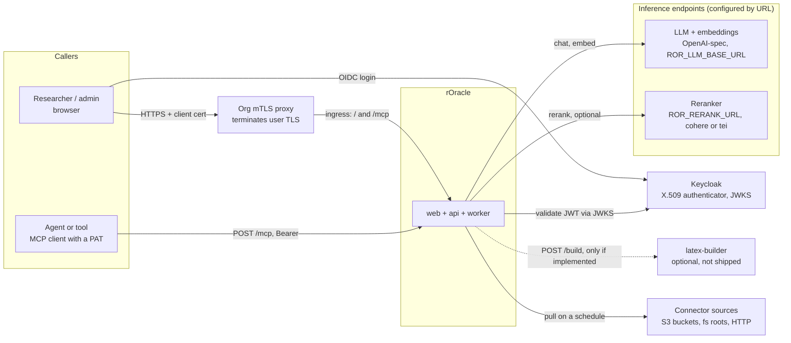
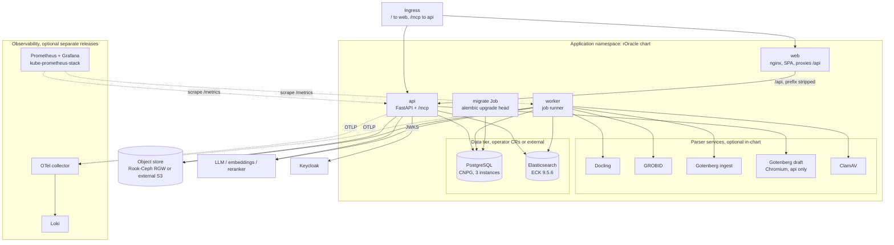
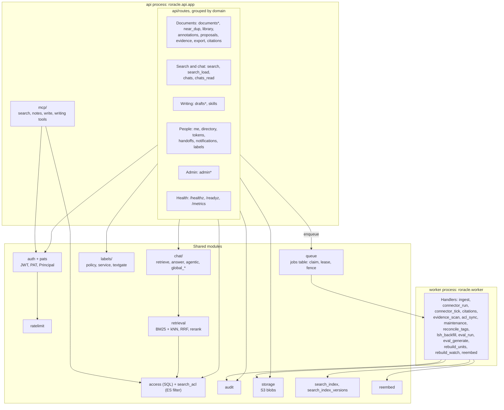

# Architecture overview

How rOracle is put together, from the outside in: who talks to it (context), what runs (containers), and how
the backend is organised (components). Terms are in the [glossary](../glossary.md). Settings are in the
[settings reference](../reference/settings.md); the ADR index is [adr/README.md](../adr/README.md).

rOracle is one Python backend image started three ways (`roracle api`, `roracle worker`, `roracle migrate`,
see [ADR-0009](../adr/0009-one-backend-codebase.md)), plus a static web image. PostgreSQL is the system of
record; Elasticsearch is a rebuildable index ([ADR-0001](../adr/0001-system-of-record.md)).

## 1. Context

- Users reach rOracle through the organisation's mTLS proxy. Keycloak turns the proxied client certificate
  into a JWT; rOracle validates JWTs against `ROR_OIDC_JWKS_URL` and accepts no trusted identity headers
  ([ADR-0004](../adr/0004-identity.md), [Keycloak setup](../enterprise/keycloak-setup.md)). The proxy and
  Keycloak are prerequisites, not part of the chart.
- Agents call `POST /mcp` with a bearer token (PAT or OIDC token). The ingress routes `/mcp` and
  `/.well-known/oauth-protected-resource` straight to the api; everything else goes to web.
  See [MCP tools](../reference/mcp-tools.md).
- One OpenAI-spec endpoint (`ROR_LLM_BASE_URL`) serves chat and embeddings; the embedding model name is
  configuration (`ROR_EMBED_MODEL`, [ADR-0006](../adr/0006-embedding-model-config.md)). The reranker is a
  separate URL (`ROR_RERANK_URL`, empty = off) speaking either the Cohere/vLLM or the TEI wire format
  (`ROR_RERANK_API`). The server behind each URL (vLLM, Ollama, TEI) is the site's choice; the optional
  Terraform `inference` module deploys vLLM-style servers.
- `ROR_LATEX_BUILDER` accepts only `disabled`, so `latex` drafts return 501 today; the service contract is in
  [latex-builder](../enterprise/latex-builder.md).
- Connectors pull from `s3`, `fs` or `http` sources; `fs` is limited to `ROR_CONNECTOR_FS_ROOTS`, `http` to
  `ROR_CONNECTOR_HTTP_ALLOW_CIDRS`.

## 2. Containers

- `web` is nginx serving the built SPA. It proxies `/api/` to the api with the prefix stripped and returns 404
  for `/api/metrics` and `/api/readyz`, so metrics are never public.
- `api` runs `python -m roracle api` and mounts the MCP endpoint at exactly `POST /mcp`. `worker` runs the
  Postgres-backed job queue ([ADR-0003](../adr/0003-postgres-job-queue.md)); it is the only caller of the
  ingest parsers and ClamAV. The `migrate` Job runs `python -m roracle migrate`.
- Draft PDF builds use a separate Chromium-enabled Gotenberg that only the api calls, so attacker-influenced
  HTML never reaches the ingest instance ([ADR-0011](../adr/0011-paper-writing.md)).
- Postgres and Elasticsearch can each be switched to `external`; nothing is rendered then. The object store is
  never bundled: set `ROR_S3_ENDPOINT` to Rook-Ceph RGW (Terraform `ceph` module) or any S3.
- The observability stack and the inference servers are optional and installed outside the chart (Terraform
  `operators` and `inference` modules, or `deploy/observability`). The chart only adds scrape annotations, an
  optional Grafana dashboard ConfigMap and OTel environment variables.

### Container map

Images come from `deploy/helm/roracle/values.yaml`; a tag of `""` means the chart `appVersion`. ADRs explain why.

| Container | Image | Helm template | ADR |
|---|---|---|---|
| web | `roracle/web` | `templates/web.yaml` | [0012](../adr/0012-frontend.md) |
| api | `roracle/backend` | `templates/api.yaml`, `hpa.yaml`, `pdb.yaml` | [0009](../adr/0009-one-backend-codebase.md), [0004](../adr/0004-identity.md) |
| worker | `roracle/backend` | `templates/worker.yaml` | [0003](../adr/0003-postgres-job-queue.md), [0005](../adr/0005-ingestion-pipeline.md) |
| migrate Job | `roracle/backend` | `templates/migrate-job.yaml` | [0009](../adr/0009-one-backend-codebase.md) |
| PostgreSQL | `ghcr.io/cloudnative-pg/postgresql:16.6` | `templates/data-postgres.yaml` | [0001](../adr/0001-system-of-record.md) |
| Elasticsearch | `docker.elastic.co/elasticsearch/elasticsearch:9.5.6` | `templates/data-elasticsearch.yaml`, `es-snapshot-job.yaml` | [0002](../adr/0002-elastic-basic-app-acl.md), [0007](../adr/0007-retrieval.md) |
| Object store | Rook-Ceph RGW or external S3 | none (Terraform `modules/ceph`) | [0016](../adr/0016-terraform-iac.md) |
| ClamAV | `clamav/clamav:1.4` | `templates/parsers.yaml` | [0005](../adr/0005-ingestion-pipeline.md) |
| Gotenberg (ingest) | `gotenberg/gotenberg:8.20.1` | `templates/parsers.yaml` | [0005](../adr/0005-ingestion-pipeline.md) |
| Gotenberg (draft) | `gotenberg/gotenberg:8.20.1` | `templates/parsers.yaml` | [0011](../adr/0011-paper-writing.md) |
| Docling | `quay.io/docling-project/docling-serve-cpu:v1.38.2` | `templates/parsers.yaml` | [0005](../adr/0005-ingestion-pipeline.md) |
| GROBID | `lfoppiano/grobid:0.8.1` | `templates/parsers.yaml` | [0005](../adr/0005-ingestion-pipeline.md) |
| Inference (LLM, embeddings, reranker) | site-chosen; optional vLLM-style image | none (Terraform `modules/inference`) | [0006](../adr/0006-embedding-model-config.md), [0015](../adr/0015-retrieval-quality.md) |
| Observability | kube-prometheus-stack, Loki, OTel collector charts | `templates/grafana-dashboard.yaml` | [0016](../adr/0016-terraform-iac.md) |

All chart settings are in the Helm values reference; network isolation (default-deny policies, parsers
without egress) is in `templates/networkpolicy.yaml` and `networkpolicy-data.yaml`.

## 3. Components of api and worker

Both processes load the same package (`backend/src/roracle`). The api exposes routes and the MCP server; the
worker registers one handler per job kind.

| Component | Role | Code |
|---|---|---|
| Route modules | HTTP surface, grouped by domain; each module owns its authorisation checks | `api/routes/` (registered in `api/app.py`) |
| `mcp/` | Stateless JSON MCP at `POST /mcp`, bearer-only; tool modules for search, notes, write and writing | `mcp/server.py`, `mcp/auth.py`, `mcp/tools_*.py` |
| `auth`, `pats` | Validates RS256 JWTs against JWKS, resolves a `Principal`, applies the rate limit | `auth.py`, `pats.py` |
| `ratelimit` | Per-principal limit per replica; `ROR_RATE_LIMIT_PER_MINUTE`, 0 = off | `ratelimit.py` |
| `access`, `search_acl` | Same visibility rule twice: SQL (`visible_documents`) and the Elasticsearch filter (`acl_filter`), the latter adding the `block_agents` gate for PAT callers | `access.py`, `search_acl.py` |
| `retrieval` | BM25 + kNN fused app-side, optional rerank, per-document grouping; ACL and `is_latest` always in filter context | `retrieval.py` |
| `chat/` | Chat retrieval, answer generation, agentic planner, global (corpus-wide) answers | `chat/` |
| `labels/` | Sensitivity label policy, gates and text gate | `labels/` |
| `queue` | Postgres job table: claim with lease, heartbeat, fencing token, requeue of expired leases | `queue.py` |
| `reembed` | Re-embed into a new index generation and cut over | `reembed.py` |
| `search_index_versions` | Demotes and deletes chunks of older document versions in the index | `search_index_versions.py` |
| `storage` | S3 blob store, streamed staging of uploads | `storage.py` |
| `audit` | Writes audit events | `audit.py` |
| worker handlers | One per job kind, registered at startup | `worker.py` (`build_handlers`) |

Access control, retrieval and the job queue each get their own page in this section (see the
[section index](README.md)).
