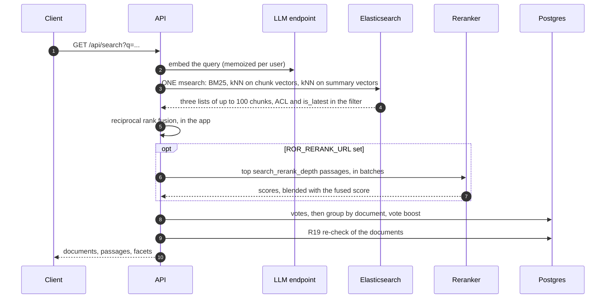
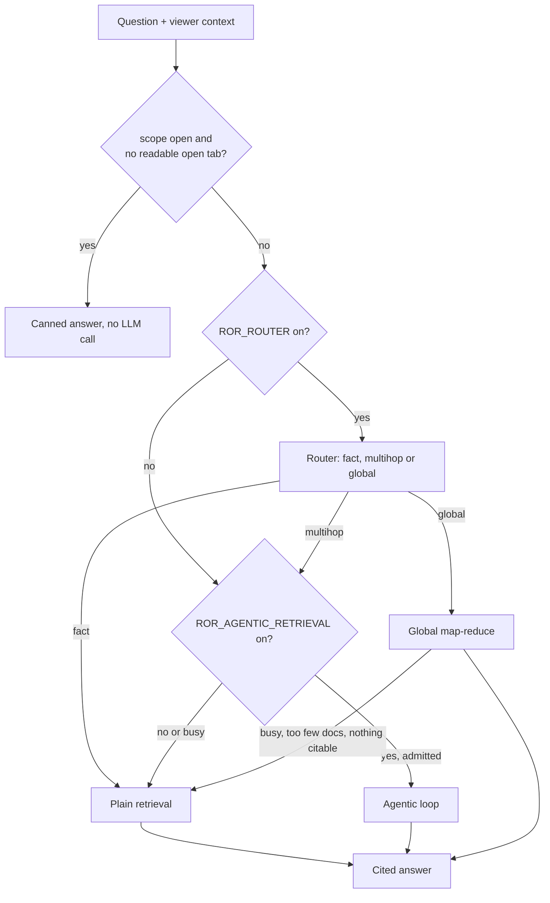
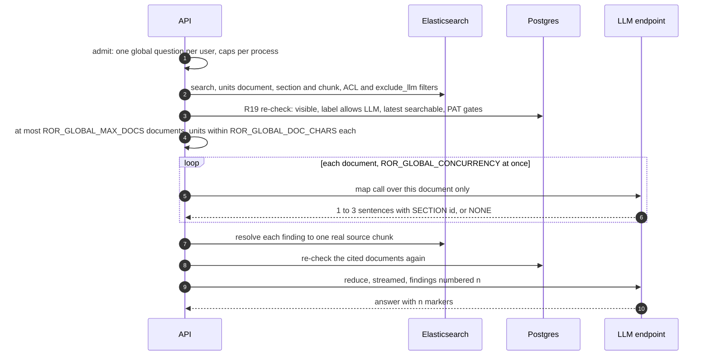
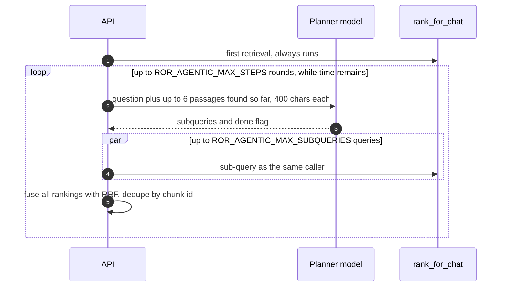
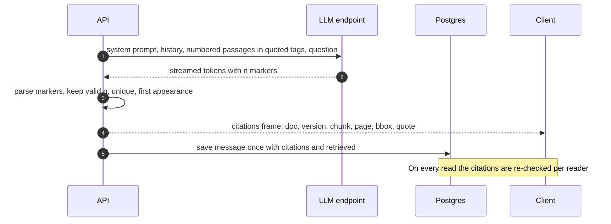

# Retrieval and chat data flow

How a query turns into ranked documents (library search) and into a cited answer (chat and MCP `ask`). Terms
are in the [glossary](../glossary.md). Defaults and ranges are in the [settings reference](../reference/settings.md);
this page names a default only where it explains the behaviour. Many of these knobs can be changed at runtime
by an admin, so the effective value can differ from `config.py`. How the index is filled is in
[Ingest data flow](ingest.md).

Two rules hold on every path:

- **Elasticsearch hits are candidates, Postgres is the authority.** The ACL filter runs inside Elasticsearch
  before ranking (never as a post-filter), and every result is then re-checked in Postgres (the
  [R19 re-check](../glossary.md)).
- **Every LLM-bound path sets `exclude_llm`.** Chat, MCP `ask`, global answers and the agentic loop pass
  `exclude_llm=True`, which keeps chunks of `exclude_llm` labels out of the query itself.

## 1. Library search

`GET /api/search` has two modes. `mode=quick` is a palette search: one ACL-filtered BM25 on titles (no
embedding, no kNN, no rerank), collapsed to one hit per document, at most 10 documents, followed by the R19
re-check. The default `mode=full` is the hybrid pipeline below.

### First stage

- **Filters.** Every sub-search carries the caller's ACL filter and `is_latest: true` in filter context.
  kNN uses its `filter` parameter, so the ACL holds before the nearest neighbours are chosen. PAT callers also
  get gate (b): chunks whose label has `block_agents` are excluded, admins included.
- **BM25.** A `multi_match` over `text` (weight 1), `title` (2), `headings` and `context` (the contextual
  note). Summary units, if present, are demoted by a factor of 0.6 so one document cannot crowd the list.
- **kNN.** On `embedding` with `k` equal to the list size (100 for search) and `num_candidates` of four times
  that. `ROR_SEARCH_MIN_SIMILARITY` (default 0.35) is the cosine floor; 0 disables it. The index uses
  `int8_hnsw` by default. `ROR_VECTOR_INDEX_TYPE=bbq_hnsw` selects BBQ binary quantization, which rescores the
  top `ROR_VECTOR_RESCORE_OVERSAMPLE` times `k` candidates with the float vectors (default 3.0). BBQ is meant
  to be switched on only after an eval gate. The type is applied when an index is created.
- **Summary kNN.** A third list on the document summary vector, used by library search only. Only chunk 0
  carries that vector, so a hit means "this document" rather than "this passage". Chat does not use it.
- **One round trip.** The three searches go out in one `_msearch`. A failure of the BM25 or chunk kNN search
  fails the request. An index that predates the summary vector skips the third list.

### Fusion, rerank and vote boost

1. **RRF.** Reciprocal rank fusion runs in the application: each chunk scores the sum of `1 / (60 + rank)`
   over the lists it appears in (`k` = 60).
2. **Cross-encoder rerank**, only when `ROR_RERANK_URL` is set (the default is empty, so it is off).
   - Depth: the first `ROR_SEARCH_RERANK_DEPTH` (default 50) passages for `/search`; chat and MCP use
     `ROR_RERANK_DEPTH` (default 200). The rest keep their fused order after the reranked head.
   - Text sent per passage: the title, a newline, then the passage cut to `ROR_RERANK_MAX_CHARS`
     (default 2000) characters.
   - Requests carry at most `ROR_RERANK_MAX_BATCH` texts (default 256) under one wall-clock budget
     `ROR_RERANK_TIMEOUT_S` (default 3.0). Wire format is `ROR_RERANK_API`: `cohere` or `tei`.
   - The final order uses `blend * minmax(rerank) + (1 - blend) * minmax(fused)` with `ROR_RERANK_BLEND`
     (default 0.3; 1.0 replaces the fused score). The head then keeps the original sorted score values, so
     later score sorts do not undo the order.
   - A timeout, an HTTP error or a malformed answer keeps the fused order and increments
     `roracle_rerank_fallback_total` with reason `timeout`, `http` or `malformed`.
3. **Group by document, then vote boost.** Passages are grouped per document. The document score is the best
   passage score times a vote multiplier, and the two best passages are kept for display. With
   `ratio = (up + 1) / (up + down + 2)`, the multiplier is `1 + 0.15 * clamp((ratio - 0.5) * 2, -1, 1)`. It
   stays inside plus or minus 15 percent, and a document with no votes gets exactly 1.0. Only library search
   applies the boost; chat ranks passages without it.
4. **R19.** Postgres loads the documents the caller may see whose latest version is `searchable`. A document
   is dropped when it is not visible. Passages from a version that is no longer the latest searchable one are
   dropped, and the document stays if it has live passages (a newer version can become latest after the first
   stage ran). The first stage is cached per principal for `ROR_SEARCH_CACHE_S` (default 60) so paging and facet
   clicks make no Elasticsearch call, but the Postgres re-check runs on every request. The cache key contains
   the label policy and the rerank and similarity settings, so a relabel is a cache miss.

At most 200 documents are kept. Sorts are `relevance`, `newest`, `votes` and `title`; `size` is 1 to 50.

### Facets come from the results only

Facet counts are computed from the documents of the (re-checked) result set, never from the whole corpus. The
facets are `tags`, `year`, `file_type`, `org_unit`, `collection`, `author` and `label`, each limited to its top
50 values. They are disjunctive: each facet counts the match set filtered by every other facet's selection but
not its own. When facet filters are active, a second pass runs the same query without the filters to build the
universe. That pass is "light": ids only, no text, and never reranked. A `collection` facet only lists the
caller's own collections. Because the universe goes through the same ACL filter and R19 re-check, a facet never
reveals a value from a document the caller cannot see.

An empty query does not use Elasticsearch: it browses the caller's visible documents in Postgres, newest first,
with a keyset cursor.

## 2. Chat

`POST /api/chats/{chat_id}/messages` streams server-sent events. The caller must own the chat. MCP `ask`
calls the same retrieval and routing functions.

The router and agentic mode are both **off by default** (`ROR_ROUTER` false, `ROR_AGENTIC_RETRIEVAL` false).
Both are runtime-overridable settings. Out of the box every question takes the plain retrieval path.

### Query router

The router classifies a question as `fact`, `multihop` or `global` (`chat/router.py`).

- A compiled-regex heuristic runs first, with no I/O. A singular target ("this paper", "the study", an
  author-year, a quoted title of four or more words) vetoes `global`. Otherwise cues such as "main themes",
  "across all papers" or "summarize everything" give `global`, and cues such as "compare", "difference
  between" or "and then" give `multihop`. A question under 8 words is `fact`.
- A question the heuristic cannot place goes to a small-model call only if `ROR_ROUTER_LLM` is true (default
  false). The call uses `ROR_ROUTER_MODEL` (empty means the summary model), `max_tokens` 24 and a timeout of
  `ROR_ROUTER_TIMEOUT_S` (1.5 s). Without it, or on any error, timeout or invalid JSON, the answer is `fact`.
  The prompt contains the question only, no document text.
- A global sweep is only eligible when the chat scope is `all` and there are no open tabs and no selection.
  Otherwise the route is `fact`.
- When the router is on, the first SSE `meta` frame reports the route actually taken.

### Global answers (map-reduce)

A global answer maps over per-document units, then reduces the findings into one answer. No stored artefact
ever mixes documents ([ADR-0015](../adr/0015-retrieval-quality.md)): each map call sees one document only.

- **Candidates.** The search uses `ROR_CHAT_CANDIDATES` (default 200) per list. Chat's excluded and ignored
  documents are removed, pinned documents come first. If fewer than 3 documents survive, the turn takes the
  fact path. The units are summaries when RAPTOR has produced them (they sort first), then real chunks.
  Without RAPTOR the units are just chunks.
- **Fan-out and admission caps.**
  - `ROR_GLOBAL_MAX_DOCS` (default 40) documents mapped per question.
  - `ROR_GLOBAL_CONCURRENCY` (default 8) map calls in flight for one question.
  - `ROR_GLOBAL_MAX_CONCURRENT` (default 16) map calls in flight in the whole process, all users.
  - `ROR_GLOBAL_MAX_ADMITTED` (default 4) global questions admitted per process at once.
  - One global question per user at a time. Nothing queues: a busy turn takes the fact path and the meta
    frame carries `global.skipped: busy`.
- **Budgets.** `ROR_GLOBAL_TIMEOUT_S` (default 90) for the whole map phase, `ROR_GLOBAL_CALL_TIMEOUT_S`
  (default 20) per map call (also bounded by the time left), `ROR_GLOBAL_DOC_CHARS` (6000) of one document's
  text per call, `ROR_GLOBAL_MAP_TOKENS` (200) per map note and `ROR_GLOBAL_REDUCE_TOKENS` (1200) for the
  streamed reduce. The map model is the summary model. MCP `ask` is bounded by
  `ROR_GLOBAL_MCP_BUDGET_S` (default 45) because clients time out near 60 s.
- **Honest outcomes.** The result counts answered, NONE, failed, skipped and timed-out documents. "None of the
  N most relevant documents you can access address this question" is only claimed when every document really
  answered NONE. If calls failed, timed out or were skipped, or no finding is citable, the turn falls back to
  the fact path, and the meta frame reports `global.fallback` as `error`, `timeout`, `busy` or `unresolved`.
- **Citations.** A finding is resolved to one real chunk: the unit the model named, else that summary unit's
  best source chunk, else the document's best-ranked chunk. A finding whose source cannot be resolved or fails
  the Postgres re-check is dropped, so every `[n]` is citable and no `[n]` points at generated text.

### Agentic retrieval

Agentic mode decomposes a question into sub-queries, retrieves each, and fuses the results.

**State: off by default.** The setting is `ROR_AGENTIC_RETRIEVAL` (default `false`, also an admin runtime
override). It is eval-gated: the default only flips after a PASS in the eval report
[2026-11-17-agentic](../eval/2026-11-17-agentic.md), which is PENDING (no recorded numbers).

When enabled it applies to `multihop` questions if the router is on, and to every eligible question if the
router is off. A user in a busy process takes the plain path.

- **Planner.** `ROR_AGENTIC_PLANNER_MODEL` (empty means the first chat model, which is slower; a small fast
  model is recommended). Its latency is the per-round budget. Each call has `max_tokens` 120 and a timeout of
  `min(ROR_AGENTIC_CALL_TIMEOUT_S (1.5), time left)`. An error, a timeout or invalid JSON ends the loop with
  what was found. The prompt holds the question and passages that already passed the gates, quoted as data.
- **Budgets.** Up to `ROR_AGENTIC_MAX_STEPS` planner rounds (default 3) after the first retrieval, up to
  `ROR_AGENTIC_MAX_SUBQUERIES` sub-queries per round (default 4), and a deadline of `ROR_AGENTIC_TIMEOUT_S`
  (default 30) for the loop. A round does not start with less than 1 second left. The first retrieval always
  completes.
- **Concurrency.** Sub-queries of a round run in parallel on their own sessions, at most
  `ROR_AGENTIC_MAX_PARALLEL` (default 4) in flight in the process. At most `ROR_AGENTIC_MAX_ADMITTED` loops
  (default 4) run per process and one per user. The loop holds no database connection while the planner runs.
- **Safety.** Every sub-query goes through the same `rank_for_chat`, so the ACL filter, `exclude_llm`, the
  PAT `block_agents` gate and the Postgres re-check hold for each of them.
- **MCP `ask`.** The loop deadline is the smaller of `ROR_AGENTIC_TIMEOUT_S` and the global MCP budget minus
  `ROR_AGENTIC_ANSWER_RESERVE_S` (default 20), so time is kept for the answer.

### Reader-aware context

Chat retrieval is shaped by what the reader has open (`chat/retrieve.py`).

| Input | Effect |
|---|---|
| `scope` | `all`, `open` (only the open tabs' documents) or `collection:<id>` (the caller's own collection). |
| Open tabs (at most 3) | Unless the scope is `open`, a second search inside the tab documents (20 candidates) only adds chunks the main search missed, scaled so it cannot outrank the main results. Tab documents are boosted by 1.5, and by 2.0 for passages on an open page. |
| Selection (text up to 4000 chars) | Inserted first as a passage with the top score, cut to 1200 characters, labelled "Selected passage". |
| Pins | Each pinned document's best passage is forced into the top k, evicting the lowest unpinned one. |
| Excludes and ignored (up to 100) | Those documents are dropped from retrieval. |

Other limits:

- The candidate depth per list is `ROR_CHAT_CANDIDATES` (default 200, 20 to 500) with a kNN floor
  `ROR_CHAT_MIN_SIMILARITY` (0.35). Chat uses no summary kNN and no vote boost.
- The prompt gets `ROR_CHAT_PASSAGES` passages (default 8, clamped to 4 to 12), each cut to 1200 characters.
  The last 6 messages are replayed as history.
- Postgres decides what survives (R19): a passage is kept only when its document is visible, its label allows
  the LLM, and its version is the document's latest `searchable` one.
- With RAPTOR on, chat also retrieves summary units and then expands them into their real source chunks
  before use (at most 24 units, 2 chunks per unit by default), so a summary is never shown or cited.
- Community notes of the documents in the answer are appended as untrusted context, not counted in the k
  passages and never numbered. Another user's note reaches the LLM only with at least
  `ROR_CHAT_NOTE_MIN_UPVOTES` upvotes (default 3) and a ratio above `ROR_CHAT_NOTE_MIN_RATIO` (default 0.6).
- With `scope=open` and no open tab the reader can see (or whose label blocks the LLM), the answer is a
  canned message with no LLM call.
- Tabs, pins and the selection dropped because their label has `exclude_llm` are listed in the `meta` frame as
  `excluded_by_label`, so the UI can tell the reader why.

## 3. Citation resolution

- Passages are numbered `[n]` with their title and page. The text sits inside quoted tags where `</` and the
  tags the prompt uses are neutralized, so a document cannot close a tag or fake a passage. The system prompt
  tells the model to cite every claim and to say so when the passages do not contain the answer.
- The parser accepts `[2]`, `[2, 3]` and `[2][3]`. A marker outside 1 to N is ignored. A citation item carries
  `doc_id`, `version_id` and the version number, `chunk_id` (null for a selection), `page`, a `bbox` and a
  300-character quote. The assistant message is saved exactly once, as `complete`, `failed` or `interrupted`.
- **Re-check on read.** Opening a chat checks every cited and retrieved item for the reader. An item stays
  available when its document is visible to the reader and its version is not `rejected` or `cancelled`. A
  non-owner non-admin also needs the version to be `searchable`. **Older versions of a visible document are
  allowed**, so a citation to version 1 still opens after version 2 became latest. An item that fails the check
  appears as `{"n": ..., "available": false}` in `citations`, and is dropped from `retrieved`. A cited
  community note also needs to be readable.
- **Shared chats.** A reader of a shared chat sees only the citations they may open, with the same rule.
- **PAT callers.** Text derived from a gated document is withheld (see the next section).
- **Replay.** History sent back to the LLM drops assistant turns, and the user turn before each, whose sources
  now carry `exclude_llm` (for everyone) or `block_agents` (for a PAT caller), so a stale answer cannot feed the
  model again.

## 4. `exclude_llm` handling end to end

`exclude_llm` is gate (a). It keeps document text away from any LLM for every caller and withholds text from
PAT callers. The gate resolves from the label at the time of use, so a later relabel takes effect.

| Where | Behavior |
|---|---|
| Ingest summary | Skipped, the summary is empty. |
| Ingest contextual notes | Label re-read before every batch. A raise stops further calls, and chunks fall back to their heading path. |
| Ingest RAPTOR | No units and no LLM call. |
| Ingest embeddings | Chunks are still embedded and indexed. The embedding model returns vectors only (see the ruling in [security](../enterprise/security.md)). |
| Chat, MCP `ask`, global, agentic | The query adds `must_not label_id in exclude_llm labels`, then Postgres re-checks with the current label, because the label in Elasticsearch can lag a raise. |
| Library search (humans) | Not filtered: a human who may read the document finds it. |
| Library search (PAT) | The hit keeps its metadata and label, passages are removed and `withheld` carries the label name. Raw layout or bytes of the document return 403. |
| Chat read and replay | Text derived from the document is stripped for PAT callers. Replay into an LLM drops it for everyone. |

`block_agents` (gate (b)) is stricter for agents: for a PAT caller the document is invisible everywhere, admins
included (`visible_documents` and the Elasticsearch ACL filter both add it).

**Ruling: the reranker may score `exclude_llm` passages.** The cross-encoder reranker is non-generative and only
returns scores, like the embedding model, so the gate does not treat it as an LLM. In practice the reranker
sees `exclude_llm` text only on paths that do not set `exclude_llm`, mainly library search, where the human
caller can already read the document. Library search by PAT callers also reranks `exclude_llm` text, because
the passages are withheld only after ranking. Chat and MCP `ask` filter `exclude_llm` chunks out before the
rerank step, so the reranker does not receive them there, except in the short window before a label raise has
synced to Elasticsearch (the filter uses the chunk's stored label id). The Postgres re-check (`_live`, which
applies the current label) then drops the passage before any LLM sees it.
Elasticsearch ACL filters always run before reranking, so it never receives text the caller may not see. Keep
the reranker endpoint inside the same trust boundary as the API (see [security](../enterprise/security.md)).
