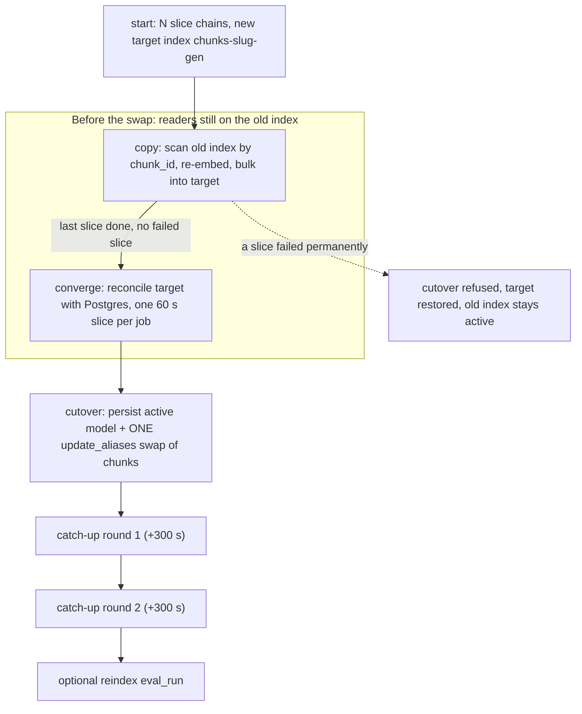

# Search index lifecycle

How the Elasticsearch chunk index is named, switched, rebuilt and cleaned up. Terms are in the
[glossary](../glossary.md); the Elasticsearch settings are in the [settings reference](../reference/settings.md)
and the sizing and vector-type guidance is in [capacity planning](../enterprise/capacity-planning.md).
Searching the index is in [Retrieval and chat](retrieval-chat.md), and the jobs that do the work are in
[Jobs and queue](jobs-queue.md).

## 1. One index per embedding model, behind two aliases

Chunks (and the per-document summary units) live in indices named `chunks-<model-slug>-<generation>`, where the
slug is the lowercased embedding model name with non-alphanumerics collapsed to `-` (`search_index.index_name`).
The first generation of a model is `-1`.

| Name | Points at | Used for |
|---|---|---|
| `chunks` (`ROR_READ_ALIAS`) | **Exactly one** index, the active one | kNN and BM25 reads. A search never sees two generations. |
| `chunks-all` (`ROR_MUTATE_ALIAS`) | **Every** live generation and shadow | All writes that must reach every copy: ACL and tag syncs, deletes, `is_latest` flips. |

The two alias names must be overridden together or not at all (a split would let reads and ACL updates hit
different indices and leave revoked shares visible). The default is also what the Helm chart uses.

The **active index** is not derived from environment alone. A cutover persists the active model, dimensions and
index name in Postgres (`runtime.set_active_embedding`, the `embed_index` runtime setting), and
`runtime.effective` layers that over the environment defaults. Ingest and chat therefore follow a cutover without a
restart, and a stale worker can not move the read alias back: `ensure_index` only repoints `chunks` when the name
is the Postgres-persisted active index, read under an advisory lock (`reembed-alias`) that the cutover also holds.

`ensure_index` runs at worker start and before ingest (memoized for 30 s per process). It creates a missing index
with explicit mappings and settings, adds it to `chunks-all`, adds mapping fields introduced later, and raises a
non-retryable error when the stored vector dimension differs from the configured one ("reindex required"). A
pre-alias deployment that has a concrete index literally called `chunks` is adopted: its documents are
reindexed into the named index and the aliases are added in one atomic `update_aliases`.

Index settings apply **when an index is created**: shards (`ROR_ES_SHARDS`, 1), replicas (`ROR_ES_REPLICAS`, 1),
refresh interval (`ROR_ES_REFRESH_INTERVAL`, `5s`), `ROR_VECTOR_INDEX_TYPE` (default `int8_hnsw`, always written
explicitly because Elasticsearch 9.1+ would otherwise choose `bbq_hnsw` for 384 or more dimensions),
`ROR_ES_EXCLUDE_SOURCE_VECTORS` and the filtered-kNN heuristic. An existing index keeps its own; only the
`hnsw_filter_heuristic` dynamic setting is re-applied to the active index at the next `ensure_index`.

### What `search_index_versions.py` is

Despite its name it is not a table of generations. `search_index_versions.py` holds the **document-version**
mutations of the chunk index: `delete_stale_chunks` and `delete_stale_units` prune what a re-run of the same
version no longer produces, `mark_previous_versions` flags every chunk of older versions as not latest, and
`demote_version` does the same for one version that was superseded while it was being indexed. Everything goes
through `chunks-all` and uses `conflicts: proceed`. Generations exist only as index names plus the active-index
setting above.

## 2. Embedding-model switch: re-embed

An admin starts a switch with `POST /api/admin/reindex` (`model`, `dims`); `GET /api/admin/reindex` reports
progress. `reembed.start` takes an advisory lock, refuses with 409 when a re-embed or a rebuild is queued or
running, and enqueues one `reembed` job per **slice** (`ROR_REEMBED_SLICES`, 4, range 1 to 16). The target is the
next generation number of that model across `chunks-all` plus the active index. A slice is a range of the first
hex digit of `chunk_id`, so slices are independent job chains.

**Copy.** Each job pages 1000 chunks (`BATCH`) from the active index by `chunk_id` (`search_after`), re-embeds
them (chunk prompt, document-summary prompt, with contextual notes copied from the source and never regenerated),
and bulk-writes them to the target with `refresh=false`. The target is created inside `chunks-all` so concurrent
ACL syncs and deletes reach it. During the copy it refreshes every 30 s instead of the configured interval, and
keeps its replicas. ACL, tags and title are **read from Postgres after the Elasticsearch read** and never copied
from the source. Deleted documents and purged versions are skipped. After each page `_verify` re-checks the batch
against Postgres and the source and corrects deletes, ACL or tag changes, stale chunks and `is_latest` that raced
the copy.

**Converge** (`reembed_converge.converge_step`). Mutations only reach refreshed chunks, so right before the swap
the target is made to agree with Postgres in five stages, each a keyset scan in batches of 500: `drift` (ACL, tags
and title by `acl_hash`, repaired with `sync_acl_many`), `deleted` (target chunks of every soft-deleted document),
`superseded` (chunks still `is_latest` whose version is not latest), `orphan_docs` and `orphan_versions` (ids with no
Postgres row, from a purge that raced the copy). A converge job works for at most 60 s and then enqueues its
continuation with a checkpoint (`stage`, `after`), so a worker restart loses at most one slice of work. This runs
**before** the alias swap, so readers never move onto an index that disagrees with Postgres about access.

**Cutover.** The last copy slice enqueues `converge`, and `converge` enqueues `cutover`. Cutover first clears the
derived summary-embedding cache when the model changed, then under the alias advisory lock persists the new active
model and index and performs **one** `update_aliases` that moves `chunks` from the old index to the target. This is
the last Elasticsearch step and is idempotent if a crash forces a re-run. The old index stays in `chunks-all`, so
mutations keep reaching it and an operator can still roll back by hand until it is deleted.

**Catch-up.** After the swap, two rounds 300 s apart copy chunks that exist in the old index but not in the
target (ingests that raced the cutover). A catch-up that finds the read alias no longer on the
target fails loudly instead of copying blindly. The last round of the last slice enqueues a reindex `eval_run` when
`eval_on_reindex` is on and a reference eval set exists.

`reconcile_tags` is also enqueued at the end of each pass and at cutover, so ACL and tags of every document are
re-verified against Postgres once more.

**Failure.** If a copy slice fails permanently (after retries), the pass is marked failed: cutover is refused,
the abandoned target gets its normal refresh interval back, and `GET /api/admin/reindex` shows the failed slices
under `failed`. Starting a new re-embed retries from scratch with a new generation number.

## 3. Rebuilding derived fields: `roracle rebuild`

`roracle rebuild --what context[,raptor] [--into NAME]` (or `POST /api/admin/retrieval/rebuild`) re-runs the index
step for every latest `searchable`, non-deleted version, reading the parsed document from storage
(`derived/<version_id>/docling.json`). It enqueues `rebuild_units` jobs of 25 versions each, in id order, plus one
`rebuild_watch`. Exit code 0 means enqueued, 2 means refused. It refuses while a re-embed is running, and
`--what context` needs `ROR_CONTEXT_MODEL`.

- **In place** (no `--into`, or the active index): a `raptor`-only rebuild rewrites the summary units and leaves
  chunks and vectors alone; anything including `context` rewrites the chunks.
- **Shadow** (`--into chunks-<slug>-shadow`): writes into a new index that joins `chunks-all`, so ACL syncs and
  deletes reach it, but never the read alias. Live search is untouched. The name must match `chunks-<slug>`, and
  names of re-embed generations (`chunks-<slug>-<n>`), the active index and the read-alias holder are refused. A
  shadow is judged by an explicit eval comparison, not an automatic one.
- `rebuild_watch` polls every 60 s; when no `rebuild_units` job of its batch is queued or running and the target
  was the active index, it starts the reindex eval (if enabled and a reference set exists).
- One broken version does not discard the other 24 in a job: it is skipped, and the job fails at the end with a
  count so the rest is not repeated needlessly.

## 4. Deleting old generations and shadows

- `DELETE /api/admin/reindex/old` removes every index in `chunks-all` except the active one (`reembed.drop_old`).
  It answers 409 while a re-embed is running, **409 while a rebuild is queued or running**, and 409 unless the read
  alias points at exactly the active index (otherwise "old" could be the live index). The rebuild check matters
  because the call also deletes shadows, and the next bulk write to a deleted shadow would auto-create an
  unmanaged index.
- `roracle rebuild --drop NAME` (`rebuild.drop_shadow`) deletes one shadow. It refuses the active index, the
  read-alias holder, re-embed generations (use the call above), anything outside `chunks-all`, and any moment a
  rebuild or re-embed job is queued or running.

Dropping a shadow mid-rebuild is also guarded on the write side: a rebuild into a shadow that no longer exists
raises a non-retryable error instead of re-creating it.

## 5. Search cache

`/api/search` caches only the **first stage** (Elasticsearch results) for paging and facet clicks:

- Per process, so two replicas can serve page 1 and page 2 from different snapshots. At most 64 entries, each
  keeping full text for the best 2 passages per document and bare stubs for the rest (about 40 MB worst case per
  worker). TTL is `ROR_SEARCH_CACHE_S` (default 60; 0 turns it off).
- The key includes the principal (user, groups, `via`, admin flag, never shared across principals), the query,
  filters and collection scope, the **label policy** (a relabel or gate change is a miss), the active index (a
  cutover is a miss) and the rerank and similarity settings.
- The Postgres visibility re-check ([R19](access-control.md)) runs on every request, cached or not. The cache key
  does not include document ACL changes, so a **newly granted** document may not appear until the entry expires,
  while a revoked one is dropped by the re-check at once.

## 6. Elasticsearch 8.15 to 9.5.6

The chart default is Elasticsearch **9.5.6** (`elasticsearch.version`), the Python client is 9.x
(`elasticsearch>=9.0,<10`), and an external Elasticsearch must be 9.x because the client sends
`compatible-with=9` and the new index settings are 9.x-only. What the code and chart support:

- **Existing 8.x cluster, in place.** The chart comment states the only supported route: 8.15, then 8.19.x, then
  9.5.x, never straight. It also needs an ECK release whose support matrix lists 9.5. After the hop, 9.x reads the
  indices created on 8.x unchanged; the new creation-time settings (`exclude_source_vectors`, shard count,
  `index_options`) only apply to indices created afterwards, that is by a re-embed or rebuild into a new
  generation. The `hnsw_filter_heuristic` setting is dynamic and `ensure_index` applies it to the active index, so
  existing indices get ACORN filtered kNN without a re-embed. `reembed.start` does not refuse the model that is already active, so a re-embed is also how an index is
  re-created with the new settings.
- **New 9.5.6 cluster.** Provision it empty (the dev compose uses a new `esdata9` volume) and refill it from
  Postgres and object storage. `ensure_active_index` creates the active index and aliases at worker start. The
  parsed documents needed to refill are `derived/<version_id>/docling.json` in the object store.

**Limitation.** No neutral refill command exists. `roracle rebuild --what context` is the only full chunk rewrite
(from `derived/<version_id>/docling.json`). It needs `ROR_CONTEXT_MODEL` and forces contextual notes on for that pass
(`context_notes or "context" in what` in `handle_rebuild_units`), so on a deployment that runs without notes it
changes the chunk text. In-place `--what raptor` writes units only. The ADR-0015 decision of a fresh cluster plus
rebuild also says "no 8.19 hop", while the chart requires the hop for an existing cluster, so do not read the ADR
as describing the chart path.

Step-by-step upgrade procedures belong to the upgrades page (enterprise/upgrades.md, not yet written).
