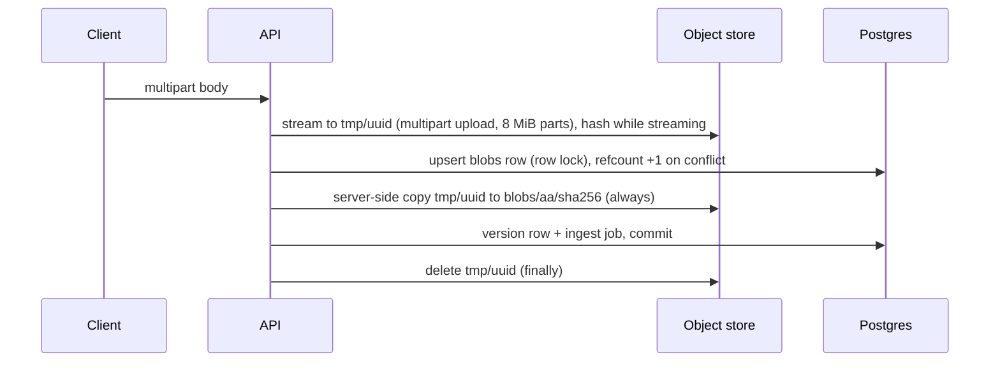
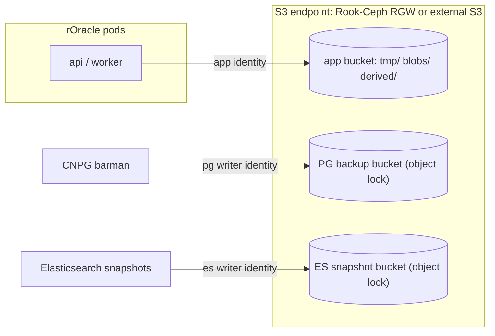

# Storage

Where bytes live and who cleans them up. Terms are in the [glossary](../glossary.md); the dedup decision is in
[ADR-0008](../adr/0008-dedup-versioning.md). Settings are in the [settings reference](../reference/settings.md).
Postgres rows (`blobs`, `document_versions`, `evidence`) record what exists; the object store holds the bytes;
Elasticsearch holds only a searchable projection (see [Search index lifecycle](search-index-lifecycle.md)).

## 1. Object layout

One application bucket (`ROR_S3_BUCKET`, default `roracle`) behind an S3 endpoint (`ROR_S3_ENDPOINT`, required;
path-style addressing, optional CA bundle `ROR_S3_CA_BUNDLE`). The chart has no bundled object store.

| Prefix | Content | Written by | Removed by |
|---|---|---|---|
| `tmp/<uuid>` | In-flight upload, streamed here and hashed on the way | Upload and evidence requests (`TmpUpload`) | The request itself (`abort`), else the bucket lifecycle rule after 1 day |
| `blobs/<sha256[:2]>/<sha256>` | Original files and evidence files, content-addressed | `promote` (server-side copy from `tmp/`) or `put` | Blob GC when nothing references them |
| `derived/<version_id>/` | Parse output and caches: `docling.json`, `rendition.pdf` (Office files), `context-v<N>.json`, `raptor-v<N>.json` | Ingest and rebuild | Retention purge of the document |

**Evidence** files use the same upload path and land in `blobs/` like documents, with `scan_status` `pending` until
an `evidence_scan` job runs ClamAV (`unscanned` when scanning is off). The download route serves only `clean` or
`unscanned` files. **Drafts** are not objects: draft text is stored as rows in Postgres (`draft` versions, capped by
`ROR_DRAFT_MAX_BYTES`, 2 MiB). A **build** (`POST /api/drafts/{doc_id}/build`) returns the PDF in the response and
stores nothing; publishing a draft as a paper goes through the normal upload path and becomes a `blobs/` object.

## 2. Upload path and the dedup rule

- The request body is streamed straight to `tmp/<uuid>`; there is no local spool. Over the size limit
  (`ROR_MAX_UPLOAD_BYTES`, 500 MiB; evidence 1 GiB) it fails with 413, empty is rejected.
- **Dedup lives in the database only.** `promote` copies `tmp/` to the content key **every time**, even when the key
  exists. A `head_object` shortcut would make upload latency an oracle for "does rOracle already hold this file"
  (ADR-0008), so duplicates cost bandwidth by design. The `blobs` row is upserted **before** the copy and takes its
  row lock, which is what makes garbage collection safe (section 3).
- An object written before its commit can be orphaned if the database commit then fails. That is accepted: blob GC
  removes it later.

## 3. Blob refcount and garbage collection

`blobs.refcount` starts at 1 and is incremented when another document version or evidence record is created for the
same content. It is decremented (never below 0) when a document is purged, evidence is deleted, a near-duplicate
version is dropped, or a note with evidence is removed. **GC does not trust the counter.** It deletes by actual
references (`maintenance.gc_blobs`, the `gc` maintenance step):

1. Candidates are `blobs` rows older than 1 day (`GC_MIN_AGE`) that no `document_versions` row and no `evidence` row
   references, up to 500 per run, locked `FOR UPDATE SKIP LOCKED`. An upload that is re-referencing the blob holds
   or needs that row lock, so GC either skips the row or the upload waits.
2. The reference check is **repeated under the lock**, right before touching the object store.
3. The object's `LastModified` must also be older than 1 day, so an object an upload has just re-copied is spared.
   A missing object is simply cleaned up. Then the object is deleted, then the row.

Only `blobs/` rows are candidates. `tmp/` is never listed or touched by GC (the bucket rule handles it), and
`derived/` is removed only by the purge below.

**Retention purge.** `ROR_RETENTION_DELETED_DAYS` (default 0 = never) hard-deletes up to 100 documents per run that
were soft-deleted longer ago than that. For each: the Elasticsearch chunks first (a retry then finds nothing left),
then blob refcounts, shares, versions and the document row (notes, tags, votes and citations cascade), and finally
the `derived/<version_id>/` prefixes. The now-unreferenced originals are then collected by GC after the 1-day grace.
Both steps run in the periodic maintenance job ([Jobs and queue](jobs-queue.md)) or on demand through
`POST /api/admin/maintenance/{op}`.

## 4. The `tmp/` lifecycle rule

Leftovers of crashed uploads and stale multipart uploads must expire, or they bill disk forever. Two layers:

- **The API checks at startup** (`ensure_tmp_lifecycle`, 1 day). It reads the bucket lifecycle and, if no rule with
  prefix `tmp/` exists, adds `roracle-tmp-expire` (expire `tmp/` after 1 day, abort incomplete multipart uploads
  after 1 day), keeping other rules. It is idempotent, short-timeout, and never raises: when the store denies the
  call (typical for external S3 with a restricted key) it logs a warning and the operator must set the rule.
- **Rook-Ceph installs get it from Terraform.** The app bucket's ObjectBucketClaim carries `tmp-expire` (1 day) and
  `abort-multipart` (1 day, whole bucket). The API's check recognises that rule and does nothing.

On external S3 the rule is an operator duty if the app key cannot manage lifecycle. The commands are in the
Terraform README (`deploy/terraform/README.md`, "External S3 commands"). Worker scratch space is separate:
`worker.tmpSize` (default 20Gi) is a pod `emptyDir`, not bucket storage.

## 5. Rook-Ceph RGW or external S3

The Terraform variable `object_store` selects the mode (`external` is the default; `rook-ceph` is the production
example). Both end at the same chart values: `ROR_S3_ENDPOINT`, the bucket names and Secrets.

| | `rook-ceph` | `external` |
|---|---|---|
| Who runs the store | Terraform installs the `rook-ceph` operator and `rook-ceph-cluster` charts (CephObjectStore, RGW). Needs at least 3 nodes with raw disks. | You operate an S3 service. Recommended for small installs, dev and kind. |
| Buckets | Three, by name from `s3.bucket`, `s3.pg_backup_bucket`, `s3.es_snapshot_bucket` (defaults `roracle`, `roracle-pg-backup`, `roracle-es-snapshots`). The app bucket is an ObjectBucketClaim. | Must already exist and be configured by you. |
| Identities | **One per bucket**: the OBC user for the app bucket, plus Rook `CephObjectStoreUser`s `roracle-pg-backup` and `roracle-es-snapshot`, and an admin user that the bucket setup Job runs as. Credentials flow into chart Secrets. | You supply `s3_access_key`/`s3_secret_key` plus separate `s3_pg_backup` and `s3_es_snapshot` identities. |
| TLS | RGW serves TLS only (cert-manager issuer or an existing Secret); `rgw.allow_plain_http` is for test clusters. | Optional private CA through `s3.ca_secret`. |

**Per-bucket users.** While backups are enabled (`backups_enabled`, default on) the apply requires the two backup
writers to have access keys **different from the app key**: the app identity must not be able to write or delete
backups. On Rook, the app identity has no grant on the backup buckets at all.

**Object lock on the backup buckets only.** A setup Job (the backend image, boto3, as the admin object-store user)
creates the PG backup and ES snapshot buckets with S3 object lock, a default retention (`ceph.object_lock`:
mode `GOVERNANCE`, 30 days by default; keep it at or above the chart's backup and snapshot retention), a lifecycle
rule that expires noncurrent versions after `retention + 1` days and aborts multipart uploads after 1 day, and a
bucket policy. The per-bucket writer may get, put, list and delete (a delete marker), and is **denied** version
deletion, governance bypass, retention and lock changes, and lifecycle and policy changes. `GOVERNANCE` lets the
admin bypass for break-glass; `COMPLIANCE` lets nobody shorten retention, so a typo in `retention_days` becomes
permanent storage. The **app bucket has no object lock** because blob GC and purge must be able to delete.

With rook-ceph the backup buckets live in the same Ceph cluster as the data they protect. Replicate them off
cluster (RGW multisite or a scheduled `rclone`) or point `s3.pg_backup_bucket` and `s3.es_snapshot_bucket` at an
external S3 at another site. Backup and restore procedures are in the
[operations runbook](../enterprise/operations-runbook.md).
