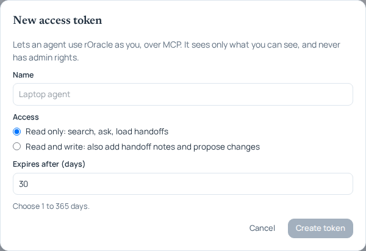
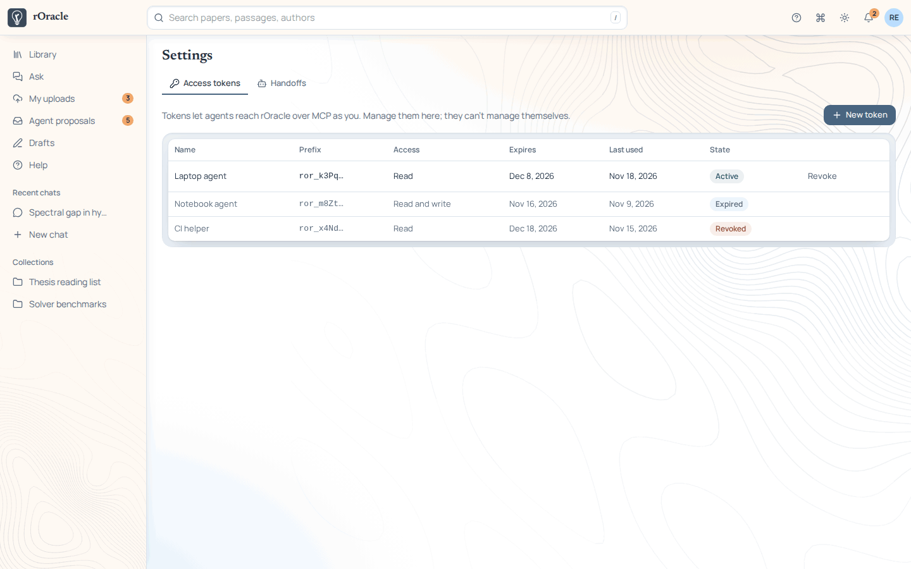

# Agents and tokens

An **agent** here is an AI assistant or script (a coding agent, a notebook, your own program) that uses rOracle for you over MCP, a standard way for agents to call tools. It signs in with an **access token** that you create. The agent acts as you, sees only what you can see, and is held to the same label rules, with a few extra limits below. Terms are in the [glossary](../glossary.md#access).

## Create a token

1. Open the avatar menu, choose **Settings**, and stay on **Access tokens**.
2. Choose **New token**.
3. Fill in:
   - **Name**: 1 to 100 characters, such as "Laptop agent". It identifies the agent in your proposals and in the audit log.
   - **Access**: **Read only** (search, ask, load handoffs) or **Read and write** (also add handoff notes and propose changes).
   - **Expires after (days)**: 1 to 365; the form starts at 30.
4. Choose **Create token**, then copy the token before you close the dialog. You will not see it again: rOracle keeps only a hash. The dialog does not close if you click outside it while the token is showing; only **Done** or `Esc` closes it.

Tokens can be created and revoked only while you are signed in to the web app. A token cannot create, list or revoke tokens, so a leaked token cannot make new ones.



## What each access level allows

| Access | The agent can |
|---|---|
| Read only | Search the library, read papers, passages and notes, list your collections, ask questions, export BibTeX, load handoffs and read their parts |
| Read and write | All of the above, and: upload papers, create handoffs, add notes to handoffs, propose notes, replies and label changes, save drafts, run validation and citation checks on drafts |

The full list of tools, with their access level, is in the [MCP tool reference](../reference/mcp-tools.md). The integration contract is the [MCP guide](../reference/mcp.md).

The limits that apply to every token:

- **It is you, but never an admin.** A token never has admin rights, even when yours does. Admin pages and actions are not available to it.
- **It sees what you see, minus more.** Papers labelled **Block agents** are invisible to tokens, admins' tokens included. The text of papers labelled **Exclude from AI** is never given to a token ([labels](labels.md#what-each-gate-means-to-you)). Group-based access follows the groups you had when you created the token, and only those you still have.
- **It proposes, you decide.** Anything an agent wants to add to your library as notes or labels becomes a proposal you approve or reject ([agent proposals](handoffs-inbox.md#agent-proposals)). It cannot approve its own proposals, acknowledge citations in a draft, or lower a label on its own.
- **Uploads stay private by default** and use your default label; an agent cannot choose a label below the default. A file uploaded by an agent is capped at 25 MiB by default (a larger file needs a normal upload).
- **Drafts.** An agent can write and check a draft, and no agent tool submits one; you submit from the web app ([writing drafts](writing-drafts.md)). The web API does not stop a write token from submitting, so give write access only to agents you trust. A token is refused (403, "withheld by label") when it validates, citation-checks or builds a draft whose label is **Exclude from AI**.
- **Human-only actions.** Approving proposals, acknowledging citations and managing tokens need you signed in; a token cannot do them.
- **A read-only token cannot change anything**, through MCP or the web API.

Successful calls a token makes are recorded in the audit log under its name, so your admins can see which agent did what. Calls that are refused or fail (for example when a token is rate limited, is read-only and tries to write, or hits an error) leave no entry.

## The token list

**Settings, Access tokens** shows each token's **Name**, **Prefix** (the first characters, so you can tell tokens apart), **Access** (Read or Read and write), **Expires**, **Last used** (updated at most once a minute) and **State** (Active, Expired or Revoked). The row menu has **Copy prefix** and **Revoke**.

**Revoke** stops the token at once: agents using it are signed out. It cannot be undone; create a new token instead.

A token also stops working when you have not signed in to rOracle for a while. By default that is 30 days since your last sign-in; the agent then gets "token owner session stale, sign in again". Sign in to the web app again to restore it. Your admins can also switch access tokens off for the whole site, in which case every token is rejected.



## Connect an MCP client

1. Create a token as above and keep it in a safe place such as a secret store or an environment variable of your agent. Do not paste it into shared files or chats.
2. In your MCP client, add a server of type "HTTP" (Streamable HTTP) with:
   - the URL of your rOracle address followed by `/mcp`, for example `https://roracle.example.internal/mcp`;
   - the header `Authorization: Bearer <your token>`.

A typical client configuration:

```json
{
  "mcpServers": {
    "roracle": {
      "type": "http",
      "url": "https://roracle.example.internal/mcp",
      "headers": { "Authorization": "Bearer ${RORACLE_TOKEN}" }
    }
  }
}
```

The exact file and field names differ between clients; use your client's own documentation for where this goes. The server is stateless and answers with JSON. Some clients can instead sign you in with your organisation's login, which needs no token; ask your admin whether that is set up.

3. Test it by asking the agent something simple, such as "list my rOracle collections" or "search rOracle for a paper you know is there".
4. To give an agent a piece of work to continue, create a handoff ([handoffs](handoffs-inbox.md#creating-a-handoff)) and paste its **Copy agent prompt** text into the agent.

If a call fails with "insufficient scope", the token is read only and the tool needs write access; create a token with **Read and write**. A 401 means the token is wrong, expired, revoked or its owner has not signed in recently.

Tool names, parameters and limits are in the [MCP tool reference](../reference/mcp-tools.md). Operators and integrators should also read the [agent integration guide](../enterprise/agent-integration.md).

## Related

- [Handoffs, inbox and notifications](handoffs-inbox.md)
- [Writing drafts](writing-drafts.md)
- [Sensitivity labels](labels.md)
- [Getting started](getting-started.md)
