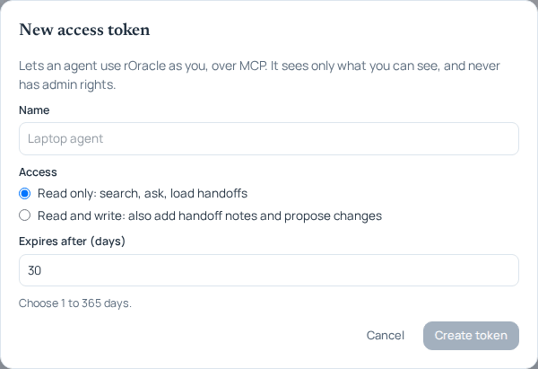

# Set up MCP, step by step

Connect an AI agent such as Claude Code or Claude Desktop to rOracle. About ten minutes.

!!! tip "You need an MCP client"
    MCP is a standard way for agents to call tools. Use a client that supports remote (Streamable HTTP) servers, such as Claude Code. Your admin must also have access tokens switched on.

## The steps

<!-- steps -->

### Know what the agent will see

The agent acts as you. It sees what you see, minus papers labelled **Block agents** and the text of papers labelled **Exclude from AI**. It never has admin rights. Read [Agents and tokens](agents-and-tokens.md) for the full list.

### Create a token

Open the avatar menu, choose **Settings**, then **Access tokens**, then **New token**. Give it a name such as "Laptop agent".

Pick **Read only** if the agent should only search and read. Pick **Read and write** if it should also add handoff notes and propose changes. Pick **Read, write and manage** only if it must also change sharing, delete, transfer or submit drafts. If your administrators have turned access tokens off, **New token** is refused with a 403 and you need to ask them to enable it. Choose an expiry from 1 to 365 days. Copy the token before you close the dialog. You cannot see it again.



<!-- try:token label="Create a read and write token" hint="Opens the dialog with Read and write selected." -->

### Add rOracle to your client

The address is your rOracle address followed by `/mcp`. The agent signs in with the header `Authorization: Bearer <your token>`. Pick your client.

!!! warning "Claude Desktop setup is not yet tested"
    The Claude Code setting has been tested end to end against rOracle. The Claude Desktop setting below follows `mcp-remote`'s own documentation but has not been tested with rOracle yet. If it fails, use Claude Code or tell your admin.

Claude Desktop does not take a remote server with a custom header directly in `claude_desktop_config.json`: that file starts local programs. The setting below uses a small bridge, `mcp-remote`. It needs Node.js and access to an npm registry or your organisation's mirror. Pin a version your admins have reviewed in place of `<version>`. It runs on your computer and receives your token, and the rOracle address must be https. Claude Desktop's Connectors screen can add a remote server by URL, but it signs in with your organisation's login rather than a token. Read [Connect an MCP client](agents-and-tokens.md#connect-an-mcp-client) before you choose it.

<!-- tabs -->

```bash title="Claude Code | Terminal"
export RORACLE_TOKEN=<your token>
claude mcp add --transport http roracle https://roracle.example.internal/mcp --header "Authorization: Bearer $RORACLE_TOKEN"
```

```json title="Claude Desktop | claude_desktop_config.json"
{
  "mcpServers": {
    "roracle": {
      "command": "npx",
      "args": [
        "-y",
        "mcp-remote@<version>",
        "https://roracle.example.internal/mcp",
        "--header",
        "Authorization:${RORACLE_AUTH}"
      ],
      "env": { "RORACLE_AUTH": "Bearer <your token>" }
    }
  }
}
```

```text title="Other client | Connection settings"
Transport: Streamable HTTP
URL: https://roracle.example.internal/mcp
Header: Authorization: Bearer <your token>
```

<!-- /tabs -->

### Check the connection

Ask the agent to use rOracle. The first time your agent connects with the token, the step is ticked on your Get started card. Searching, asking, uploading or adding to a collection with a token does not tick those steps; only your own actions in the web app do. A handoff the agent creates with the token (for example with the `create_handoff` tool) does not tick the handoff step either; only a handoff you create in the web app does. A token cannot hide or reopen the card.

```text title="Prompt"
Use rOracle to list my collections.
```

### Hand it some work

Choose **Continue in agent** on a chat, a search or a paper, then paste the prompt into your agent. See [Hand work to an agent](handoffs-inbox.md).

### Review its suggestions

Agents propose notes and label changes. You decide. Open **Agent proposals** in the sidebar to approve, edit or reject them ([agent proposals](handoffs-inbox.md#agent-proposals)).

<!-- /steps -->

If something fails, see [Troubleshooting agents](agents-troubleshooting.md).
