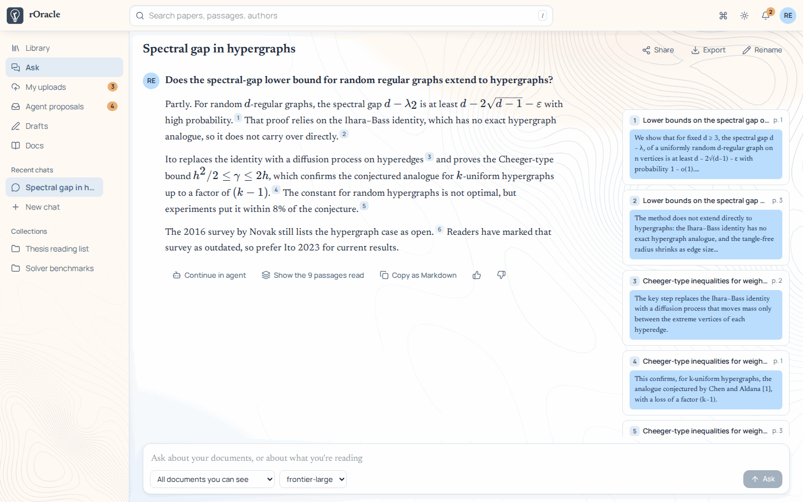
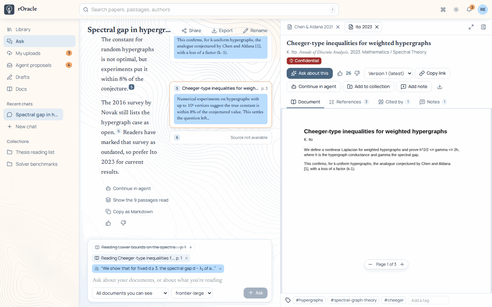
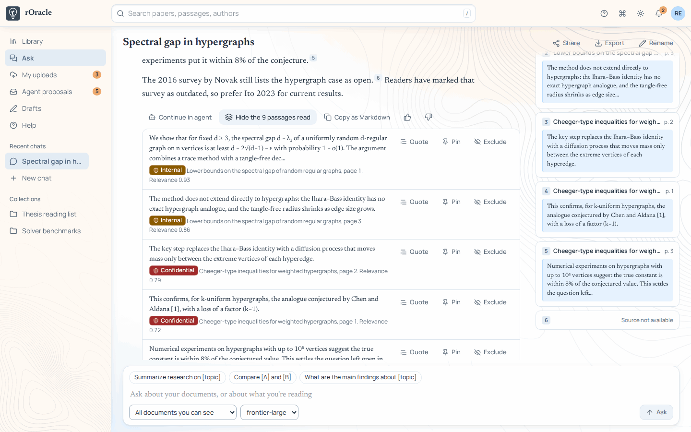
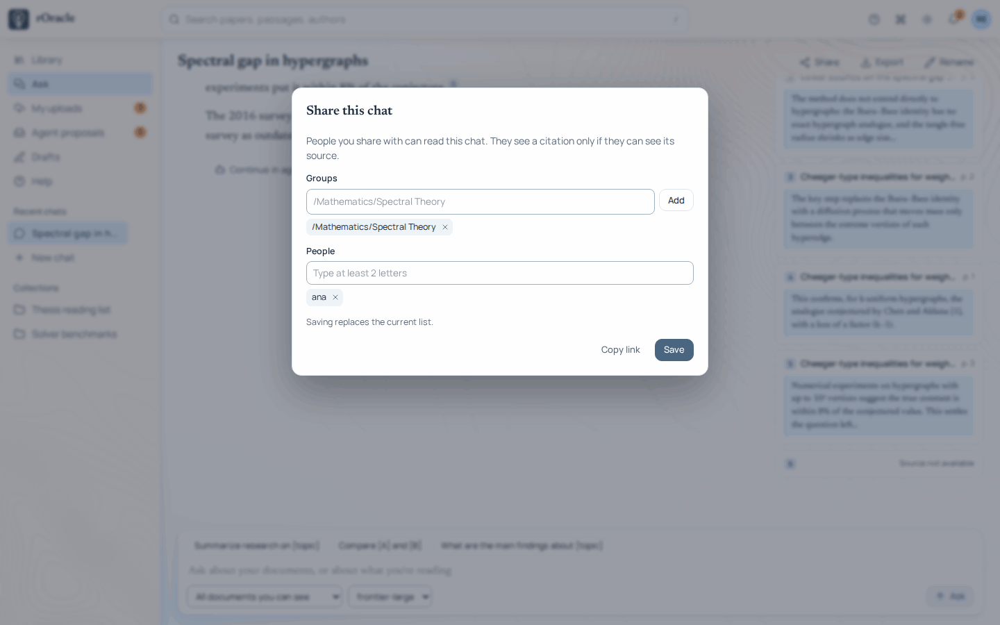

# Asking questions

**Ask** answers a question from the papers you are allowed to see and cites every claim. Open it from the sidebar, with **Ask about this** in the reader, or with **New chat** in the command menu. Answers only use passages from the library. If the passages do not contain the answer, the answer says so.

<!-- try:ask label="Ask about the open paper" -->

## Asking a question

Type in the question box and press `Enter` (or choose **Ask**). A question can be up to 4000 characters. The chat gets a title from your first question (its first 80 characters); **Rename** in the chat header (owners only) changes it. Follow-up questions in the same chat can build on the last few messages (the most recent six).

Under the box you can set:

| Control | What it does |
|---|---|
| **Search in** | **All documents you can see**, **Open documents only** (the papers open in the reader; disabled while none are open), or **Collection: name** for one of your collections. The 20 first collections are listed; the rest are behind **More collections…** with a filter. The choice is saved with the chat |
| **Model** | The language model that writes the answer. Your admins decide which models are listed; the first one is the default |
| **Ask** / **Stop** | **Stop** appears while an answer is being written. It keeps what was written so far and marks it "Stopped before the answer finished." |

!!! tip "Check the sources"
    Every claim carries a numbered marker. Open the marker to see the passage it came from.

Keys in the question box are in [Keyboard shortcuts](#keyboard-shortcuts).

If you ask with **Open documents only** and nothing readable is open, no model is called and the reply says "No open documents to answer from. Open a document or switch scope." If the open papers are all kept away from AI by their label, it says "None of the open documents can be used as a source for answers."

## What the answer is based on (reader-aware context)

Chat looks at what you are reading, so you can ask "what does this paper say about X" without naming it.

- **Open tabs.** Each paper open in the reader appears as a chip above the question box, "Reading *title*, p. *page*". At most three papers are sent, the one you are looking at first. Passages from open papers rank higher, and passages from the page you are on rank highest. Searching still covers the rest of your scope.
- **Ignoring a paper.** The **x** on a chip ignores that paper: it is left out of the answer completely, even if it would match. The chip dims and the button becomes **+** to use it again. Ignoring lasts until you press **+** or use **Ask about this** on that paper. Closing the paper's tab removes its chip, so the paper is no longer ignored in answers; if you reopen it, it comes back still ignored.
- **A passage you quote.** In the **Passages read** list (below) a **Quote** button puts a quote chip above the question box. The next question is asked about that passage, and the chip is removed once you send. A quote can be up to 4000 characters.
- **Pins and excludes.** The same list lets you **Pin** a paper (its best passage is always included in later answers) or **Exclude** it (it is left out of later answers). Pinning a paper removes it from the excludes and the other way round. A chat holds up to 50 pins and 200 excludes. Only the chat's owner can set them; people a chat is shared with do not see them.
- **Community notes.** Notes other readers wrote on a paper can be passed to the model as untrusted commentary. They are never cited as a numbered source ([notes](notes-annotations.md)).

Everything is checked against your own access every time. A paper you cannot see, or an older version that is no longer available to you, is never used. Admin-set visibility, labels and your group decide what is in scope ([collections and sharing](collections-sharing.md#who-can-see-a-document)).

## Citations and how to verify them

An answer has small numbered markers in the text and a margin beside it with one card per source: number, paper title, page and a short quote ([reader](reader.md#sources-in-answers-the-citation-margin) describes the margin). To check a claim:

1. Hover a marker or its card; the other lights up.
2. Click either. The paper opens in the reader on that page with the passage highlighted.
3. Read the passage and decide whether it supports the sentence. A model can misread a source, so the quote on the card and the page are there for you to check.

Other things to know:

- A source you cannot see, or one that was removed since, shows as "Source not available". Its number stays so the text still reads correctly.
- A `[3]` in the text that matches no source stays as plain `[3]`. While an answer streams, markers show before their cards arrive.
- Links to other websites in an answer are shown as plain text with the full address, not as clickable links, so a link planted in a source cannot send your data anywhere in one click. Copy the address if you want to open it. Images in an answer are never loaded; only their alt text shows.
- In **Passages read**, a passage from another reader's note is marked "Community note". Notes are context only and are never numbered sources.
- **Passages read** (under a finished answer, "Show the N passages read") lists every passage the model saw, best first with a relevance score. It shows the first 20; **Show all** lists the rest. This is wider than the cited sources: it shows what the model had, not only what it used.

## Summarizing a paper

Ask "summarize this paper", "key findings", "what is this paper about?" or "tl;dr" while a paper is open in the reader, and the answer covers **that paper only**: the library is not searched. With several tabs open, the active tab is used; with a passage selected, the question is about the selection instead.

- **Quick prompts.** With a paper open, chips under the question box send *Summarize this paper*, *Key findings*, *Methods used*, *Limitations* or *Explain for a non-specialist* in one click. With no paper open, chips such as *Summarize research on [topic]* fill the question box with the first [slot] selected, so you type over it. Chips hide while an answer is written and once you start typing.
- **How it reads the paper.** A short paper is read in full, in page order, and cited by page. A long paper is read in parts ("Reading part 2 of 5…") and the parts are combined. If a part cannot be read in time, the note above the answer says the summary is partial.
- **Without an open paper.** "Give me a summary" on its own gets "Summary of what?" instead of a library search. Add a topic ("summarize research on statins") to search the library.
- **Limits.** One long-paper summary per person runs at a time; a second one gets a "wait for it to finish" message. Papers kept away from AI are never summarized.

## Global and agentic answers

Two optional modes exist for harder questions. Both are off unless your admins turned them on, and neither shows a label saying which mode ran.

- **Overview questions across the library.** A question such as "what are the main themes across my library" can be answered by reading many papers one at a time and combining what each one says. It applies only when you search **All documents you can see** with no paper open (open papers you ignored do not count) and no quote. It needs at least three suitable papers, reads at most 40 papers, and takes up to 90 seconds by default. Each cited source is one paper. If none of the papers address the question, the answer says so. While it works you see "Reading the library…" and then the answer streams. Only one such question per person runs at a time; if the system is busy, your question is answered the normal way instead.
- **Comparison and multi-part questions.** For questions such as "compare A and B", the system can plan a few follow-up searches and combine the results before answering. You see "Searching sub-question 1/3 (round 1)…" while it works. By default it runs up to three rounds within about 30 seconds. If it is busy or cannot finish, the question is answered the normal way.

Both modes use the same access rules as a normal question: only papers you can see, and no text from papers kept away from AI.

## What "Exclude from AI" hides

A label with the **Exclude from AI** gate keeps a paper's text out of every prompt sent to the language model ([labels](labels.md#what-each-gate-means-to-you)). In chat that means:

- Such a paper is never a source, never in **Passages read**, and never passed to the model, even if you pinned it or have it open.
- If you pinned or opened such a paper, the answer shows "Not used for this answer, because their label keeps them away from AI", naming the paper and label. This note appears while you are in the chat session; it is not stored, so it is gone after a reload.
- If a paper's label is raised to Exclude from AI after you asked, earlier answers that cited it (and the question before each) are left out when the chat is used as context for later questions.
- You can still read the paper normally in the reader.

Agents using access tokens never receive the text of such papers either ([agents and tokens](agents-and-tokens.md)).

## While an answer is written

The answer streams in. If you are at the bottom, it scrolls with the text; if you scroll up, a **Jump to latest** button appears. A screen reader hears only how the answer ended: "Answer ready", "Answer stopped" or "Answer failed".

- **Stop** ends the answer. If the server had not yet saved your question, it returns to the question box.
- If the answer fails, you see "The answer couldn't be completed" with the reason and **Try again**. If answering is unavailable, a message says to try again shortly and your question stays in the box.
- Leaving the chat page while an answer is being written stops it.

## After an answer

Under a finished answer:

- **Continue in agent** hands this chat to an agent ([handoffs](handoffs-inbox.md#creating-a-handoff)). Owners only.
- **Show the N passages read**, see above.
- **Copy as Markdown** copies the question and answer with a numbered reference list.
- Thumbs up and down rate the answer. Thumbs down asks "What went wrong? (optional)" for up to 2000 characters. Ratings are read by your admins to tune answers. Owners only.

## Managing chats

- **Recent chats** are in the sidebar (the newest five, with a menu for more). The row menu has **Open**, **Copy link** and **Remove from my chats**. Removing hides the chat from your list only; people it is shared with keep their access, and it returns to your list if you ask in it again.
- **Share** (chat header, owners only) lets named people (type at least two letters of a name and pick them) and groups (org-unit paths starting with `/`) read the chat. Saving replaces the current list. The link opens read-only: people see the answers, but each citation only if they can see its source. Pins, excludes and your quotes are not shown to them.
- **Export** downloads the chat as Markdown. If a cited paper's label blocks export, its reference and the answer text derived from it are replaced by a "withheld" line for anyone but the owner or an admin ([labels](labels.md#what-each-gate-means-to-you)).
- A chat that was deleted or never shared with you shows "This chat isn't available".

## Keyboard shortcuts

Global shortcuts are in [Keyboard shortcuts](keyboard-shortcuts.md). These work only in chat:

| Key | Where | What it does |
|---|---|---|
| `Enter` | Question box | Send the question (ignored while an input method such as an IME is composing) |
| `Shift+Enter` | Question box | New line |
| Up arrow | Question box | Recall the previous question you sent. With a one-line draft it works anywhere in the box; with a multi-line draft only when the cursor is at the very start |
| Down arrow | Question box | Step forward through recalled questions. Past the newest one, your unsent draft comes back. With a multi-line draft only when the cursor is at the very end |
| `Enter` | Share dialog, group or people field | Add the typed value as a chip (also used by the handoff and note sharing fields) |
| `Enter` | Rename field | Save the new title |

Question recall keeps your last 100 questions for your account in this browser only. Typing anything stops the recall. Shortcuts with Shift, Ctrl, Alt or Cmd held do not recall.

## Related

- [Reading a paper](reader.md)
- [Sensitivity labels](labels.md)
- [Handoffs, inbox and notifications](handoffs-inbox.md)
- [Glossary](../glossary.md)
