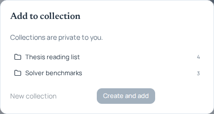
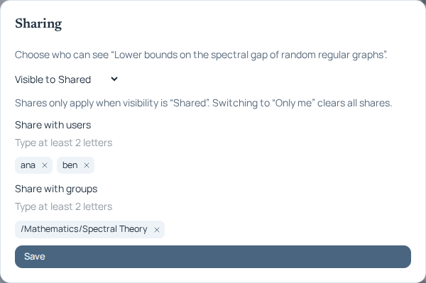

# Collections and sharing

## Collections

A collection is your own named list of papers, for example a literature review. Collections are private: only you see them, and they are not shared with colleagues. Names are 1 to 100 characters.

### Adding papers

- From a result card or the reader, choose **Add to collection**. The dialog lists your collections with their paper counts.
- Pick one, or type a name under **New collection** and choose **Create and add**. If the name matches one of yours (ignoring case), the paper goes into that one instead of creating a duplicate.
- Adding the same paper twice does nothing.

### Using a collection

- Your collections are listed in the sidebar. Click one to open the Library filtered to it. The **Collection** filter does the same and can be combined with other filters ([library and search](library-search.md#filters)).
- With exactly one collection selected, a result's three-dot menu has **Remove from collection**. A toast offers **Undo**.
- The sidebar three-dot menu on a collection offers **Show in Library**, **Rename…**, **Delete…** and **Copy name**. Deleting removes the collection for you; the papers stay in the library.
- The count next to a collection only counts papers you can currently see. If a paper in it is deleted or you lose access, it quietly drops out of the count.

To pass a whole collection to an agent, use **Continue in agent** on the Library while filtered to that single collection. See [handoffs](handoffs-inbox.md#creating-a-handoff).

## Who can see a document

Each paper has a visibility, set by its owner:

| Visibility | Who can see it |
|---|---|
| Everyone | Everyone signed in to rOracle (the default for uploads) |
| My org unit | People in the owner's org unit and in units below it |
| Only me | Only the owner (and admins) |
| Shared | The named users and groups, and the owner |

Admins can see everything. The owner and admins can always see a paper; everyone else sees it only once its processing has finished and it is **Searchable**. Papers you are not allowed to see do not appear in search, references, cited-by lists or collection counts; opening one by link says it is not available and that you may need to request access from its owner. Co-authors of a published draft keep access whatever the visibility.

Visibility decides who can find and read a paper. Labels add further rules on top ([labels](labels.md)); neither widens the other.

## Sharing a document you own

If you own a paper (or you are an admin) the reader has a **Sharing** button.

1. Choose **Visible to**: Everyone, My org unit, Only me or Shared.
2. For **Shared**, search for **users** and **groups** with the pickers and add them as chips. Remove a chip with its x.
3. Choose **Save**. You see "Sharing updated".

Notes:

- Shares only count while visibility is Shared. Switching to Only me clears all shares.
- If you empty a share list, the dialog warns "This empties a share list and removes everyone on it" and asks you to press **Save** again.
- Co-authors from a published draft are listed but managed on the draft.
- **My org unit** needs your account to belong to a usable org unit; otherwise the choice fails with "cannot determine org unit; choose another visibility".
- Uploading with Shared visibility keeps the paper visible to you only until you add people here ([uploads](uploads.md)).

## Transferring and deleting

The three-dot **Manage** menu in the reader (owner and admins) has:

- **Transfer ownership…**: the new owner controls the paper, including sharing, labels and deletion.
- **Delete document…**: removes it from the library for everyone at once. Deleted papers are purged only if your admins have set a retention period; by default they are never purged. The app has no way to restore a deleted paper. If an admin deletes your paper you are notified.

## Related

- [Library and search](library-search.md)
- [Labels](labels.md)
