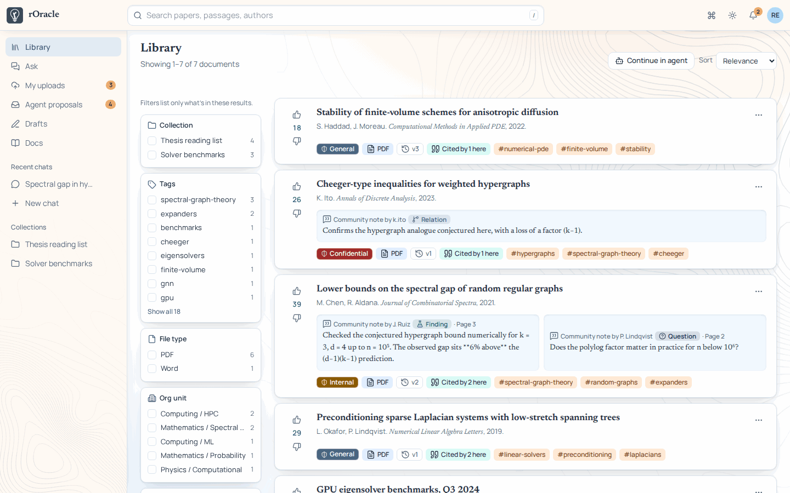
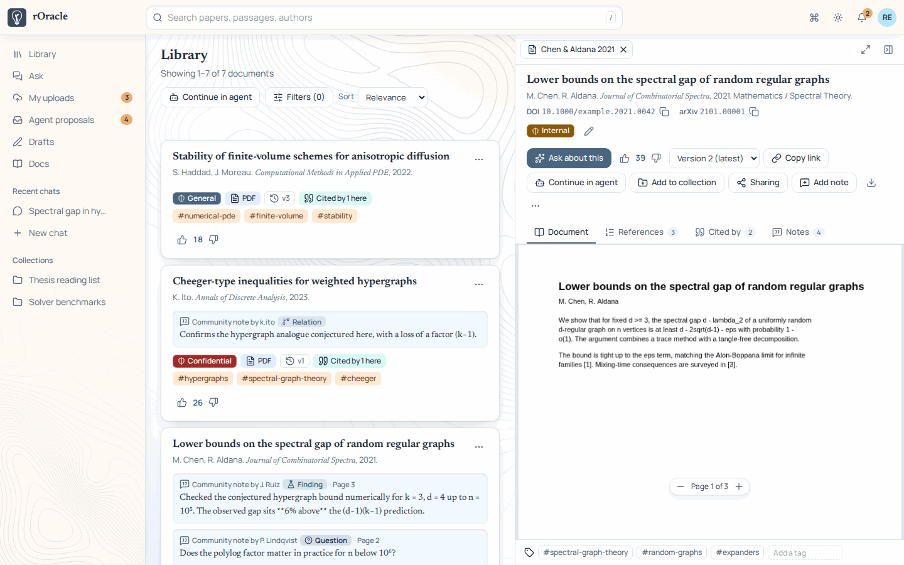
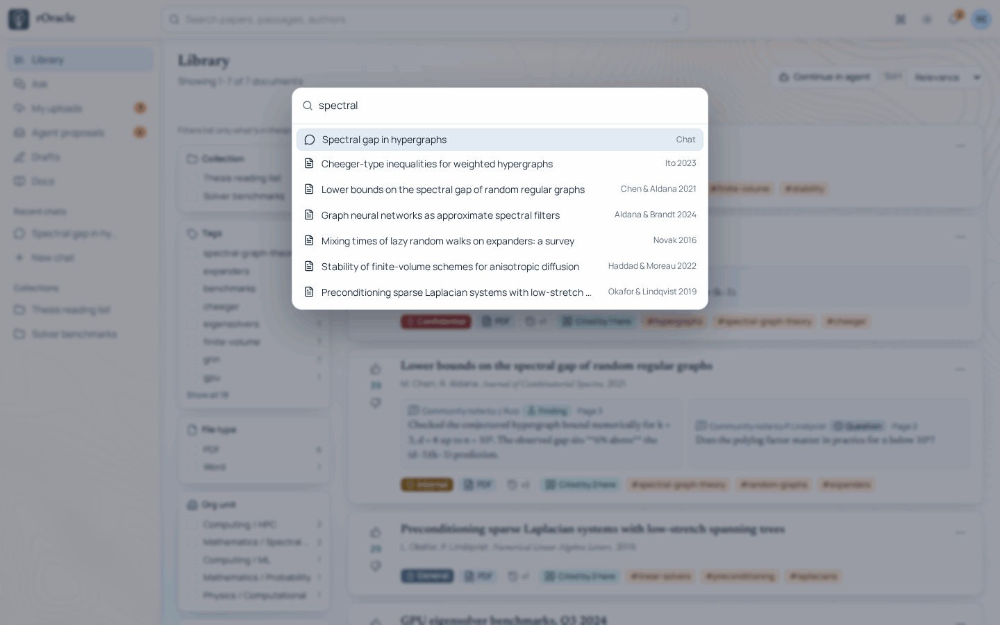

# Getting started

## Signing in

rOracle uses your organisation's single sign-on. There is no separate rOracle password.

1. Open the rOracle address your admin gave you. If you are not signed in, the page shows "Signing you in…" and sends you to your organisation's login page.
2. After you sign in you land back on the page you asked for, not on a start page. A link someone sent you to a paper opens that paper once you are signed in.
3. The session renews quietly in the background. If renewing fails you are sent to the login page again and returned to where you were.
4. If sign-in fails you see "Sign-in failed" with a reason; reload the page to try again.

To sign out, open the round avatar at the top right and choose **Sign out**. The same menu has **Settings** and, for admins, **Admin**.

Which papers you can see depends on your account's groups (your org unit) and on each paper's visibility. See [collections and sharing](collections-sharing.md#who-can-see-a-document) and the [glossary](../glossary.md#access).

## The layout

| Area | What it holds |
|---|---|
| Top bar | Search box, command menu button, theme button, notification bell, avatar menu |
| Left sidebar | Library, Ask, My uploads, Agent proposals, Drafts, Admin (admins only), Docs, your recent chats and your collections |
| Centre | The page you are on |
| Right | The reader, which opens when you open a paper ([reader](reader.md)) |

The sidebar shows a number on **My uploads** when an upload needs your attention, and on **Agent proposals** when agents have suggestions waiting. **Docs** opens this documentation.

Settings (from the avatar menu) holds your access tokens and handoffs. The bell lists notifications; choosing one marks it read and takes you to what it is about.

## Theme

The sun and moon button in the top bar cycles **system**, **light** and **dark**. A short message tells you which one is active. "System" follows your operating system. The choice is remembered in this browser only. The command menu also has a **Switch theme** action.

## Command menu

Press `Ctrl+K` (or `Cmd+K` on a Mac), or click the command button, to open the command menu. Type to filter pages and actions, your recent chats and recent papers. After three or more characters it also looks up paper titles (up to 10). Use the arrow keys and `Enter`, or click.

It offers every sidebar page, Settings, Notifications, Admin (admins only), **New chat** and **Switch theme**.

## Keyboard shortcuts

Shortcuts that are plain letters or `/` do nothing while you are typing in a text field or while a dialog is open.

| Key | Where | What it does |
|---|---|---|
| `Ctrl+K` / `Cmd+K` | Anywhere | Open or close the command menu, even while typing |
| `/` | Anywhere | Focus the top-bar search box |
| `j` | Library results | Move to the next result (the first one if none is focused) |
| `k` | Library results | Move to the previous result (the first one if none is focused) |
| `Enter` | A focused result | Open that paper in the reader |
| `Esc` | Reader | Step the reader back: full, then three-quarter, then split, then close it |
| `Esc` | Add-note mode | Cancel picking a passage |
| Up and Down arrows, `Enter` | Command menu | Move through and choose an item |
| Up and Down arrows, `Home`, `End` | Row menus (the three-dot menus) | Move between menu items |
| `Enter` | The "Add a tag" field | Add the tag |
| `Enter`, `Shift+Enter`, Up and Down arrows | Chat question box | Send, new line, recall earlier questions ([chat shortcuts](chat.md#keyboard-shortcuts)) |
| `Enter` | Group and people fields in sharing dialogs | Add the typed value as a chip ([chat shortcuts](chat.md#keyboard-shortcuts)) |

`Esc` closes an open dialog or menu first; only when none is open does it step the reader back. It is also ignored while you type in a field.

The search box waits 300 ms after you stop typing and searches once you have typed at least three characters. Clearing the box returns to browsing.

## Where to next

- [Find something](library-search.md)
- [Read it](reader.md)
- [Add your own papers](uploads.md)
