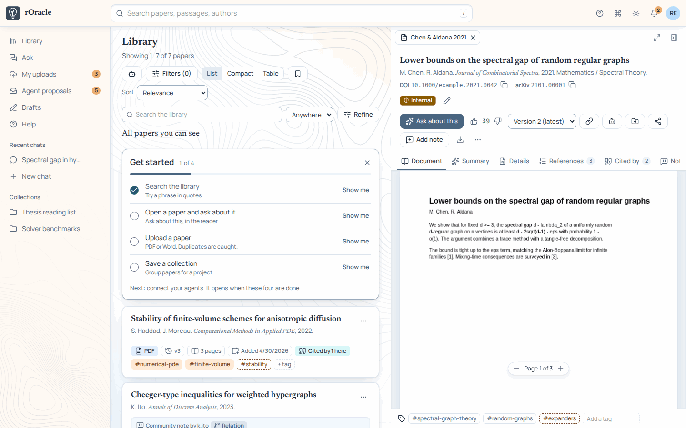
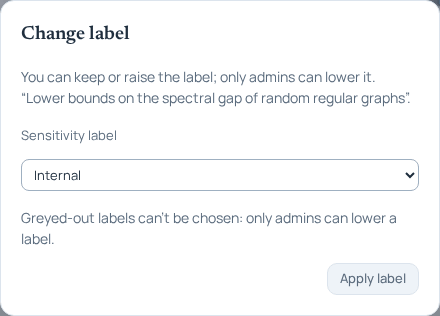

# Sensitivity labels

Every paper carries a sensitivity label set up by your admins: a name, a colour and a rank (how sensitive it is). The label appears as a coloured badge, never as colour alone. Hover over it to read the admin's description. You see it in the reader header, on result cards, in My uploads and on notes, and you can filter the Library by it (**Sensitivity**, least sensitive first). The terms are defined in the [glossary](../glossary.md#labels).

A label can switch on rules, called gates. Which gates a label has is decided by your admins, so two labels can behave very differently. The sections below say what each gate means to you as a reader.

!!! warning "Labels apply to agents too"
    A paper labelled **Block agents** is invisible to every agent token, and the text of an **Exclude from AI** paper is never given to one.

## What each gate means to you

| Gate | What you notice |
|---|---|
| Exclude from AI | You can read the paper normally. Its text is not put in prompts to the language model, so Ask does not use it. If you pinned or opened it as context, the answer says "Not used for this answer, because their label keeps them away from AI", naming the paper and label. Library search still finds the paper and its ranking step reads the text. No AI summary is written for it only if the label was already on the paper when it was processed; a label added later does not remove a summary that exists. Agents using access tokens never receive its text either |
| Block agents | The paper is invisible to agents acting on your behalf (access tokens), including agents of admins. Handoffs leave it out for everyone who opens them |
| Block export | You can read the paper in the app, page by page, but the original cannot be downloaded: the download button is greyed out with "Downloads are disabled by the *label* label". Exports built from your library, such as a BibTeX list or a chat export, leave it out or withhold its text. The owner and admins are exempt. Your reading of such a paper may be recorded in the audit log, at most once per day per paper |
| Reason on lower | If an admin lowers this label, they must give a reason of 3 to 500 characters |

A note can have its own label too. The label that applies to a note is the higher of the paper's label and the note's own ([notes](notes-annotations.md)).

## Setting a label when you upload

[Uploads](uploads.md) has a **Sensitivity label** menu. The default label is preselected and marked "(default)". You can keep it or choose a more sensitive label. Labels below the default are greyed out with "only admins can go lower"; admins can choose any.

## Changing the label of a paper

The owner of a paper and admins see a pencil button next to the badge in the reader. It opens **Change label**.

- **Raising** (a more sensitive label) or keeping the current one: allowed for the owner and for admins.
- **Lowering** (a less sensitive label): only admins can do it. For anyone else the lower options are greyed out with "only admins can lower a label".
- When the current label has the reason-on-lower rule, an admin must give a reason of at least 3 characters; without the rule the reason is optional. Reasons are limited to 500 characters.
- After you choose **Apply label** you see "Label updated". Search results and chat follow the new label.

For a note, the author and admins see the same pencil on the note. The same rules apply, and a note can never be labelled below its paper.

If someone else changes the label of your paper, you get a notification.

## Asking for a lower label

There is no "request" button in the app. If a label is too strict, ask an admin to lower it; they see the same dialog and must give a reason when the label requires one.

When you upload a paper that near-duplicates an existing one and you add it as a new version, the existing paper keeps the higher of the two labels. A label is never lowered by adding a version ([uploads](uploads.md#near-duplicates)).

## Labels proposed by agents

An agent working for you can propose a label change. It appears on **Agent proposals** as "Label change" (or "Note label change") with the current and proposed labels. Nothing changes until you press **Approve**.

- Raising: you can approve it if you own the paper.
- Lowering is marked "Lowers the label: admins only". Only an admin can approve it, and an admin is asked for a reason when the label requires one. Anyone else gets an error.
- **Reject** discards it.

The agent's own stated reason is shown as untrusted text.

## Related

- [Uploads](uploads.md)
- [Notes and annotations](notes-annotations.md)
