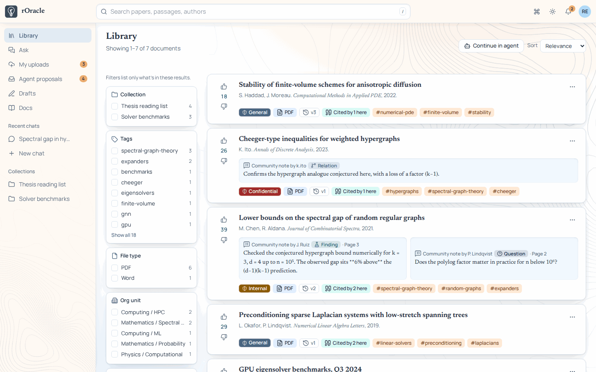
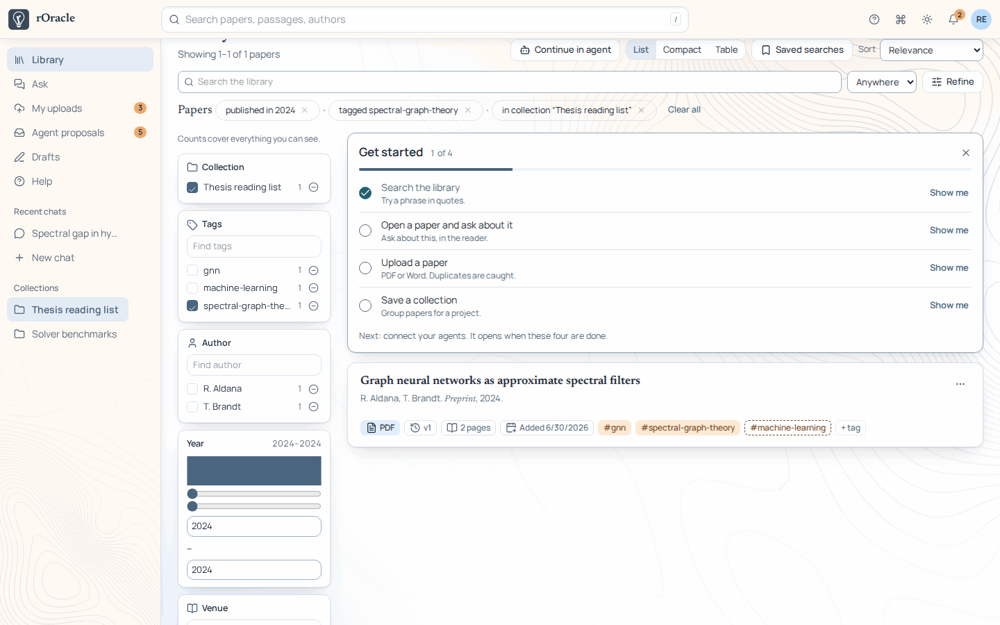

# Finding papers

The Library is the start page. With nothing typed it lists the newest papers you can see. Type in the search box to search the text of papers.

<!-- try:search label="Try a search" hint="Quotes match a phrase; a minus sign leaves a word out." q='"multi-agent" -survey' -->

## Searching

- Type words in the search box above the results and press Enter. The query can be up to 1000 characters.
- rOracle combines keyword matching with meaning-based matching, so a paper can match without containing your exact words. Matches in the title count double against matches in the body; headings and the surrounding context of a passage also count.
- The global search box in the top bar searches as you type: after three characters and 300 ms of no typing. An empty box goes back to the full list.
- Results are papers, each with its best passages. Matches are marked in the passage text. Click a passage to open the paper at that page with the passage highlighted.
- Only the latest version of each paper is searched.
- You only ever see papers you may see; a paper you cannot access is simply absent. See [collections and sharing](collections-sharing.md#who-can-see-a-document).
- If nothing matches you see "Nothing you can see matches …". Use fewer words or clear the filters.

### Query syntax

| You type | It means |
|---|---|
| `spectral graphs` | Papers about these words (keyword and meaning match) |
| `"heat kernel"` | Only papers containing this exact phrase |
| `graphs -directed` | Leave out papers containing `directed` |
| `-"random walk"` | Leave out papers containing this phrase |

A query needs at least one word or phrase to search for: a query made only of exclusions shows "Add at least one word to search for". `AND`, `OR` and field prefixes such as `title:` are not operators; they are searched as words.

**Refine** opens a form with three boxes (all of these words, this exact phrase, none of these words) and writes the query for you.

### Where to search

The **Search in** menu next to the box chooses the fields:

- **Anywhere** (the default): title, abstract and full text, by keyword and meaning.
- **Title**, **Authors** or **Abstract**: keyword match on that field only.
- **Full text**: the body of the paper, by keyword and meaning.

With **Anywhere** or **Full text**, an excluded word is checked per passage, so a paper can still match through a passage that does not contain it. With **Title**, **Authors** or **Abstract** the exclusion applies to the whole paper.

### The query sentence

Under the search box the current search reads as a sentence, for example "Papers matching “spectral graphs” · not by A. Author · published 2015–2020 · tagged expanders". Each part is a chip: click it to edit that part in place, or remove it with its cross (or Backspace or Delete). With two or more parts, **Clear all** removes every filter and the query. With nothing set the sentence reads "All papers you can see".

## Views

The **List**, **Compact** and **Table** switch changes how results are shown; the choice is kept in the address.

- **List**: result cards with passages, tags and notes (described below).
- **Compact**: one line per paper with title, first author, year, venue, citations and net votes.
- **Table**: sortable columns. **Columns** chooses which of Authors, Year, Venue, Cited by, Votes and Added are shown (Title is always shown). Click a column header to sort by it; click again to reverse where that applies. On a narrow screen the table scrolls sideways inside its own frame.

### What a result card shows

- Title, authors, venue and year.
- An AI summary, clamped to three lines. **More** expands it; when the paper also has an extracted abstract the button reads **More and abstract** and shows the abstract under the summary.
- Persistent identifiers (DOI, arXiv and so on), when the paper has them.
- The sensitivity label badge ([labels](labels.md)), unless the paper has the default label. Then the file type, the version (`v2`), the page count, the reference count (when it is not zero), an "Added *date*" badge, and "Cited by N here" when N papers in the library that you can see cite it.
- Tags. Click a tag to filter by it. Tags the AI suggested from the summary are styled differently and carry the hint "Suggested by AI from the summary". Right-click a tag (or use its menu) for **Filter by this tag**, **Copy tag** and, if you own the paper or are an admin, **Remove tag**. This is also how you remove an AI-suggested tag you do not want.
- A **+ tag** button: click it, type a tag and press `Enter` to add it (`Esc` cancels).
- Up to two community notes on the paper ([notes](notes-annotations.md#community-notes)), shown as plain text. Click one to open the paper on its Notes tab.
- The three-dot menu: **Open**, **Add to collection**, **Copy title**, and **Remove from collection** when you are viewing exactly one of your collections.

Votes are cast in the reader (see [votes](#votes)); the Compact and Table views show the net score read-only.

### Counts and paging

Results are 20 to a page. The line under the title reads "Showing 1–20 of 1,234 papers".

- Without a query the count covers everything you can see, up to 10,000; above that it reads "10,000+".
- A query, the **Most cited** sort and the "cited by at least" filter look at the best 200 papers. When more papers match than that, the count ends in "+" (for example "200+").
- On the last page you can reach, the note "Refine the search to see more papers." asks you to narrow the search.

## Sorting

The **Sort** menu offers **Relevance** (the default), **Recently added**, **Most useful** (by votes), **Title**, **Newest published**, **Oldest published**, **Most cited**, **Shortest** (page count), **Venue** and **Author** (first author). With no query, relevance is the same as recently added. Papers without a year sort last by publication date. **Most cited** counts only citing papers you can see.

## Filters

Filters appear as a rail beside the results, or behind the **Filters** button when the window is narrow.

| Filter | Values |
|---|---|
| Collection | Your own collections ([collections](collections-sharing.md)) |
| Tags | Tags on the papers |
| Author | Authors |
| Year | A histogram of publication years with a range (see below) |
| Venue | Venue name as written on the paper |
| Journal | Journals by ISSN, so the print and electronic ISSN of one journal match together |
| File type | For example PDF |
| Org unit | The org unit the paper was uploaded under |
| Sensitivity | Labels, ordered from least to most sensitive |

### Include and exclude

Tick a value to include it. The minus button beside a value excludes it: papers with that value are left out. Including a value clears its exclusion and the other way round.

How they combine:

- Several included values in one filter are OR by default: tags `a` and `b` shows papers with either. For **Tags** and **Author**, once two values are ticked, **Match any** / **Match all** switches to AND (papers with every ticked value).
- Different filters are AND: a tag and a year range shows papers matching both.
- Each filter's counts ignore its own selection but respect the others, so you can see what choosing another value would give. A value you have selected or excluded stays listed even at zero.
- The rail lists up to eight values per filter; **Show all** opens the rest. **Author**, **Venue**, **Tags** and **Journal** have a find box that looks through every value, not only those listed (case does not matter).
- Without a query the counts cover everything you can see; with a query they cover the results.

### Year and other ranges

The year histogram shows how many papers were published each year. Drag either end of the range, or type the **Earliest year** and **Latest year**; the search updates when you let go or press Enter. An old link with single years (`year=2020`) opens as the matching range.

Below the facets are further filters:

- **Date added** (when the paper entered the library) and **Page count**, each as an earliest / latest range.
- **At least N votes** and **Cited by at least N library papers** (only citing papers you can see count).
- **Has a DOI**, **Has an abstract** and **Has references**: Any, Yes or No.
- **Has identifier**: for each identifier kind (DOI, arXiv, PubMed, PMC, ISBN, ACL, OpenReview, ISSN), Any, Has or Lacks.
- **Owner**: Everyone's, Mine (papers you own) or Shared with me (papers you can see that someone else owns, including co-authored ones).
- **Citing**: a link can carry a citing filter that lists the papers citing one paper; it shows as "Citing *title*" and can be removed. A paper you cannot see gives an empty list.

Changing a filter returns you to page 1. The address in your browser holds the query, filters, view, columns, sort and page, so you can bookmark or share a search.

## Saved searches

**Saved searches** keeps searches for later. **Save this search** asks for a name (1 to 100 characters, unique among your saved searches) and stores the current address: query, filters, view, columns and sort. A search whose address is longer than 4000 characters cannot be saved ("This search is too long to save. Remove some filters."). Pick a saved search to run it again; rename or delete it from the same menu. Saved searches are private to you, and you can keep up to 200. A saved search re-runs against the library as it is now, so its results change as papers are added or shared.

## While the search index upgrades

After an upgrade your administrator may need to rebuild the search index. Until that finishes the page shows "Some filters will be available when the search index upgrade finishes." Searching, the original filters (collection, tags, author, file type, org unit, sensitivity) and the original sorts still work; the other controls are disabled.

## Votes

Vote in the reader, with the thumbs up and thumbs down next to **Ask about this**. The score is up minus down; the Compact and Table views show it read-only.

- Click the thumbs up to mark a paper useful. Click it again to take the vote back.
- Click the thumbs down to say it is not useful. A menu asks why; the owner sees your reason. The choices are **Outdated**, **Wrong or misleading**, **Low quality** and **Superseded by a newer document**. Choosing the last one asks which paper replaces it, chosen from papers in your recent library results. It is not offered if you have not searched yet in this session.
- Votes nudge ranking: a well-liked paper ranks a little higher and a disliked one a little lower (the effect is at most 15 percent).

## Related

- [Reading a paper](reader.md)
- [Collections and sharing](collections-sharing.md)
