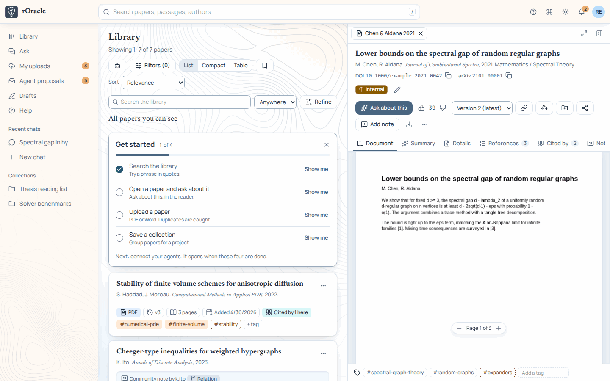
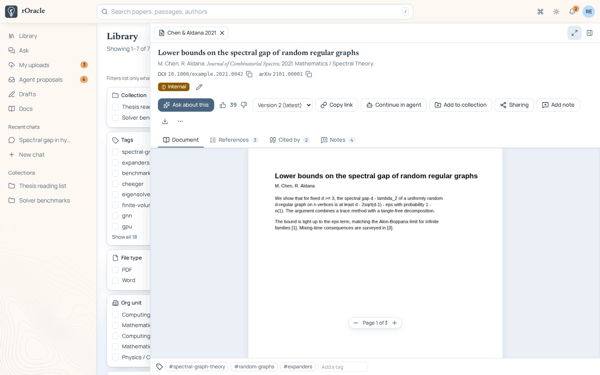
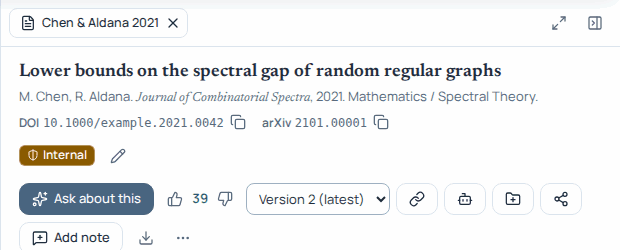
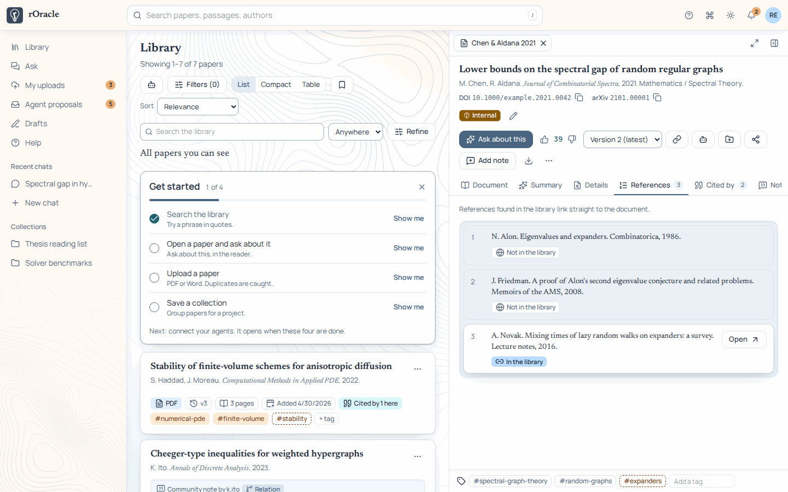

# Reading a paper

Opening a paper from search results, a citation, a note or the command menu opens the reader on the right of the window. The page you were on stays where it was. You can also open a paper by its link; if you cannot see the paper, the reader says it is not available and that you may need to request access from its owner.

!!! tip "Press Esc to step back"
    `Esc` steps the reader back from full to three-quarter to split, then closes it.

## Tabs, versions and the toolbar

- Up to three papers stay open as tabs across the top of the reader. Opening a fourth closes the oldest. The **x** on a tab closes it; the panel-close button closes the reader.
- The **Version** menu switches between versions of the paper. The newest is marked "(latest)". Search uses the latest version only.
- **Ask about this** starts a question about the paper in Ask.
- The thumbs control votes on the paper ([votes](library-search.md#votes)).
- **Copy link** copies a link to this version and page. People without access are asked to request it.
- **Continue in agent** hands this paper to an agent ([handoffs](handoffs-inbox.md#creating-a-handoff)).
- **Add to collection** ([collections](collections-sharing.md)).
- **Add note** ([notes](notes-annotations.md)).
- The download button saves the original file. For papers whose label blocks export, see [labels](labels.md#what-each-gate-means-to-you).
- **Sharing** and the three-dot **Manage** menu (transfer ownership, delete) appear only for the paper's owner and admins ([collections and sharing](collections-sharing.md#sharing-a-document-you-own)).
- A tag bar at the bottom lists the paper's tags; type in "Add a tag" and press `Enter` to add one.

Documents render as PDF pages. The page indicator at the bottom has zoom out and zoom in buttons. If a version has no PDF rendition, Markdown and plain-text files show as text; any other file shows "Preview not available for this file" with a **Download** button. A paper without a title shows "This document has no title" with **Add title**, for the owner and admins.

## Focus mode

The expand button at the right of the tab row cycles the reader through three widths:

1. **Split view**: the reader sits beside your workspace. Drag the thin grip on its left edge to resize it.
2. **Three-quarter width**: the reader covers about three quarters of the screen over your workspace.
3. **Full screen**: the sidebar and workspace are hidden and the reader fills the window.

`Esc` steps back the other way: full screen to three-quarter, three-quarter to split, and from split it closes the reader. `Esc` does nothing while you type in a field and closes an open dialog or menu first. While you are picking a passage for a note, `Esc` cancels that instead. The width you last chose is remembered in this browser, so the next paper opens at the same level.

## Tabs in the side panel

The reader has six tabs: **Document**, **Summary**, **Details**, **References**, **Cited by** and **Notes**.

### Summary tab

Shows the **AI summary** (written when ingest finishes; before that it says no summary yet) and the **Abstract** extracted from the document, or a note that none was found.

### Details tab

A list of what is known about the paper: title, authors, year, venue, org unit, file type, pages, references, owner, visibility, sensitivity, status, added date and tags (empty fields are left out), then its **Identifiers** and a **Versions** list with file names and upload dates.

## Identifiers

Under the title the reader lists the paper's persistent identifiers, when known: DOI, arXiv, PMID, PMCID, ISBN, ACL Anthology, OpenReview, ISSN and eISSN. Each one is plain text with a copy button. They are never links, because rOracle does not reach the internet.

DOI, arXiv, PMID, PMCID, ACL and OpenReview ids are also used to link citations to papers in the library (see below). ISBN, ISSN and eISSN identify a book or a journal, not a paper, so they are shown but never used for matching.

## References tab

**References** lists the paper's bibliography in order, with a count. Each entry is marked either **In the library** with an **Open** button, or **Not in the library**.

rOracle links a reference to a library paper by matching identifiers first, then by a very close title match plus the same year. Only papers you are allowed to see are linked, so a reference may show as not in the library for you while it is for a colleague. The list shows 25 at a time; use the **Show N more (M left)** button. A paper with no parsed references says "This document lists no references".

## Cited by tab

**Cited by** lists the papers in the library that cite this one (again, only those you can see), with an **Open** button for each. Like References, it shows 25 at a time. If none do, it says "Nothing in the library cites this yet". The "Cited by N here" figure on result cards is the same count.

## Sources in answers (the citation margin)

In Ask, each answer has small numbered citation markers in the text and a margin beside it with one card per source: number, paper title, page and a short quote. Hovering a marker or card highlights its partner. Clicking either opens the paper in the reader on that page with the passage highlighted. A source you cannot see, or that was removed, shows as "Source not available". The margin shows the first 12 sources and a "+N more sources" menu for the rest. Chat itself is described in [chat](chat.md).

## Notes tab

The **Notes** tab holds the notes on the paper and the count of top-level notes. See [notes and annotations](notes-annotations.md).

## Related

- [Notes and annotations](notes-annotations.md)
- [Labels](labels.md)
