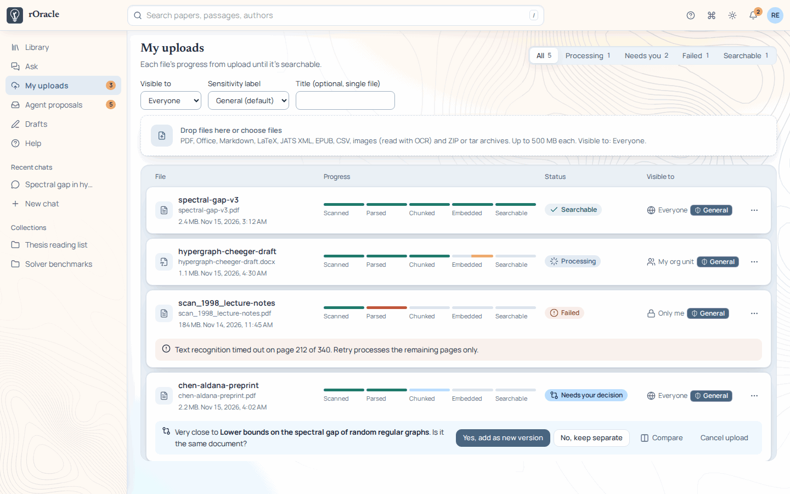
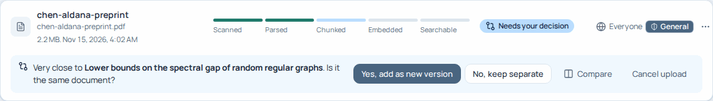
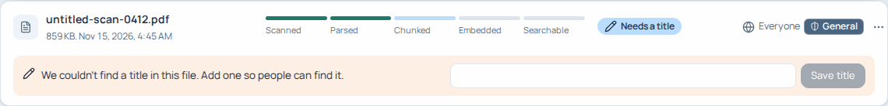

# Uploading papers

**My uploads** is where you add papers and follow each file until it can be searched.

<!-- try:uploads label="Open My uploads" -->

## Adding files

1. Open **My uploads**.
2. Set the options above the drop area (they apply to files you add next):
   - **Visible to**: Everyone (the default), My org unit, Only me or Shared. With Shared, add the people and groups afterwards from the reader's **Sharing** button; until then only you can see the paper ([collections and sharing](collections-sharing.md)).
   - **Sensitivity label**: the default is preselected. You can choose a more sensitive label; labels below the default are greyed out unless you are an admin ([labels](labels.md)).
   - **Title (optional, single file)**: used only when you add exactly one file.
3. Drop files on the drop area, or choose files. You can add several at once. The [supported file types](#supported-file-types) are listed below.

Each file can be up to 500 MB: the app refuses larger files before sending them ("Split it, or ask an admin to raise the limit"), and the server may enforce its own limit and say so. If your admin set a per-user storage quota, an upload over it fails with "upload quota exceeded".

You see "uploaded. Processing has started" when a file is accepted. A file whose type is not in the table below is refused before it is sent ("isn't a file type rOracle can read"). An archive shows "*n* papers added", plus how many were skipped if any.

## Supported file types

| Type | Extensions | Notes |
|---|---|---|
| PDF | `.pdf` | Read directly |
| Word, PowerPoint, Excel, OpenDocument, RTF | `.doc` `.docx` `.ppt` `.pptx` `.xls` `.xlsx` `.odt` `.odp` `.ods` `.rtf` | Shown in the reader as a PDF copy |
| Web and text | `.html` `.md` `.txt` | Markdown and plain text also show as text in the reader |
| Images | `.png` `.jpg` `.jpeg` `.tif` `.tiff` `.webp` `.bmp` | The text is read with OCR; the reader shows the picture (not TIFF). Scans of small or faint print read poorly |
| Scholarly XML | `.xml` `.nxml` | JATS articles such as PubMed Central |
| LaTeX | `.tex` | Source file; `\input` is not followed for a single file |
| Ebooks | `.epub` | |
| Tables | `.csv` `.tsv` | Rows become a table; TSV is converted to CSV first |
| JSON | `.json` | Shown as formatted JSON text. A file that is not valid JSON fails with "This file isn't valid JSON." |
| Archives | `.zip` `.tar` `.tar.gz` `.tgz` `.gz` | See below |

A ZIP or tar archive is unpacked when you upload it and every file inside becomes its own paper, with the options you set above (the single-file title is not used). The archive itself is not kept. Files that cannot be added are listed on the page under the archive with the reason: an unsafe path, a symbolic link, an archive inside the archive, a file over the size limit, one you already have, or going over your quota. Limits: 500 files per archive (the rest are skipped), each file within the upload limit, and everything together no more than 10 times the upload limit once unpacked. Hidden files and `__MACOSX` entries are ignored.

A **LaTeX source archive** (the `.tar.gz`, `.tar`, `.zip` or `.gz` that arXiv gives for an e-print) is the exception: it becomes one paper. rOracle finds the main `.tex` file (the one with `\documentclass`; `main.tex` or `ms.tex` if there are several, else the largest) and inlines the files it pulls in with `\input` and `\include`. Figures in the archive are not read.

## Following progress

Each row shows the file name, size and time, five steps (**Scanned**, **Parsed**, **Chunked**, **Embedded**, **Searchable**), a status and who can see it with its label. The list refreshes by itself every few seconds while anything is processing.

| Status | Meaning |
|---|---|
| Processing | Moving through the steps |
| Needs your decision | A near-duplicate was found ([below](#near-duplicates)) |
| Needs a title | No title could be found ([below](#needs-a-title)) |
| Failed | Rejected or failed; the row shows the reason in plain words, for example "No text could be read from this file" |
| Searchable | Done. Search, the reader and chat can use it |

Filter the list with **All**, **Processing**, **Needs you** (decisions and titles together), **Failed** and **Searchable**; each shows a count. The sidebar badge on **My uploads** counts uploads that need you or have failed. You also get notifications when an upload is ready, looks like a duplicate, or fails.

Until a paper is Searchable only you (and admins) can see it. The row menu has **Open document** once it is done and **Copy filename**.

!!! tip "Duplicates are caught"
    If you upload a file rOracle already has, it tells you instead of adding a second copy.

## Duplicates

If the exact same file is already in the library and you can see it, the app asks first: **Possible duplicate. You already have access to this document. Add it anyway?** with the file name.

- **Cancel** drops the file.
- **Add anyway** uploads it as a separate paper.

The check compares the file's contents, not its name. You are only told about papers you may see, and other people's papers count only once they are searchable.

## Near-duplicates

After a file is parsed, rOracle compares its text with papers you can see. If it is very close to one, the upload stops at **Needs your decision** and shows "Very close to *title*. Is it the same document?" with four choices:

| Choice | Result |
|---|---|
| **Yes, add as new version** | Your file becomes the next version of the existing paper. Its tags, collections and notes carry over. If your upload had a higher sensitivity label, the paper takes the higher label; a label is never lowered this way |
| **No, keep separate** | Your file continues as its own paper |
| **Compare** | Opens the existing paper in the reader. It makes no decision |
| **Cancel upload** | Drops the file |

Adding a new version needs you to own the existing paper (or be an admin); otherwise choose **No, keep separate** or cancel. If the existing paper has since been deleted, the choice fails and you can keep the file separate instead.

## Needs a title

rOracle takes the title from the file's metadata or its first heading. If it finds none, the upload stops at **Needs a title** with "We couldn't find a title in this file. Add one so people can find it." Type a title and choose **Save title** (blank titles are refused; up to 500 characters). Processing then continues. Admins also see a queue of everyone's untitled uploads and can title them.

A finished paper that still has no title shows "This file has no title" with **Add title**, and the reader offers the same to the owner.

## Related

- [Labels](labels.md)
- [Collections and sharing](collections-sharing.md)
- [Reading a paper](reader.md)
