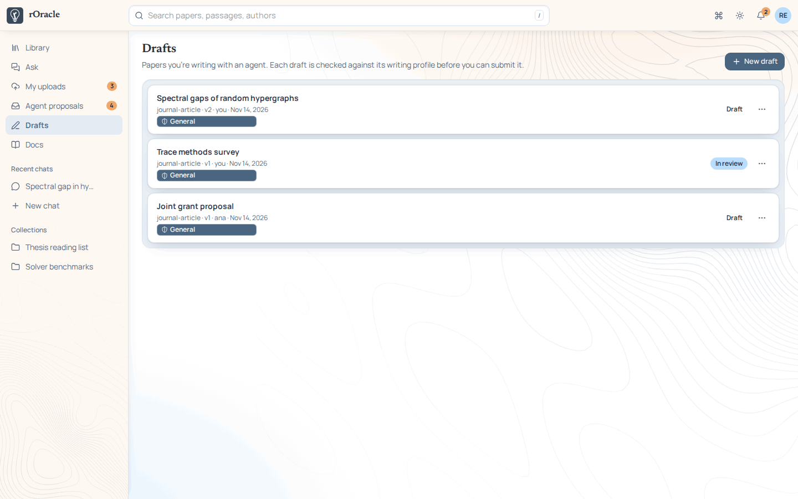
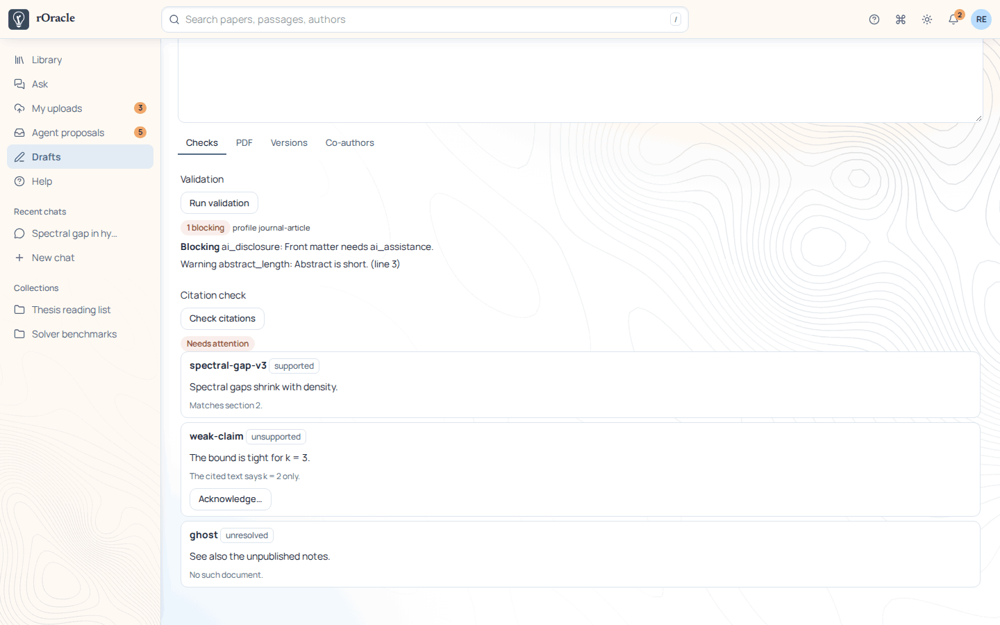
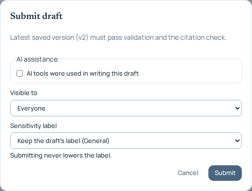

# Writing drafts

**Drafts** is where you write a paper in rOracle, check it against your organisation's rules, and publish it into the library. Drafts are often started by an agent working for you ([agents and tokens](agents-and-tokens.md)), but you can write one yourself. Terms are in the [glossary](../glossary.md#writing-and-evaluation).



## What a draft is

- **Private.** A draft is visible only to you (the owner), your co-authors and admins. No one can cite a draft until it is published.
- **Versioned.** Every save creates a new numbered version. Old versions are never changed; you can view them and restore one (below).
- **Markdown.** The text is Markdown with a short block of settings at the top (the front matter). Raw HTML and raw TeX are dropped when the PDF is built. Images are kept only when they are embedded in the text as data, and links only if they start with http, https or mailto.
- **Size limit.** A draft can be up to 2 MiB.

The Drafts page lists drafts you own or co-author: title, writing profile, latest version, owner, date, sensitivity label and a status of **Draft**, **In review** or **Submitted**. The row menu has **Copy link** and, for the owner of a draft that is not yet submitted, **Delete draft**. A submitted draft cannot be deleted, and neither can a draft reopened for revision after it was published: deleting it would remove the published paper. Delete the paper from the Library instead.

## Starting a draft and writing profiles

Choose **New draft**, give it a title (up to 500 characters) and pick a **Writing profile**. The profile gives the draft a template (the sections to fill in) and decides which checks apply. Leaving it on **Default** uses the journal article profile.

Built-in profiles:

| Profile | Word limit | Needs admin review |
|---|---|---|
| Journal article (default) | 8000 | No |
| Conference paper | 6000 | No |
| Dissertation | 80000 | Yes |
| Technical report | 20000 | No |
| Grant proposal | 6000 | No |
| Literature review | 10000 | No |
| Preregistration | 4000 | No |

Each profile also sets required sections and front-matter fields, an abstract and title length, and a limit on figures and references (the full values are in the template and in the validation results). Your admins can replace these profiles or add their own, for example one for your org unit that always requires review ([admin guide](../admin/README.md)). The profile used for a check is the one stored on the draft. A draft with no stored profile is matched to an admin-defined profile by its `doc_type` front-matter field and your org unit; if none matches, the journal article profile applies.

## Editing and saving

The editor has **Edit** and **Preview** (the preview hides the front matter and shows safe, sanitised Markdown). **Save** creates the next version. While you have unsaved changes the page says so, leaving it asks you to confirm, and **Submit** is disabled.

- **Conflicts.** If someone else (a co-author or your agent) saved a newer version, saving shows "Someone saved a newer version." with **Load the latest version (discards your edits)**.
- **Versions tab.** Lists every version with its author and time. **View** shows one. **Restore** saves that version's text as a new latest version; it is not offered for the latest one, or while the draft is in review.
- **In review.** While a draft is in review it cannot be edited.

### Citing papers

Cite a library paper with its identifier: `[@doc:<id>]` cites the whole paper, and `[@psg:<version id>:<n>]` cites one passage. The paper's id is the part of its link after `/d/`, but you rarely need to copy it: **Insert citation** above the editor (or typing `[@`) opens a search of the papers you can see by title, and choosing one puts `[@doc:<id>]` at the cursor. **Preview** shows the paper's title in place of a `[@doc:…]` citation. Group citations as `[@doc:<id>; @doc:<id>]`. A reference list is generated for you. By default a draft can use up to 200 different citations.

A paper you cannot see is treated exactly like one that does not exist, so a citation to it is "unresolved". Citations cannot point at unpublished drafts.

## Checks: blocking and warning

Open the **Checks** tab. Only the owner and co-authors can run checks; admins can read a draft but cannot run or acknowledge checks. Each person's results are their own: submitting needs results that you ran yourself on the latest saved version. If you save again, results for the earlier version are marked "This result is for version N; the latest is M. Run it again."

### Validation

**Run validation** checks the latest version against the profile. Each finding is **Blocking** or a **Warning**, shown with its rule and line. Blocking findings must be fixed before you can submit; warnings never stop a submission. By default:

| Rule | What it checks | Default |
|---|---|---|
| structure | Required sections are present | Blocking |
| metadata | Required front-matter fields (such as title, authors, keywords) are filled and the front matter is valid | Blocking |
| limits | Word, abstract, title, figure and reference limits | Blocking |
| crossrefs | Figure, table, section and equation references have a matching label and labels are unique | Blocking |
| alt_text | Every image has alt text | Blocking |
| ai_disclosure | An AI-assistance statement is present (below) | Blocking |
| citations | Citations are well formed and resolve to a paper you can read | Blocking |
| notation | A symbol is defined where it is first used | Warning |
| acronyms | An acronym is explained at first use | Warning |
| si_units | Units are SI and written with a space after the number | Warning |
| style | A language model reviews the text against the profile's style guidance | Warning |

Your admins can switch any rule to blocking, warning or off in a profile. The style review asks a language model, so validation can take up to about 30 seconds; the Checks tab says so while it runs, and you can keep editing. If the style review cannot run or takes longer than that, you see "Style checks were unavailable for this run" and it never blocks. If the draft's label is **Exclude from AI**, the style review is skipped and a warning says so, because the draft text must not reach a language model ([labels](labels.md#what-each-gate-means-to-you)). Validation stops with a blocking "validation exceeded time budget" finding if it runs too long.

### Check citations

**Check citations** looks up each citation and asks a language model whether the passage it points to supports the sentence that cites it. One model call per citation can take a while on a long draft; the tab says so while it runs. For a `[@psg:…]` citation that is the cited passage. For a `[@doc:…]` citation it is the paper's passage that best matches the sentence; if that one does not support it, up to two more of the best-matching passages are tried before the citation is marked unsupported. Each item gets one of:

- **supported**: the passage supports the sentence.
- **unsupported** or **unclear**: it does not, or the model could not tell. Fix the sentence or the citation, or acknowledge it.
- **unresolved**: the paper does not exist or you cannot read it. Unresolved citations cannot be acknowledged; fix them.
- **unchecked**: the cited paper (or the draft) is labelled **Exclude from AI**, so nothing was sent to the model. It needs an acknowledgement.

**Acknowledge…** records why you accept a citation that is not "supported" (a reason of 1 to 500 characters). Only a person can acknowledge; an agent cannot. An acknowledgement belongs to that exact sentence, so editing the sentence clears it, and **Remove acknowledgement** undoes it. The result reads "All citations pass" when every citation is resolved and either supported or acknowledged. If the model or search is unavailable, the check fails and stores nothing.



## AI disclosure

Every draft needs an `ai_assistance` entry in its front matter, and it is part of validation:

```yaml
ai_assistance:
  used: false
  description: ""
```

Set `used: true` if AI tools helped write the draft, and then a description of how is required. The **Submit** dialog edits the same entry (**AI tools were used in writing this draft**, tools, and **How were they used?**, up to 2000 characters). If you change it there, rOracle saves it as a new version first, and you then have to run both checks again. Fill it in before you run the checks. The statement is stored with the published paper. The app does not show it in the reader.

## Building a PDF

The **PDF** tab has **Build PDF**, which makes a preview you can read and **Download PDF**. The preview is not stored; building again gives a fresh one. It can take up to two minutes; if too many builds are running you get "build service busy", and a site without the PDF service set up shows "build service not configured". Only the owner and co-authors can build, and if the draft's label blocks export only the owner can.

**LaTeX.** A draft whose front matter says `format: latex` cannot be built in this release: building and submitting fail with "LaTeX builds are not enabled". Use Markdown. ([LaTeX builder contract](../enterprise/latex-builder.md) describes the contract such a service would follow; no builder other than "disabled" exists today.)

## Co-authors

The **Co-authors** tab lists them. The owner adds a person or an org unit by typing at least two letters of the name and picking it, and can remove them. Co-authors can edit, save, run checks and build. Only the owner can submit, change co-authors or delete. Named co-author people (not groups) keep read access to the paper after it is published, whatever its visibility.

## Submitting

The owner chooses **Submit…** once the latest saved version has passed validation and the citation check. The dialog asks for:

- **AI assistance**, described above.
- **Visible to**: **Everyone** (the default), **My org unit**, **Only me** or **Shared** (pick people and org units by name). Co-authors are included automatically. **My org unit** needs a usable org unit on your account.
- **Sensitivity label**: keep the draft's label or pick a higher one. Only labels at or above the current one are listed, for admins too, because submitting never lowers it. The profile may also set a minimum.

If something is missing you see a plain message: "Run validation and the citation check on the latest saved version first.", "Fix the blocking findings first.", "Some citations are unresolved. Fix them first.", "Complete the AI-assistance disclosure." or "This version was already submitted. Save a change first."

What happens next depends on the profile:

- **No review needed.** The PDF is built and added as the next version of the paper, with the visibility and label you chose. It then goes through the normal processing before it is searchable. The draft shows **Submitted**.
- **Review needed.** This applies when the profile requires review (the dissertation profile does), or when any review-requiring profile applies to your draft's or your org unit, whatever profile you chose. The draft shows **In review** and is locked. Admins are notified. When an admin decides you are notified: approved ("approved and published", built from the version you submitted) or sent back (with the reviewer's note, shown on the draft). A sent-back draft returns to **Draft** (or stays **Submitted** if an earlier version was already published) and you can edit it and submit again.

In the published PDF, a citation to a paper that is not visible to everyone appears as "Restricted reference", with its number kept. After publishing you can keep editing; saving and submitting again adds another version.



## Related

- [Agents and tokens](agents-and-tokens.md): letting an agent write and check drafts
- [Handoffs, inbox and notifications](handoffs-inbox.md#notifications): review notifications
- [Sensitivity labels](labels.md)
- [Glossary](../glossary.md#writing-and-evaluation)
